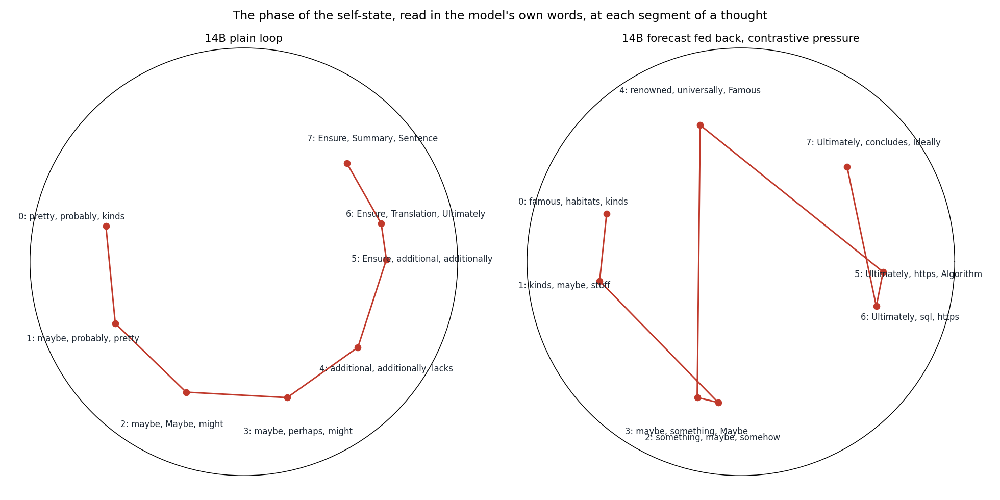

# Strange loop in J-space

**What does a language model build when a description of itself is looped back into itself?**

Wiktor Tomasik · 2026 · this work extends my earlier writing on self-models and latent loops:
[medium.com/@pixedar](https://medium.com/@pixedar)

```
the system's own state → a compact description of it → written back into the system → a new state → …
```

A neural system that represents its own behaviour and uses that representation in a way that changes the behaviour
represented — a strange loop. This repository builds that loop four times inside Qwen3 language models (1.7B–32B),
using the verbalizable workspace ("J-space") of Gurnee et al. (2026) as the first candidate bottleneck, and asks what
representation, geometry and dynamics emerge, and what is genuinely self-specific rather than ordinary feedback.

**Full report: [REPORT.md](REPORT.md)** — architecture, every result with its controls, corrections, and what it
might mean.


## Main findings

1. **Loops through a self-description keep what they can regenerate, not what is "own".** A mind holds the
   best-fitting stranger's self-model at least as well as its own (own − matched −0.045 ± 0.014, z −3.2; Parts 1–2); a
   frozen J-space loop converges on the words that reproduce themselves through the model's write→read transport
   (discourse and stance in, names and entities out) and forgets the evidence.
2. **A learning self-model's current surprise is a learned way out of attractors** — more exploration than momentum,
   random input or its own stale surprise (pre-registered, Stouffer z +26.9 to +52.9) — but carries no privileged
   self-knowledge (Part 3).
3. **Self-specificity needs private state.** In loops whose state is recomputed from the input, a compact self-state
   adds nothing (ΔR² ≈ 0) while a planted hidden state is detected (+0.21 to +0.36).
4. **A trained self-describing loop around the model's own thinking** carries information the model uses (own vs
   another trace's state 0.27 nats/token at 8B, 0.29 at 14B); its main axes are modes of thought — uncertainty,
   reconsidering vs planning what to say, recalling vs speculating.
5. **Asked to be predictable to its own self-model, the system cheats unless self-prediction means discrimination:**
   it collapses and hides its information from the self-model's metric. Under discriminative pressure it represents
   **its own time as a multi-frequency rotation** — a phase clock, robust to strict nulls, seeds and scale (8B, 14B);
   read in words it follows the arc of a thought (recall → hedged exploration → assertion → conclusion), except when 8B
   is pushed hardest and the clock cycles through topics unrelated to the thought. What the self-model must
   tell apart decides the shape: its own moments → a clock; itself vs others → a persistent identity code.
6. **Closing the loop makes the self-model a cause.** A fed-back self-forecast is **enacted** — the system makes its
   prediction of itself come true — far more than a matched memory channel (cosine pull 0.24–0.39 vs 0.04–0.07). Strong
   pressure lets the self-model take over the state, which stops being about the thought; mild pressure keeps both
   (8B and 14B).




## Repository

| folder | content |
|---|---|
| [`part1-2_reflective_loop/`](part1-2_reflective_loop) | Parts 1–2: a reflective loop through J-space words; Qwen3-4B-Base and the 1.7B–32B ladder; interactive report |
| [`part3_ring/`](part3_ring) | Part 3: the ring — no text in the loop, online self-models, pre-registered controls |
| [`v3_decision_loop/`](v3_decision_loop) | the J loop at a decision position: relational structure, dispositions, regimes A/B/C, natively recurrent models |
| [`v5_loop_geometry/`](v5_loop_geometry) | what the frozen loop converges to: fixed points, word transport, persona drift; why self-forecasts cannot be self-specific there |
| [`phaseB_trained_self_model_loop/`](phaseB_trained_self_model_loop) | the trained self-describing loop: time code, identity code, enactment, 8B and 14B |
| [`figures/`](figures) | figures of the report |
| [`infra/`](infra) | the unattended GPU runner used for the experiments |
| [`docs/related_work.md`](docs/related_work.md) | related work |

## Data

* Parts 1–2, the decision loop, loop geometry and Phase B arrays:
  [huggingface.co/datasets/Pixedar/jspace-strange-loop](https://huggingface.co/datasets/Pixedar/jspace-strange-loop)
* Part 3: [huggingface.co/datasets/Pixedar/jspace-ring](https://huggingface.co/datasets/Pixedar/jspace-ring)
* Interactive report for Parts 1–2: [huggingface.co/spaces/Pixedar/strange-loop-in-j-space](https://huggingface.co/spaces/Pixedar/strange-loop-in-j-space)

## Cite

See [CITATION.cff](CITATION.cff). Code under the MIT licence ([LICENSE](LICENSE)); text, figures and data under
CC BY 4.0 ([LICENSE-DATA](LICENSE-DATA)). Commits and the release tag are signed by the author; `SHA256SUMS` lists a
hash of every file in the release.
