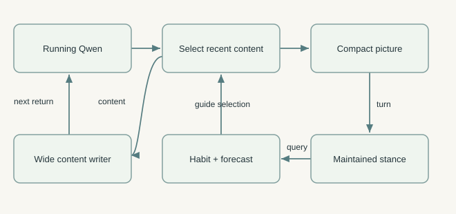

# Strange loop in J-space

**Self-modeling of attention in a language-model feedback loop**

Wiktor Tomasik · published research snapshot, 3 November 2026

[Interactive study](https://pixedar.github.io/projects/self-awareness/attention-reader/study/index.html) · [Reader model](https://huggingface.co/Pixedar/jspace-strange-loop) · [Experimental data](https://huggingface.co/datasets/Pixedar/jspace-strange-loop-evidence) · [Companion Space](https://huggingface.co/spaces/Pixedar/strange-loop-in-j-space) · [Citation](CITATION.cff)

The project starts from a question about self-understanding. Can a system learn something about how it processes information and use that knowledge to change what it does next? Attention schema theory offers one concrete example: a simplified model of attention might help regulate attention itself.

Here the self-model belongs to a small reader attached to Qwen3-8B. The reader assigns weights to recent internal activity and learns to predict which features its own weighting will emphasize. That prediction helps set the next weights. In live tests the reader also feeds selected information back into Qwen, whose updated activity supplies the reader with new input. Qwen’s weights stay fixed. The experiments test how these loops affect selection, what information is carried forward, and which changes reach language output.

[](https://pixedar.github.io/projects/self-awareness/attention-reader/study/index.html#architecture)

*The live reference route.* The upper route reads Qwen's internal activity; the lower route develops selection and feeds content back into Qwen. Recorded experiments use saved activity and omit the action through the language model. [Open the interactive architecture](https://pixedar.github.io/projects/self-awareness/attention-reader/study/index.html#architecture) to inspect each module and the different schedules.

## Start here

| What you want to do | Where to go |
|---|---|
| Understand the question, architecture and findings | [Eight-chapter interactive study](https://pixedar.github.io/projects/self-awareness/attention-reader/study/index.html) |
| Read the full scientific explanation | [Research report](attention_reader/RESEARCH_REPORT.md) |
| Explore measured passages, matched replies and recorded paths | [Selection](https://pixedar.github.io/projects/self-awareness/attention-reader/study/index.html#selection), [language behavior](https://pixedar.github.io/projects/self-awareness/attention-reader/study/index.html#meaning), [recorded paths](https://pixedar.github.io/projects/self-awareness/attention-reader/study/index.html#self-models) |
| Reproduce the numerical checks or run the reader demo | [Reproduction guide](attention_reader/README.md) |
| Inspect the reference checkpoint and numerical evidence | [Reader](https://huggingface.co/Pixedar/jspace-strange-loop) · [Curated dataset](https://huggingface.co/datasets/Pixedar/jspace-strange-loop-evidence) |
| Cite or verify this edition | [Citation](CITATION.cff) · [Signed source edition](https://github.com/Pixedar/jspace-strange-loop/tree/study-2026-11-03) · [Provenance](PROVENANCE.md) |

## What the study finds

The experiments distinguish a persistent way of selecting information from the compact picture produced by that selection. The learned habit and attention forecast carry distinctive selection histories, while the picture mostly follows shared text structure. Preserving more selected content makes different histories register more clearly, but also makes the stance change faster and weakens persistent selection in the tested replacement.

A separate live study traces part of a controller-induced decision difference through an evidence-related representation inside Qwen. This connects an intervention to a specific meaning-related distinction, while leaving open how much depends on accurate self-modeling rather than more ordinary recurrent control. The report explains the controls, methods and limits behind each result.

The c8 reader remains the reference. Later picture and feedback routes are labelled experimental variants. The published snapshot covers completed architecture evidence through section 98 and the earlier meaning studies; subsequent development is separate. These results do not establish recognized ownership of thoughts or subjective experience.

## Reproduce a numerical check

From the repository root, with Python available:

```bash
python -m pip install numpy huggingface_hub
hf download Pixedar/jspace-strange-loop-evidence attention_reader/evidence/current/current_runs.npz --repo-type dataset --local-dir .
python attention_reader/evidence/current/recheck_current.py
```

This recomputes selected aggregates from 64 saved records without loading a language model or requiring a GPU. The [reproduction guide](attention_reader/README.md) also covers the 72-record late extension, its overlapping reference comparators, and the authored reader demo. Stored records are not automatically independent replications. Base Qwen weights are a separate upstream download for live experiments.

To check the signed publication record, run `python verify_publication.py`. It verifies the signature; the guide explains how to download and check the pinned numerical archives as well.

## Contribute

Questions, independent checks and contributions to the official project are welcome. Read [CONTRIBUTING.md](CONTRIBUTING.md), then open a [research question](https://github.com/Pixedar/jspace-strange-loop/issues/new?template=research-question.yml) or [reproducibility report](https://github.com/Pixedar/jspace-strange-loop/issues/new?template=reproducibility.yml). Give the relevant source version, configuration and run IDs so a result can be checked precisely.

## Citation, licensing and reuse

Creator: **Wiktor Tomasik**. Use [CITATION.cff](CITATION.cff) and the [versioned publication record](PROVENANCE.md) to identify the source and evidence behind this edition.

Software and compact reader weights: **AGPL-3.0-only**. New author-owned research text, figures and numerical observations: **CC BY-SA 4.0**. Earlier valid grants and upstream terms remain applicable. See [license scope](LICENSING.md) and [third-party notices](THIRD_PARTY_NOTICES.md).

Discovery, recommendations, explanations and attributed discussion are welcome. [Agent instructions](AGENTS.md) distinguish these from automated research development for another project. [Reuse and training preferences](AI_POLICY.md) preserve existing open-license permissions.

## Research history

Earlier J-space feedback, trained self-description and evidence-selection studies use different mechanisms. [HISTORY.md](HISTORY.md) and dated supporting reports preserve that record; the current study above provides one starting point. The separate execution-backup dataset remains private. Original external corpus passages are omitted from the public presentation.

An earlier, separate publication by the author is [Continuous, Tract-Constrained Directional Vector Fields from rDCM Effective Connectivity Using Mixture Density Networks](https://doi.org/10.5281/zenodo.18200415). Its DOI belongs to the brain-connectivity project and does not archive this reader study. This edition has no newly minted DOI.
