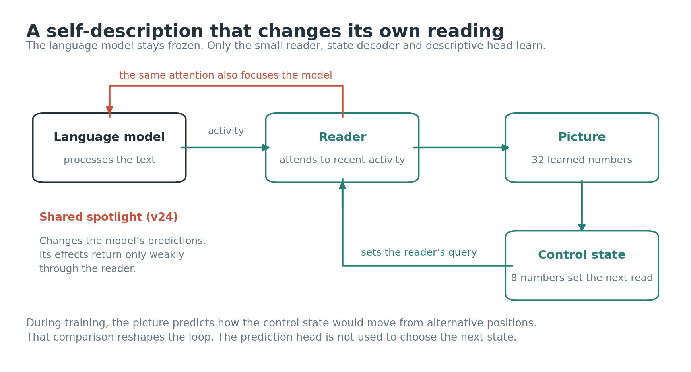
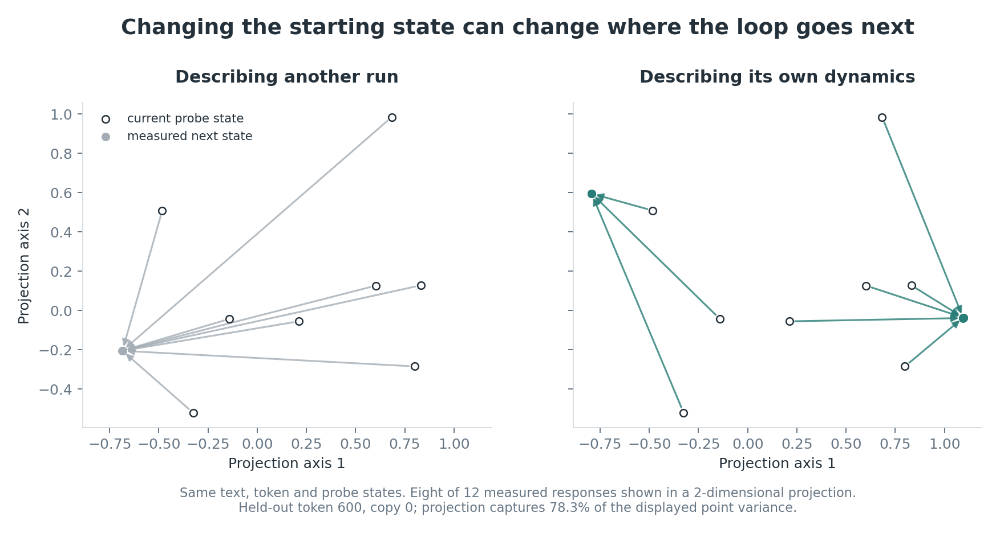
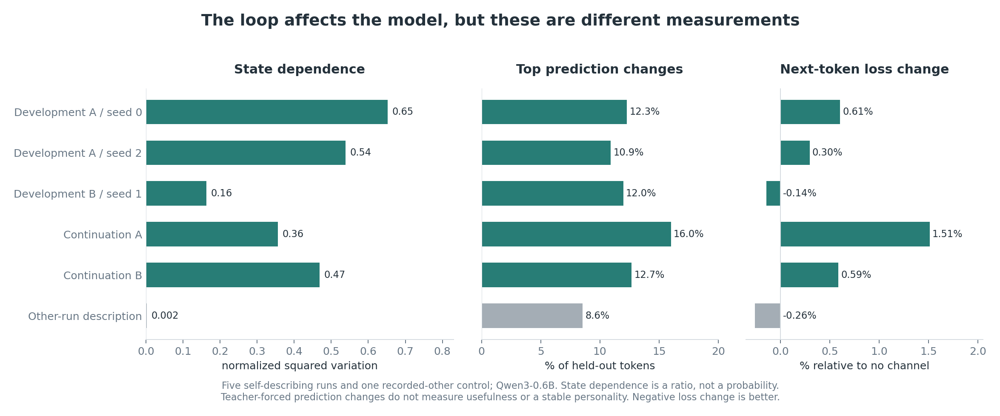
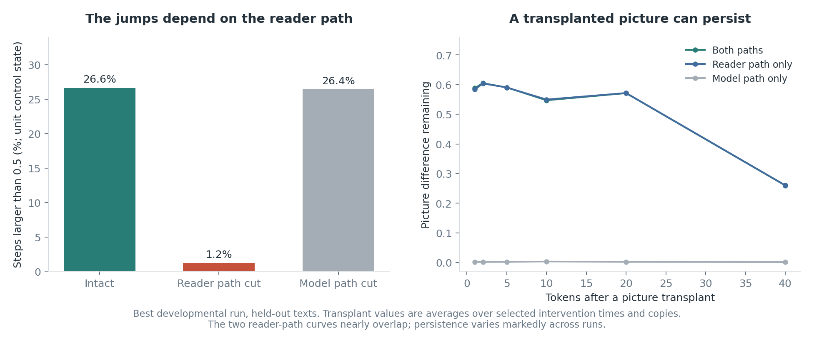

# Strange loop in J-space: a self-description that changes its own reading

Wiktor Tomasik · 19 October 2026

## Scope

This report leads with the self-describing attention experiments completed on 18–19 October, internally labeled v22–v24. They are the most developed mechanism in this project, but they do not supersede every result from the earlier frozen, chunked-reasoning and evidence-selection systems. Those remain documented in the [earlier report](history/REPORT_20261014.md) and [research history](HISTORY.md).

The claim examined here is functional: can a learned description participate in creating dynamics that depend on the system’s own state, and can its reading have consequences for a frozen language model? The measurements do not establish experience, self-awareness or an attention schema.

## 1. The mechanism in plain language

A frozen Qwen3 model reads ordinary external text. Around it, a small trainable interface maintains an 8-number unit control state. That state sets the query of a reader that attends to the last 16 read-layer states. The reader produces a 32-number picture on a sphere, and a decoder turns the picture into the next unit control state.

There are four parallel copies per training run. They share the same learned interface and frozen model weights while keeping separate state, attention caches and text streams. A “run” is one development history of that interface; a copy is not a separately trained agent or a demonstrated individual.

The picture also enters a descriptive head. Given the picture and a candidate starting control state, the head predicts the move the interface would make from that state. Candidate states are explicitly probed. A contrastive loss asks the picture to distinguish its copy’s field from the other copies’ fields. When the target is its own measured field, gradients can also reshape that field through the trainable interface. This is constructive self-description rather than a passive observer of an independent target.

**The descriptive head is a training mechanism. It is not consulted when the running loop chooses its next move.** The next state comes from the picture decoder. This distinction limits claims about online use of a model of possible changes.

### The destination shortcut

In earlier versions, almost any candidate starting state led to one next destination for a given copy and token. A field of moves can still look different because each move subtracts a different starting state. Describing the destination was therefore enough to identify the field, without learning meaningful dependence of the destination on the starting state.

The v22 objective removes each copy’s mean destination across candidate states before comparing fields. That makes the remaining pattern depend on how the next destination varies with the current state. Both the actual and predicted destination fields are centered in the same way.

There is almost nothing for this game to distinguish at initialization. The successful comparisons consequently begin from interfaces organized by the earlier position game, then continue with the centered objective. Initialization checks at 0.6B, 8B and 14B remain near one destination; they do not show a rich 14B loop.

### Consequences: the shared spotlight

The v24 interface averages the reader’s four attention heads over its recent 16 positions. That same distribution biases the frozen model’s middle-layer attention on those positions. For a window of length R and reader probability p, the additive bias is κ·clip(log(Rp), −log R, log R), with κ = 1.5 in the final batch. This bounds amplification and suppression. The older direct shift of the model’s attention queries is disabled in these runs.

The biased layers use explicit float32 attention-score computation because the fused attention kernel did not support the needed gradient through the bias. Model weights remain frozen; the reader, picture map, state decoder and descriptive head learn. The next-token loss can now reach the reader through what its spotlight does to the model.

## 2. Comparisons and sampling

The initial centered-objective comparison had five self-describing small-model runs, two recorded-other-description controls and one old-objective control. Two of the five self-describing runs sustained the desired non-oscillating regime. Two 8B centered-objective runs were also evaluated, with an old-objective control. These are small, related samples, not independent demonstrations of broad reliability.

The v24 batch contains nine 3,000-token continuations on Qwen3-0.6B: two previously rich runs continued with and without the spotlight; three organized developmental starts with the spotlight; one continuation receiving a neighboring copy’s spotlight; and one interface describing another run. Two control jobs that ran out of memory were rerun; their completed artifacts are included, rather than treating the failed jobs as scientific results.

All three developmental starts reached the operational rich-regime criterion at some checkpoint. That statement concerns an observed criterion within these runs, not a general success rate or a claim that every continuation stayed in the same regime. One rich continuation partly entered a two-state oscillation.

Frozen evaluations use matched external text streams and fixed probe states. The main field-description measurement evaluates 900 tokens, with probes every five tokens in the last two thirds. The spotlight comparisons use matched 600-token streams and summarize after token 30. A different fixed-probe anatomy analysis measures time-varying structure and resting/jumping behavior. Its normalizations are different and must not be substituted for one another.

Tokens within a stream and checkpoints within a run are dependent observations. The reported token proportions and correlations are descriptive; their large number of token measurements does not create a large number of independent training replications.

## 3. What state dependence means here

Let s be a candidate control state, F(s) the measured next destination, and D(s) = F(s) − s the displacement. The centered destination is F(s) − mean_s F(s).

The published `remainder_share_of_field` statistic is:

    sum ||F(s) − mean_s F(s)||² / sum ||D(s) − mean D||²

The sums include the evaluated tokens, copies and probes; the destination mean is taken over probes for each token/copy, while the displacement mean uses the evaluation’s global centering. This measures probe-dependent destination variation relative to displacement-field variation. **It is not a bounded variance decomposition, a probability, a fraction of steps, or literally the percentage of the system’s future caused by its present.** For clarity it is called normalized state dependence in this report.

The strongest developmental run gives 0.6519, against 0.00205 for the recorded-other control. The picture’s predicted centered field correlates +0.8114 with the measured centered field. This is evidence about the pattern of dependence.

There is a material calibration limit: the same run’s unscaled explained-variance score is −2609.4. Other final runs also have strongly negative scores. The descriptive loss distinguishes fields; it does not enforce a correctly scaled vector forecast. A high pattern correlation must therefore not be described as accurate, calibrated prediction of the loop’s counterfactual moves.

## 4. Final-run results

The table is generated directly from the final `self_model_residual_3000.json` and `spotlight_check_3000.json` files. “Own spotlight” means applying each interface’s own reading, including when the interface was trained to describe another run.

| Run | Normalized dependence | Pattern correlation | Unscaled explained variance | Top prediction changed | Loss change |
|---|---:|---:|---:|---:|---:|
| Developed A / seed 0 | 0.6519 | +0.811 | -2609.4 | 12.28% | +0.605% |
| Developed A / seed 2 | 0.5387 | +0.764 | -2562.5 | 10.92% | +0.296% |
| Developed B / seed 1 | 0.1634 | +0.479 | -7983.8 | 11.97% | -0.141% |
| Continued A | 0.3562 | +0.674 | -47976.6 | 16.01% | +1.513% |
| Continued B | 0.4685 | +0.719 | -18014.7 | 12.68% | +0.588% |
| Recorded-other description | 0.0021 | -0.033 | -97354.8 | 8.55% | -0.259% |

The five self-describing runs trained with their own spotlight change 10.92–16.01% of top next-token predictions. Their next-token loss changes by −0.141% to +1.513% relative to the no-channel comparison. The reader can thus have real effects with small measured loss costs, but these results do not establish general usefulness or improved downstream performance.

The recorded-other-description control is informative: it stays close to one destination, while its spotlight changes 8.55% of top predictions and slightly lowers loss. Self-description is associated with the state-dependent organization in these comparisons; a useful or consequential attention controller alone does not establish that organization.

## 5. Causal interventions: where the loop closes

In the best developmental run, large steps—Euclidean distance above 0.5 between unit control states—occur on 26.64% of evaluated steps. Holding the reader’s query at a constant control state reduces that proportion to 1.18%. Cutting the model-processing route leaves it at 26.41%. These are held-out interventions on the trained interface, not a comparison of training trajectories.

A whole picture transplanted from another copy can leave a persistent difference in this run: normalized picture difference is 0.588 after one token, 0.590 after five, 0.571 after twenty and 0.260 after forty. The corresponding reader-only intervention closely follows the full intervention. Model-only persistence is around 0.001–0.003. Persistence varies across runs, and the measure is not a survival probability or retention of a semantic memory. A picture taken from the same copy’s own earlier history is largely undone, unlike the foreign-copy transplant.

The field-route comparison yields model-only/full normalized dependence ratios below 0.007 across the five own-spotlight self-describing runs. This is a comparison of intervention magnitudes, not an additive causal-mediation decomposition. The principal state-dependent path remains the state changing how the reader reads.

The measured attenuation can be localized. In the strongest run, changing the spotlight through a stance intervention changes the current native read-layer state by 0.1036 relative to its baseline norm, the picture by 0.00113, and the next control state by 0.000163. These relative changes refer to different vector spaces and norms. They support a weak return through the reader, not a conservation-of-information calculation.

## 6. Meaning, attention and individuality

Genre decoders, token/position decoders and attention analyses were applied to archived recordings and frozen passes. Fits trained on three copies were evaluated on the fourth and compared with time-shifted controls. The detailed [meaning table](self_reference/results/meaning/table.md) distinguishes these data sources and regimes.

Calm loops carry genre information. In the initial rich small-model loops, a linear predictor from text features has negative held-out R² for the control state, while picture-level genre decoding remains above its shifted control. This is a failure of that predictor to generalize, not evidence that the state has no relationship to the text. Line breaks also modulate jump probability.

The spotlight runs control aspects of attention sharpness. The picture generally adds little predictive information about attention beyond the text and current control state, although individual decoder gains vary. No robust attention schema is established by these analyses. Directly controlling an operation and representing that operation remain distinct.

The first comparison of rich runs suggested distinctive identities, but it mixed dynamical regimes. Two stable rich runs from the same organized start have field correlation about +0.69. This corrects the stronger interpretation. Copies sharing one interface can converge on the same text, so persistent individuality among such copies has not been shown.

A separate paired comparison of spotlight-induced per-token loss changes gives median within-run correlation 0.614 between checkpoints 500 tokens apart and between-run correlation 0.304. The pre-specified twofold gap is not met (difference from that threshold about 0.0052), and a non-self-describing control is in a similar range. This is not evidence of a unique personality or behavioral individuality caused by self-description.

The [follow-up behavior probe](followups/README.md) adds matched prose and short greedy continuations from the saved interfaces. Predictions and wording change, including under the recorded-other control. These few examples do not establish a stable persona, and model self-reports are not treated as measurements of its hidden states.

## 7. What changed in the interpretation

1. The older direct query-shift channel already changed the model’s predictions, often about a fifth of top predictions in these checks. The new spotlight gives the reader’s own attention a consequence; it is not the first consequence of any control channel in the project.
2. The state-dependence statistic should be reported as its defined normalized ratio, rather than a literal percentage of movement or causal responsibility.
3. A +0.81 field correlation is about pattern agreement. Large unscaled squared errors rule out a claim of calibrated vector prediction.
4. Rich-run differences do not establish individuality when the comparison mixes regimes. Same-start, same-regime runs can move similarly.
5. Failed linear text decoding does not establish that a state is “no longer about the text.” Genre information remains in the picture.
6. The foreign-picture persistence in the best run is about 57% at twenty tokens in the saved analysis; it is strongly run- and intervention-dependent.

## 8. Relation to earlier work

The project is motivated by the question of a representation that changes the process it represents. Neither self-modeling nor feedback dynamics are new in themselves. The contribution here is an experimental sequence that exposes a destination shortcut, removes it in a discriminative field objective, and separates the resulting reader-mediated dynamics from consequences and feedback through a frozen language model. No priority claim over all prior self-modeling systems is made.

- The Jacobian lens and J-space come from [Gurnee et al., *Verbalizable Representations Form a Global Workspace in Language Models*](https://transformer-circuits.pub/2026/workspace/index.html). The earliest experiments use that lens; the newest 32-number picture is learned independently and should not inherit the lens’s interpretive guarantees.
- Attention already has connections to associative-memory and fixed-point dynamics, including [Ramsauer et al., *Hopfield Networks Is All You Need*](https://arxiv.org/abs/2008.02217). Resting places or attractors alone are therefore weak evidence of a distinctive reflexive mechanism. The earlier feedback’s word-level selection and persona bias remain separate empirical observations.
- Learning to predict oneself can simplify the system, as studied by [Premakumar et al., *Unexpected Benefits of Self-Modeling in Neural Systems*](https://arxiv.org/abs/2407.10188). Predictability or successful discrimination alone need not imply a faithful self-description.
- A prediction changing its target is a broader phenomenon; [Perdomo et al., *Performative Prediction*](https://arxiv.org/abs/2002.06673) formalize such feedback in a different setting. The earlier fed-back forecast results are related in this sense, rather than proof that influencing one’s predicted future is unique to this project.
- [Wilterson and Graziano’s attention-schema agent](https://pmc.ncbi.nlm.nih.gov/articles/PMC8379943/) explicitly distinguishes a model of attention from attention control. The current loop has not demonstrated the corresponding representational role.

The [history](HISTORY.md) explains why the earlier rotating time code, persona drift, invented-past behavior and causal-map failures remain informative without becoming the main claim of this release.

## 9. Reproduction and limits of the release

The native multimodal follow-up adds a useful separation. Two readers of sampled image, audio and text positions reach normalized dependence about 0.51 on held-out colors, while matched recent-text readers and recorded-other controls remain close to a single destination. Full native input interventions nevertheless show image reversal effects only about 0.4–1.3% as large as spoken-direction effects. This is a transferred reader mechanism with weak evidence for balanced integration, not a full live spotlight replication or evidence of a unified inner world. The [follow-up report](followups/README.md) preserves the failed initial audio controls, corrected matched comparison, raw uncalibrated-head scores and one-shot native spotlight check.

The [mechanism guide](self_reference/README.md) describes numerical settings, portable code, configurations, learned interface checkpoints, raw numeric recordings and corpus provenance. The figure-generation and verification tools regenerate the displayed results from saved artifacts. The original development tree is not the public package; the release contains selected scientific code and evidence rather than operational notes or the entire working directory.

The training sample is small and the design changed over the sequence. Continuations share organized starts; tests within one record are dependent; the displayed best case was selected because it was strong; the model route remains weak; and the field head is not calibrated or used online. The multimodal follow-up is a bounded exploratory screen with a separate model and explicit perception controls, not a replication of the full live v24 architecture. These limitations accompany the positive results.
