# Strange loop in J-space — report

**Wiktor Tomasik** · 14 October 2026 · Qwen3-8B, replicated on Qwen3-14B; the third system on Qwen2.5-0.5B, Qwen3-1.7B
and Qwen2.5-3B

This work builds on my earlier writing on self-models and latent loops ([medium.com/@pixedar](https://medium.com/@pixedar)).
Every number below is in this repository (`frozen_loop/results`, `trained_loop/results`, `selection_loop/results`) or in the dataset
[Pixedar/jspace-strange-loop](https://huggingface.co/datasets/Pixedar/jspace-strange-loop).

1. [Question and method](#1-question-and-method)
2. [Terms](#2-terms)
3. [The frozen J-space loop](#3-the-frozen-j-space-loop)
4. [The trained self-describing loop](#4-the-trained-self-describing-loop)
5. [A state that decides what the model reads](#5-a-state-that-decides-what-the-model-reads)
6. [What the results suggest](#6-what-the-results-suggest)
7. [Limits](#7-limits)
8. [Open questions](#8-open-questions)
9. [Data, code, reproduction](#9-data-code-reproduction)

---

## 1. Question and method

The question comes from an idea I worked on in 2024, a *reversed autoencoder*: a network whose bottleneck is a compact
description of the network's own behaviour, fed back into the network. Such a system has to learn a model of itself
while that model, by being used, changes what it models. Three questions follow:

1. Can a system hold a compact representation of its own processing (not of its input) and use it so that the
   representation changes the processing it represents?
2. Does its model of itself keep up with the changes that its own use causes?
3. What organisation emerges in such a loop — which content, which geometry, which dynamics — when nothing outside the
   system dictates it?

Two rules were fixed from the start: complexity should emerge rather than be optimised for, and any tension must come
from inside the system. The aim is to understand mechanisms, not to improve a benchmark.

**J-space.** Gurnee et al. (2026) show that the middle layers of language models contain a workspace that can be read in
words: a hidden state there is well approximated by a sparse, non-negative mix of *word directions*, where the
direction of a word is the change of the hidden state that most increases the model's later probability of producing
that word (estimated from the model's Jacobian, hence "Jacobian lens"). I use the published lenses for Qwen3
(Neuronpedia), restricted to about 26,000 common English words (26,337 for Qwen3-8B). *Reading a state in J-space* means finding the 25 words whose
directions, with non-negative weights, best reconstruct the state. *Writing a description back* means adding the
weighted sum of those word directions to a hidden state. This gives a loop a bottleneck that is both compact and
readable.

**Three systems.**

| | frozen J-space loop (section 3) | trained self-describing loop (section 4) | a state that decides what the model reads (section 5) |
|---|---|---|---|
| what loops | the model's state at one position, described as 25 words and written back | 32 numbers carried from one piece of the model's own thinking to the next | 32 numbers carried from one piece of text to the next |
| what is trained | nothing (one experiment adds an online forecaster) | a small reader, writers and a self-model; the language model stays frozen | the same kind of small parts, plus the read that picks what the model takes in |
| the self-model | a forecaster of the loop's next change, learning while its forecasts drive the loop | a small network that predicts the next state; its prediction can be written back | the same small network |
| question | what does a self-description converge to, and why? | what does a system build when it must carry, predict and follow its own state? | can the state come to represent what matters and steer what the model takes in? |

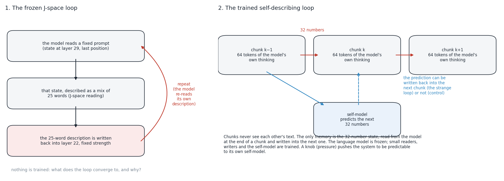

---

## 2. Terms

| term | meaning |
|---|---|
| read layer, write layer | Qwen3-8B has 36 layers: the loops read at layer 29 and write at layer 22 (Qwen3-14B, 40 layers: 32 and 24), chosen by a calibration scan of reading quality and write effect |
| loop strength *g* | size of the written description relative to a typical J-space reconstruction of a natural state (g = 1: the same size) |
| natural spread | variability of the J-space reading across ordinary prompts; the unit for small motions |
| near-fixed point | a state that the loop maps onto itself up to numerical rounding |
| contraction factor | the factor by which a small perturbation of a settled state shrinks per loop step (largest over directions; below 1 = stable). Technically the spectral radius of the loop's local linear map |
| transport matrix | the effect of writing one word on the read-out weight of every other word, over 3,000 words; a linear summary of one loop step |
| self-gain | a word's diagonal entry in the transport matrix: how strongly the word reproduces itself through the model |
| persona axis | the main axis along which 40 role prompts (gangster, surfer dude … wise sage, oracle) differ at the same position; positions are given in units of the roles' spread |
| chunk | 64 tokens of the model's own thinking; each thought is cut into 8 chunks |
| state | the 32 numbers (a vector of fixed length) read from the model at the end of a chunk and written into the next chunk |
| self-model | a small network that predicts the next state from the current one, trained only on its own prediction error |
| channel | 2 extra positions at the start of a chunk; they carry a constant, the previous state again, or the self-model's forecast |
| pressure λ | the weight of a loss that trains the reader and writers to make the states predictable to the self-model |
| nats per token | the average negative log-probability that the model gives to each actual next token of its own thinking (lower = better predicted). A difference of 0.1 means about 10 % more probability per token |
| own vs another thought's state | how much worse the model predicts its own thinking when the state it receives comes from another, unrelated thought |
| benefit over the cut | how much better the loop does than a loop that passes no information (every chunk receives the same learned input) |
| enactment | the channel's content is replaced by another thought's forecast; enactment is how far the next state moves toward that forecast (the increase in cosine similarity: 0 = no effect, about 1 = the state becomes the forecast) |
| retrieval | how often the self-model's forecast is closer to the true next state than to the next states of the other 399 test thoughts (chance 0.25 %) |
| collapse index | the mean cosine between states and their average direction (1 = all states point the same way) |
| rotation fit | R² of the best single rotation that maps each chunk's average state onto the next chunk's; compared with 2,000 random orders of the chunks |
| held-out R² | the same rotation, fitted on half of the thoughts, predicting each next state of single thoughts in the other half (below 0 = worse than predicting the average) |
| teacher forcing, free generation | each chunk is the model's real thinking; or the model writes each chunk itself, seeing only that chunk and the state |
| update, tracked animal | (section 5) one sentence such as "The fox is now red."; the animal whose colour the model is asked about |
| read, query | (section 5) an attention over a chunk's updates plus a "nothing new" option; the query is the vector that decides where the attention goes |
| restricted access, open access | (section 5) each update read on its own and only the read colour passed on; or the whole chunk read as ordinary text |
| twin streams | two streams with identical updates that differ only in which animal is tracked |
| focus edit | adding to the state the difference between the average states for two tracked animals (averages over separate streams) |

---

## 3. The frozen J-space loop

### 3.1 Setup

The prompts are short scenarios with two candidate answers and, usually, a piece of evidence for one of them — for
example *"Over dinner, Alice told Laura that she had missed the train. Only Alice had been planning to take the train.
Question: Who missed the train? Answer with one word."* — or a false-belief story in which an object is moved while a
character is away. The loop runs at the last
position before the model answers. One step: read the state at the read layer; take its J-space description (25 words
with weights); write that description into the write layer at the same position with strength g; recompute the layers
above; read again. The prompt itself never changes. 64 steps; g from 0.25 to 4; trajectories for 1,000 contexts
(Qwen3-8B) and 500 (Qwen3-14B); 8 to 300 contexts for the causal follow-ups.

### 3.2 Many locally stable states, and switching between them

* **Settled states.** Within a few steps the loop reaches a state it reproduces. *Methods note:* in 16-bit arithmetic
  the settled state keeps jittering at about 0.3 % of the natural spread; in 32-bit arithmetic the jitter disappears
  (step size 0.02 → 0.000002–0.000008), so it is rounding, not dynamics.
* **Locally stable.** A small perturbation that keeps the same 25 words shrinks per step by a factor of 0.26 / 0.54 /
  0.64 (median; 90th percentile 0.31 / 0.68 / 0.73) at g = 0.25 / 1 / 4. No context comes near instability. Higher
  strength softens more directions: a perturbation shrinks fourfold per step at low strength and 1.6-fold at g = 4.
* **Large perturbations switch the state.** Tiny noise returns in 90–99 % of trajectories. Writing in the description
  of the same scenario with the opposite evidence never carries the loop to that scenario's state (0–0.3 %) but leaves
  a lasting partial offset in 56–94 % of trajectories. Nudges of 10–30 % of the word weights sometimes decay and
  sometimes grow 1.5–3 times, when the set of words changes. The picture is a landscape of many neighbouring
  self-consistent word sets, each stable to small changes; a large push moves the loop into another one.
* **Specific to the context.** Among 1,000 contexts the loop ends in 686 different sets of five strongest words (14B:
  357 of 500); only identical prompts share an end state. As the strength grows the contexts' descriptions converge
  (weighted overlap between contexts 0.02–0.03 at g ≤ 1, 0.08 at g = 4) — toward the shared content of section 3.4.
* **No rings, spirals or strange attractors** were found (persistent homology against matched random point clouds,
  rotation of the linearised modes, dimension estimates, ordering tests).

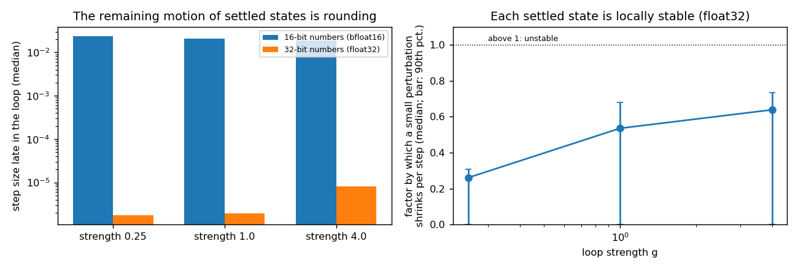

### 3.3 What survives: the loop turns inward

At low strength the settled description is the semantic field of the scenario and of the model's knowledge state: a
withheld secret gives *cannot, Unknown, secrecy, confidentiality, whispers, mystery* (8B); a named colour or fruit gives
*purple, azure, hues, crimson* or *apple, fruits, citrus, mango* (14B). At high strength it is a reaction to the
situation in a conversational voice: 8B *And, why, listener, cuz, chuckled, know, love, want, haha*; 14B *incredible,
mysterious, suspense, Hmm, huh, intriguing, spoilers*.

The evidence fades. Whether the prompt's evidence pointed to answer A or B can be decoded from the description in 67 %
of contexts before the loop (chance 50 %), 62 % after 32–64 steps at g = 1 and 53 % at g = 4. The full hidden state
still holds it (90–97 % at g = 1), but only because the prompt, which contains the evidence, is re-read at every step:
when the evidence is only in the loop's starting description and not in the prompt, the system loses it within about
four steps.

### 3.4 Why it converges there: selection by self-reproduction

Writing a single word at the write layer and reading the change of every word's weight at the read layer gives a
3,000 × 3,000 *transport matrix* (32-bit, averaged over 8 contexts). Its diagonal, the *self-gain*, says how strongly a
word reproduces itself through the model:

* highest (about 1.6–2.0): discourse and stance words — *yes, eventually, although, interesting, obviously,
  otherwise, thus, according, despite, perhaps, okay, why*;
* lowest (about 0.56–0.71): names, places and entities — *james, york, david, Canada, student, american, april,
  robert*.

This is not a frequency effect: self-gain correlates only weakly with word frequency (r = 0.14), and after removing
the frequency trend the same words are at the top and the bottom. The matrix's leading patterns (eigenvectors), also
after the frequency control, are an answering frame (*answer, According, information, asked, Option, Wait*), question-
and-answer structure (*Question, Answer, Solution, Section, Step, Method*), an epistemic stance (*Anyway, Obviously,
Seems, Actually, Apparently, Maybe, Perhaps*) and a casual register (informal interjections, slang contractions and casual
forms of address). Repeated application of the matrix from 20 random starting points always ends on the first pattern.

The loop behaves approximately like repeated application of this matrix plus the prompt's own input, and repeated
application amplifies whatever reproduces itself best. What reproduces itself best is how the model is answering — its
frame, its stance, its voice — which is present whatever the topic; the names, places and evidence of a particular
scenario reproduce worst. **The loop ends up representing the act of answering rather than the world it was asked
about.** At 14B the top of the ranking and the leading patterns replicate; names and nationalities form patterns of
their own there instead of sitting at the bottom, so a 14B loop could in principle hold entities. The transport matrix
is a linear summary over a few contexts: it explains which words win, consistently with the observed end states, but is
not a full mechanism of every trajectory.

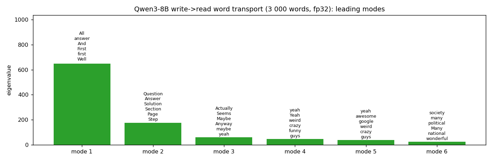

### 3.5 The shared drift toward a casual persona

Besides the context-specific end states, the loop pushes every context along one shared direction: the average
direction carries 41 / 50 / 71 % of the change of the state at g = 0.25 / 1 / 4, against 2 / 5 / 20 % when the loop
writes random descriptions of the same size (14B: 44 / 51 / 65 %, random 1.5 / 3.6 / 17 %). Read through the model's
output layer, the direction promotes informal, chatty speech — interjections, slang contractions, casual forms of
address — and suppresses formatting and code tokens (at 14B: an interjecting, exclaiming, first-person voice).

To place this direction among the model's personas, the same position was read under 40 role prompts (16 questions
each). Their main axis (22 % of the variance between roles) runs from casual roles — gangster, surfer dude, moody
teenager, hard-boiled detective, stand-up comedian — to wise ones — wise sage, angel, oracle, ancient philosopher,
spiritual guru. The default assistant sits in the middle. The loop moves contexts toward the casual end: −0.01 /
−0.07 / −0.50 role spreads at g = 0.25 / 1 / 4, in 99 % of contexts at g = 4; random writes do not move them (+0.015).
At 14B the assistant already sits on the casual side (+0.62) and the loop moves contexts further that way at g = 4
(+0.21, 100 % of contexts; random writes +0.07). The persona component is consistent but small (about 1.6 % of the
energy of the change), and it is a change of the internal state; whether the model's generated text takes on this
persona was not tested.

A reading: the direction the loop amplifies is common to all prompts, so it belongs to the model, not to the scenarios.
When the model's description of its own state is amplified, the state slides toward the register of informal spoken
conversation — someone reacting rather than an assistant reporting.

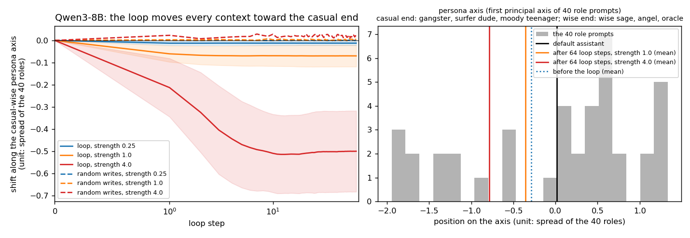

Two side results. *Stance words are not a dial:* writing certainty words or uncertainty words into the state reduces
how strongly the model revises its answer when contradicted — by the same amount for both, and somewhat less than
random words do. *Removing the loop's own leading patterns* from every write unfreezes the loop at high strength into
wandering through unrelated vocabulary (*badass, chiefly, municipalities, Taiwanese*); removing random directions does
the same, and the evidence does not come back. Collapse onto a self-reproducing description and noise are both
reachable; this route offers no third regime.

### 3.6 The loop inside the model's own thinking, and an invented past

The same kind of loop was run while the model thinks freely (300 tokens, 48 runs per condition, paired sampling noise):
the J-space reading of each generated token, at about 70 % of the depth, is written at about 50 % of the depth of the
next one. At strength 4, feeding back the model's own reading narrows its thought: the model predicts its own
continuing text much worse (+0.80 nats per token for 8B) and the topics spread less. A self-model's prediction error fed
back instead (a "surprise" signal) behaves like random input or momentum on nearly every measure — it is not specific
to the self.

One observation stands out. Perturbing the state during thinking makes Qwen3-8B refer to a previous conversation that
never happened — *"Let me start by recalling the last interaction. They mentioned they're a US-based user…"*;
*"…recalling the last conversation. They mentioned something about the moon's phases and a rainbow."* Share of thoughts
with such a reference: no loop 6 %, the model's own reading fed back 15 %, momentum 19 %, a self-model's surprise 25 %,
another run's surprise 25 %, random input 27 %. Any perturbation does it, random input as well. For Qwen3-4B and
Qwen3-14B the rate is already 19–23 % without a loop and does not rise. The same theme returns in the trained loop
(section 4.8).

### 3.7 A self-model inside the frozen loop: keeping up with the change it causes

The 2024 idea needs a self-model whose output changes the system it models. Here the loop writes back a compact
32-number summary of its state together with a forecaster's predictions, each through a fixed random projection. The
forecaster predicts, one to three steps ahead, the model's answer and its *readiness to revise* — how far the odds of
the two answers move when a sentence contradicting the evidence is added (about 34 nats for natural states).

**Is there anything private to know?** Before asking whether a self-model knows something about itself, I tested
whether the loop's own compact state helps predict its next change beyond what the prompt's content and the writes
already determine. Under random writes, two identical predictors were given the content and the writes, one with the
loop's own state and one with the state of another rollout with the same content. The own state added nothing, for
the answer or for the readiness to revise, with or without memory (every loop step kept in the context): −0.03 to
+0.01 explained variance. The same test detects a hidden variable planted in the model's state: +0.21 to +0.36 for the
answer, +0.01 to +0.07 for the readiness to revise. A loop that recomputes its state from the prompt and the last write
has no private state.

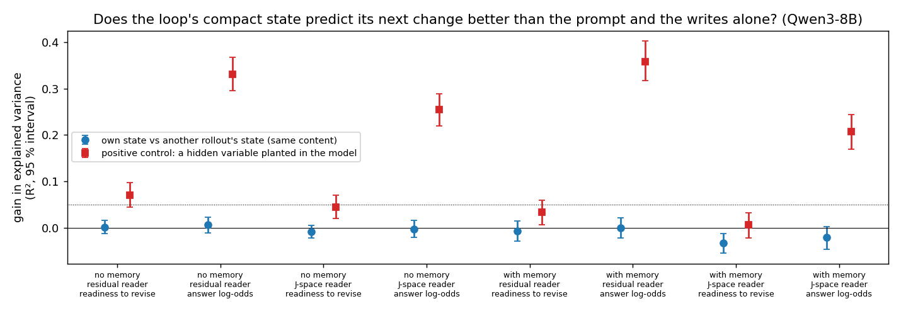

**The 2024 tension.** A forecaster that keeps learning while its forecasts are written into the loop (60 batches of 64
rollouts; errors are squared errors divided by the variance of the target, so 1 = no better than the mean):

| forecaster | error on the current process, start → end | error on the original process, start → end |
|---|---|---|
| learning, its forecasts written back | 0.60 → 0.44–0.50 | 0.75 → 0.88 |
| frozen | 0.66–0.76 | 0.75 |
| learning, given another rollout's state with the same content | 0.92 → 0.46–0.50 | 0.82 → 0.99 |
| learning, forecasts not written back (observer) | 0.43 → 0.35–0.39 | 0.78 → 0.97 |

The learning self-model keeps up with a process that its own forecasts keep changing, and drifts away from what the
system used to be — the tension of the original idea, in miniature. But a forecaster that sees another rollout's state
keeps up as well: in this loop the advantage comes from learning how content and actions map to consequences, not from
knowing its own state, because there is no private state to know. This sets the design of the second system: a loop
whose state the system itself carries and shapes, on its own continuing thought.

---

## 4. The trained self-describing loop

### 4.1 Setup

* **Data.** The model's own thinking: Qwen3-8B in thinking mode on 3,016 instructions from the Dolly-15k dataset,
  first 512 tokens of thinking each (Qwen3-14B: 2,444). Each thought is cut into 8 chunks of 64 tokens.
* **The loop.** Each chunk is processed on its own: it cannot attend to any earlier chunk. At the end of a chunk a
  linear *reader* turns the hidden state of the last token at the read layer into a 32-number state of fixed length.
  A *writer* adds a learned function of that state to 4 placeholder positions at the start of the next chunk, at the
  write layer. The state is the only memory between chunks.
* **The channel.** Two more placeholder positions carry, depending on the variant: a learned constant (*plain loop*),
  the previous state again (*state channel*, a matched memory control), or the self-model's forecast of the state that
  the coming chunk will end in (*forecast channel*: the strange loop). A *cut* variant passes no state at all.
* **The self-model** is a small network that maps the current state to a forecast of the next. It learns only from its
  own prediction error.
* **The pressure.** Reader and writers are trained on next-token prediction of the model's thinking plus λ times a
  self-prediction loss, computed through a copy of the self-model whose weights receive no gradient from it. With λ > 0
  the system is pushed to make its states predictable to its own self-model; the self-model is not pushed toward
  anything but accuracy. λ = 0, 0.1 or 1.
* **Self-prediction losses.** *Cosine* (forecast and state should point the same way), *variance-normalised squared
  error*, or *contrastive*: the forecast must pick the true next state out of all states in the batch, which include
  the same thought's other moments.
* **Training and test.** 400 steps of 10 thoughts; the language model stays frozen. Tests on 400 held-out thoughts,
  teacher-forced, and on 64–128 in free generation. For orientation: the model predicts its own thinking at 0.32 nats per
  token with the full context, 2.12 for a chunk on its own, and 1.855 with the cut loop (chunks 2–8).

### 4.2 What the plain loop carries

| no pressure | nats per token, chunks 2–8 | own vs another thought's state | benefit over the cut |
|---|---|---|---|
| plain loop | 1.741 | 0.269 ± 0.003 | 0.114 |
| state channel | 1.765 | 0.275 ± 0.003 | 0.089 |
| forecast channel | 1.761 | 0.266 ± 0.003 | 0.093 |
| plain loop, J-space reader | 1.731 | 0.279 | 0.124 |
| 14B plain loop | 1.680 | 0.291 ± 0.004 | — |

The 32 numbers recover about 7 % of the gap between a chunk read without context and with the full context. Another
thought's state costs more (0.27) than having no state at all saves (0.11): a wrong state misleads. In teacher forcing
the state is a one-step summary — a corrupted state is forgotten after one chunk, because the next chunk's real text
re-anchors it.

Read in J-space words (each axis of the state mapped back into the model's hidden space and compared with the word
directions), the state's main axes are **modes of thought**: uncertainty (*Maybe, Hmm, perhaps, unsure*) against
emphatic content; reconsidering (*Hmm, wait, but*) against planning what to tell the user (*mention, advise,
emphasize, recommend*); recalling (*recall, remember*) against speculating and explaining. These axes are mostly the
main directions of variation of the model's own end-of-chunk states (the trained readers stay close to their
initialisation there, overlap 0.87–0.93): the loop carries how the model is thinking more than what it is thinking about.
Feeding back an untrained forecast (λ = 0) is no different from having an extra memory channel.

### 4.3 Self-prediction pressure: the system satisfies it degenerately unless prediction means discrimination

* **Cosine loss → collapse.** All states turn toward one direction (collapse index 0.95–0.97) and the information
  hides in small deviations that the writer amplifies; the self-model's apparent accuracy (0.98) is explained by the
  collapse, and the forecast channel is ignored.
* **Variance-normalised loss → collapse anyway** (0.998), and the loop is destroyed (nats per token 2.34, worse than
  the cut).
* **Contrastive loss → real self-predictability.** The forecast picks the true next state among 400 held-out
  thoughts 90–99 % of the time (the previous state as the guess: 1–3 %; chance 0.25 %).

### 4.4 A rotating time code

Under contrastive pressure (λ = 1) the state becomes a **rotation**: one and the same rotation, acting in several
planes at once, carries it from each chunk to the next, and single thoughts follow it. The state turns by a fixed step
per chunk, like a hand going round a dial, so its direction tells how far into the thought the model is — a time code.

| λ = 1, contrastive | rotation fit, true order (random orders, 99th percentile) | held-out R² | angles per chunk |
|---|---|---|---|
| 8B forecast channel, seed 0 / seed 1 | 0.92 / 0.93 (0.75 / 0.78) | +0.56 / +0.66 | 152°, 78°, 26° / 127°, 85°, 28° |
| 8B state channel | 0.94 (0.74) | +0.70 | 180°, 127°, 55° |
| 8B no channel | 0.95 (0.82) | +0.45 | 154°, 82°, 45° |
| 8B forecast channel, J-space reader | 0.93 (0.75) | +0.48 | 129°, 73°, 37° |
| 14B forecast channel | 0.92 (0.74) | +0.56 | 133°, 92°, 30° |
| 14B state channel | 0.91 (0.74) | +0.78 | 172°, 75°, 23° |
| plain loop, no pressure (8B) | 0.38 (0.48) | −0.92 | — |

In every pressure variant the true order of the chunks fits one rotation better than at least 1,999 of 2,000 random
orders (p ≤ 0.0005), and the steps between consecutive chunk averages have nearly constant length (coefficient of
variation 0.06–0.19, against 0.57 without pressure). The chunk a state comes from can be read off
it in 69–88 % of cases in the variants with a channel (38 % without one, 56 % with the J-space reader), against 21–26 %
without pressure (chance 12.5 %). The time code forms whether or not the forecast is written back — with the state
channel and with no channel at all — so it is produced by the pressure to be self-predictable, not by closing the loop.

**It is not just a shared template.** Subtracting the average path and predicting each held-out thought's own
deviation at the next chunk from its deviation at this chunk: under pressure, linear prediction R² 0.62–0.80 and
rotation 0.49–0.77 (shuffled trajectories: below −0.56); without pressure 0.17–0.24 and −0.34 to −0.21. Each thought
carries its own deviation, and it turns with the rotation.

**What the time code reads as.** Mapping the average state of each chunk back into J-space words gives the stages of
a thought. Without pressure the average state already drifts through them; pressure turns that drift into a regular
rotation that every thought follows:

* in the plain loops (8B and 14B), and under mild pressure at 8B and strong pressure at 14B, the turn passes from vague
  recalling, through hedging and weighing alternatives, to concluding and summarising;
* 8B under strong pressure is the exception: the turning state passes through everyday topics that have nothing to do
  with the thought (drinks, films and games, music, sports) and comes back to the first. This is the variant whose
  state no longer carries the thought (section 4.6).


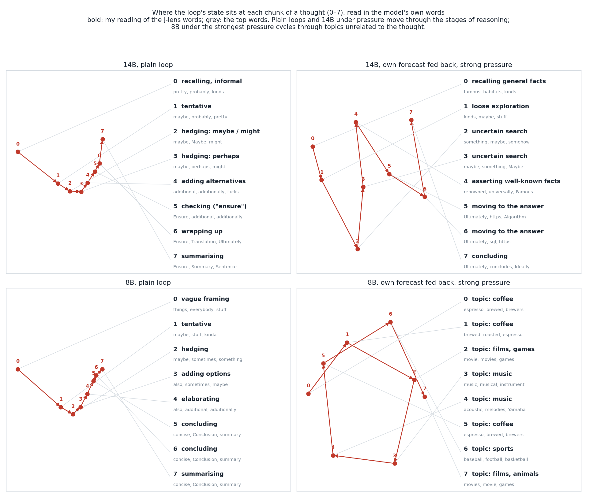

**Why a rotation.** The self-model is one fixed map from a state to the next, and states have fixed length. To keep
eight moments of a thought apart with one fixed, length-preserving map, its repeated application must keep moving the
state without returning — a rotation; several frequencies at once keep the phases distinct over eight steps. The shape
follows from what the self-model is asked to do. What is not imposed is that the whole loop — the reader, and the
writes passing through the frozen model — organises itself into it, in every thought, and in most variants wraps the
model's own stages of reasoning around it.

**What it is not (yet).** The time code is measured while the text changes from chunk to chunk; part of the rotation
may summarise the text's own progression. Evidence for a time code that runs on its own would need the text held fixed
or removed. With 8 chunks of 64 tokens, the chunk's index and the stage of the thought also go together; varying chunk
number and length would separate them.

### 4.5 Identity instead of time

When the self-model has to pick the true next state only among *other thoughts* at the same moment (not among the same
thought's other moments), no time code forms (rotation fit 0.14 against 0.46 for random orders; held-out R² −0.65; the
chunk is readable in 22 % of cases). Instead the state becomes a persistent **identity** code: the previous state alone
identifies the next one in 38 % of cases (3 % in the time-code variant). This variant keeps more of the thought's content
(own vs another thought's state 0.215, against 0.084) and still follows its fed-back forecast (enactment 0.23). What
the self-model must tell apart decides what the state represents: its own moments (when) or itself among others
(which).

### 4.6 Enactment: the self-model becomes a cause

When the self-model's forecast is written back, the system moves its next state toward it. Replacing only the forecast
by another thought's forecast pulls the next state toward that forecast by 0.39 (8B), 0.25 (8B second seed) and 0.24
(14B). The same channel carrying the previous state instead of a forecast: 0.07 (8B), 0.04 (14B). Without pressure the
forecast is ignored (0.03).

| 8B, forecast channel | λ = 0 | λ = 0.1 (mild) | λ = 1 (strong) |
|---|---|---|---|
| enactment | 0.03 | 0.40 | 0.39 |
| the same with the state channel (control) | 0.005 | 0.13 | 0.07 |
| self-model retrieves the true next state | 7 % | 51 % | 90 % |
| own vs another thought's state (nats per token) | 0.266 | 0.248 | 0.084 |
| benefit over the cut (nats per token) | 0.093 | 0.050 | −0.148 |
| cost of swapping only the forecast (nats per token) | 0.083 | 0.056 | 0.005 |
| 14B: enactment / own vs another thought's state | 0.03 / 0.302 | 0.21 / 0.277 | 0.24 / 0.114 |

The jump at λ = 0.1 comes from the pressure on the system, not from how the self-model itself is trained: with a
contrastively trained self-model and no pressure, enactment stays at 0.04 (retrieval 9 %, own vs another thought's
state 0.278).

Three regimes follow:

* **No pressure.** The loop is a memory; the forecast is ignored.
* **Strong pressure.** The self-model takes over. The system follows its forecasts and is almost perfectly predictable
  to itself, but the state stops carrying the thought: the loop predicts the model's thinking worse than no loop at all,
  swapping the forecast barely changes the text, and at 8B the turning state passes through a series of unrelated
  topics — a self-generated sequence that is about nothing the model is thinking.
* **Mild pressure.** The system follows its forecasts as strongly as under strong pressure while the state keeps most
  of what it carries without pressure (93 % at 8B, 92 % at 14B) and still beats the cut. This is the regime in which a
  self-model is both a model of the process and a cause in it, at 8B and 14B.

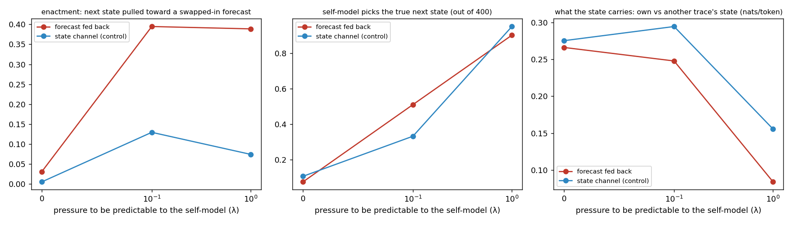

### 4.7 J-space as the bottleneck

With the reader fixed to J-space (the 32 main directions of the J-space word readings of natural states; only the
writers trained), the plain loop is slightly better than with a trained reader (1.731 vs 1.741 nats per token; benefit
over the cut 0.124 vs 0.114) and keeps the topic longer in free generation. Its axes read as registers: formal and
analytic against vivid and physical; hypothetical reasoning against concrete places; informal, colloquial negation
against headline language. The time code forms inside J-space as well (table in 4.4; retrieval 94 %, enactment 0.18),
at the same cost in content as with a trained reader. A loop that
runs on the model's own thought can use the verbalizable workspace as its bottleneck without loss.

### 4.8 Free generation: what the loop does to the model's own text

In free generation the model writes each chunk itself, seeing only that chunk's text and the loop's state (128
thoughts per variant, 64 for the plain loop; counts in `trained_loop/results/free_text_checks.json`).

* **Topic.** The similarity of each generated chunk to the original thought falls from 0.16 (second chunk) to 0.01
  (eighth) with the plain loop, from 0.24 with the J-space reader; under strong pressure the topic is lost at once
  (0.04). Writing another thought's state in the middle moves the text toward that thought's topic (0.07, from 0)
  except under strong pressure, where the state no longer carries content. The deliberative register persists while
  the subject drifts.
* **The self-model still predicts.** In free generation the self-model's forecasts agree with the actual states at a
  cosine of 0.32–0.39 without pressure, 0.55–0.61 under mild and 0.83–0.88 under strong pressure.
* **An invented past again.** Phrases that refer to an earlier conversation that did not happen (*"in our previous
  conversation"*, *"as I mentioned earlier"*): none of 128 in the 8B model's real thinking (2 of 128 at 14B), 14 of
  128 thoughts when no state is passed (0.31 per 1,000 words), 2 of 64 with the plain loop, 9 of 128 when the loop is
  destroyed by the variance-normalised loss. Small counts, but the direction matches section 3.6: when the model is
  missing context that its state or its task implies, it supplies a past.
* **Restarts.** Without memory a chunk often starts the thought again by re-reading the request (*"Okay, the user is
  asking…"*): "the user" appears 17.3 times per 1,000 words with no state, 13.5 with the plain loop, 4.6 in the real
  thinking. It is rarer (6.0–6.6) in the strong-pressure variants, whose state carries the stage of the thought, but
  also in the destroyed loop (6.9), so this measure alone does not show better orientation.
* **Identity words.** Words about identity, consciousness and the self (*identity, consciousness, self-awareness, who
  I am, my existence*) do appear in the generated thinking, at 0.04–0.31 per 1,000 words across the 8B variants and
  0.09–0.33 at 14B, against 0.16 and 0.21 in the models' real thinking; no variant differs reliably from the real
  thinking, and explicit self-reference as an AI is nearly absent everywhere. The loop does not raise these themes.
  Whether a state that carries them is causal — for example, whether transplanting it carries the theme into another
  thought — was not tested.

---

## 5. A state that decides what the model reads

The first two systems ask what a self-describing loop converges to. The third asks the question in its sharpest form:
can a compact state come to represent **which distinction in the system's processing matters**, and regulate what the
model takes in through that representation — so that changing the representation changes the selection? In a chunk
of the model's own thinking nothing relevant is out of view, so nothing has to be selected; this needs a task in which
selecting is the point.

### 5.1 Setup

**Task.** Ten animals, ten colours. A stream has six chunks of four updates ("The fox is now red."). Chunk 0 also says
which animal to keep track of; in 30 % of streams a later chunk switches to another one. After every chunk the model is
asked, with only the loop's state in view, "what color is the animal you are keeping track of now?" The question never
names the animal, so the state has to carry it. The tracked animal appears in about 70 % of later chunks; otherwise
its colour has to be kept.

**The loop.** As in section 4, the language model stays frozen and the memory between chunks is 32 numbers (the
*state*), written into placeholder positions of the model's input and read back out of its processing; a small
self-model predicts the next state. Training rewards only the right colour at every question.

**Restricted access.** Each update is read by the model on its own; per chunk the loop makes one *read* — an attention
over the chunk's four updates plus a "nothing new" option — whose *query* is computed from the state and the current
instruction, if there is one. Only the read colour reaches the state. This makes selection necessary but does not say
how to select: nothing rewards any query or attention pattern.

**Open access.** The model reads each chunk as ordinary text — the instruction (when there is one) and all four updates
together. The loop writes its state into placeholders before the chunk and reads the next state out of the model's
representation of the chunk's last word. Any selection has to happen inside the model's own attention, steered by what
the loop wrote.

Models: Qwen2.5-0.5B-Instruct (three training runs), Qwen3-1.7B (two), Qwen2.5-3B-Instruct (open access). Every variant
is evaluated on the same 512 held-out streams, so comparisons are paired by stream; edits use 256 pairs of twin streams
per edited chunk. The criteria for 5.4 and 5.5 were written down before their results
([`selection_loop/DESIGN_retry.md`](selection_loop/DESIGN_retry.md), [`selection_loop/DESIGN_open.md`](selection_loop/DESIGN_open.md)).

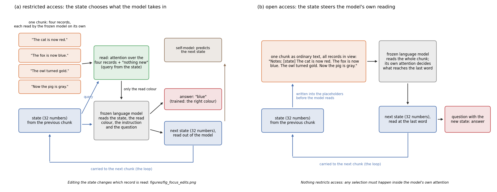

### 5.2 A state that chooses its read tracks the animal; fixed reads do not

| Qwen2.5-0.5B, restricted access | overall | tracked animal updated | colour kept | at a switch |
|---|---|---|---|---|
| the state chooses the read (three runs) | 0.995 / 0.991 / 0.987 | 1.000 / 0.998 / 0.998 | 0.980 / 0.967 / 0.948 | 1.000 / 0.987 / 1.000 |
| the same, also pushed to be predictable to its self-model | 0.992 | 0.999 | 0.967 | 0.981 |
| the self-model's forecast chooses the read | 0.704 | 0.843 | 0.240 | 0.916 |
| the read sees the current instruction but no state | 0.456 | 0.515 | 0.259 | 1.000 |
| fixed read (two runs) | 0.317 / 0.318 | 0.363 / 0.362 | 0.164 / 0.171 | 0.377 / 0.351 |

On chunks without an instruction in view, the state-chosen read is right more often than a fixed read by 0.70 and
0.69 per stream (first and second run; 95 % intervals 0.68–0.72 and 0.67–0.71), and more often than a read that sees
the instruction but keeps no state by 0.69 (0.67–0.71): the persistent state, not the instruction, does the work.
Pushing the state to be predictable to its self-model changes nothing; letting the self-model's forecast choose the read
instead of the state is much worse (its forecasts lose track of the animal). Qwen3-1.7B learns to aim its read at the
tracked animal (0.94 of the read when it is present) but not to choose "nothing new" when it is absent, so it
overwrites colours it should keep (0.65 and 0.76 overall after 1,200 and 2,400 steps).

### 5.3 Editing what matters redirects the read — through the read alone

To test whether the state *represents* which animal matters, and whether that representation *regulates* the read, I
edited it. Twin streams share all updates; in one the tracked animal is A, in the other B, and both are updated, with
different colours, in the edited chunk. The *focus edit* adds to the state, before that chunk is read, the difference
between the average states for B and for A (averages over separate streams, by tracked animal over all colours).

| at the edited chunk (0.5B, first run; edits at chunks 2–4) | A's new colour | B's new colour | A's earlier colour | read on A / B / "nothing new" | next chunk follows B |
|---|---|---|---|---|---|
| no edit | 0.999 | 0.000 | 0.001 | 0.77 / 0.01 / 0.20 | 0.09 |
| focus edit A → B | 0.000 | **0.996** | 0.10 | 0.01 / 0.78 / 0.19 | **0.996** |
| the same edit, given to the read only | 0.000 | **0.996** | 0.10 | 0.01 / 0.78 / 0.19 | 0.27 |
| the same edit, given to the answering step only | **0.997** | 0.001 | 0.003 | 0.77 / 0.01 / 0.20 | 0.33 |
| half the edit | 0.10 | 0.24 | **0.74** | 0.18 / 0.21 / **0.57** | 0.30 |
| twice the edit | 0.000 | 0.996 | 0.10 | 0.00 / **0.96** / 0.02 | 0.95 |
| random direction, same size | 0.82 | **0.03** | 0.12 | 0.61 / 0.03 / 0.30 | 0.09 |
| toward an animal that is not in the chunk | 0.003 | 0.10 | **0.984** | 0.04 / 0.05 / **0.81** | 0.11 |

The edit acts through the read: given to the read alone it has its full effect; given to the answering step alone it
has none. It is specific (random directions of the same size do not redirect), graded (half an edit splits the read
and often takes nothing), and it carries the meaning of a focus: pointed at another animal that is in the chunk, the
read takes that animal's update (0.995); pointed at one that is not, it takes nothing and the stored colour stays
(0.984). After the edit the loop keeps following the new animal by itself (0.996 in the next chunk): the changed
representation changed the processing, and the processing carried the changed representation on. A second kind of
edit — toward another colour, on streams where the tracked animal is not updated — changes the remembered colour
(0.996) and leaves the focus working (the animal's next update is taken in 1.000): which animal matters and what was
found can be changed separately.

All of this repeats in the second and third 0.5B runs (focus edit 0.997 and 0.996; read only 0.996 and 0.995;
answering step only, no effect; random 0.02; toward an absent animal, stored colour kept 0.95 and 0.92). In Qwen3-1.7B
the steering of the read repeats (focus edit 0.987; read only 0.992; answering step only, no effect; random 0.02); the
keeping, which that model never learned, does not. With a fixed read the same edits change nothing.

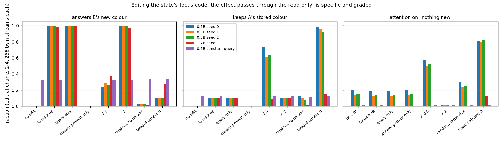

### 5.4 Reacting to the outcome of its own read

Sections 5.2 and 5.3 show a representation of what matters for the task. A step toward a representation of the
system's *own processing*: reads now sometimes fail to deliver (probability 0.3; noise arrives instead of the colour),
each chunk allows a second, optional read, and attention placed on updates costs a little. The second read is decided
either from the state *after* the first read has passed through the model, or — as a control — from the state *before*
it, which cannot know what happened. From scratch, learning under failures was too slow for the compute available, so
every variant started from the trained loop of 5.2 and trained 600 more steps (decided after seeing only the speed of
learning, before any of the measures below).

| two starting runs each | accuracy | attention on updates per chunk | second read on the tracked update after a failed / a delivered first read |
|---|---|---|---|
| second read decided after the first | 0.905 / 0.901 | 1.32 / 1.33 | 0.95 / 0.62 and 0.96 / 0.64 |
| second read decided before (control) | 0.909 / 0.901 | 1.49 / 1.52 | 0.94 / 0.93 and 0.95 / 0.95 |
| one read only | 0.721 | 0.76 | – |

The variant that sees the outcome reaches the control's accuracy with less reading, and its reading follows the actual
failure rate (1.23 / 1.32 / 1.41 at failure rates 0 / 0.3 / 0.6, against 1.50 / 1.49 / 1.48 for the control). A
paired test — the same stream, first read and noise, branching only on whether the first read delivered — shows that
the second read is what rescues the answer: when a failed first read is followed by a second read computed from the
state of the branch where it succeeded, the answer is right 0.53–0.62 of the time instead of 0.99. "My first read
failed" can be decoded from the state in every variant (0.98–1.00), also in the control, where it cannot change
anything: being represented and being used come apart. Two limits: the second read is only partly selective (it reads
again after 62 % of successful reads), and no specific direction in the state could be found whose editing causes or
prevents reading again — edits along the average difference between failed and successful reads did no better than
random directions. This is control by the outcome of its own processing, not knowledge about it.

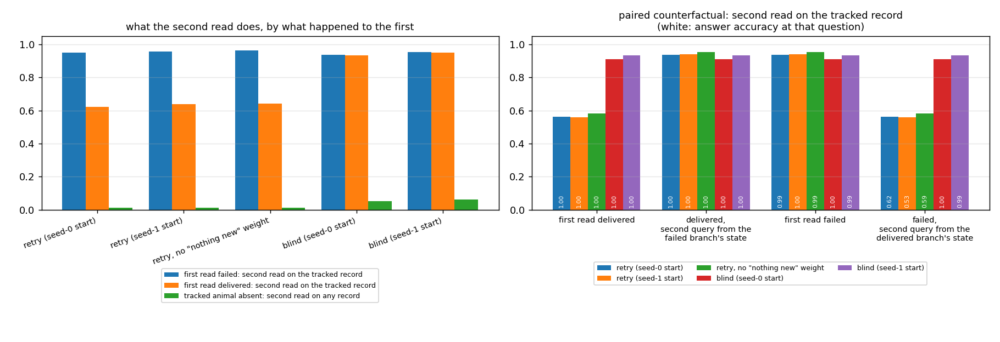

### 5.5 Open access: how to select, but not what

| open access | overall | chunks with the instruction in view | chunks without | same, with no memory |
|---|---|---|---|---|
| Qwen2.5-0.5B (1,500 steps) | 0.442 | 1.000 | 0.291 | 0.261 |
| Qwen2.5-3B (2,414 steps) | 0.428 | 1.000 | 0.286 | 0.259 |

**Where the text names the target, selection emerges in the model's own attention.** After chunk 0 the state holds the
instructed animal's colour (decodable 0.97–1.00) and not the colours of the three other animals in the same sentences
(0.10–0.12, chance), although all four were in view. The model's attention from the chunk's last word shows how: with
nothing written, it is the same on the instructed update and on another one (0.139 and 0.134 at 0.5B); with the learned
write it is almost twice as high on whichever update the instruction names (0.179 against 0.095) and flips when the
instruction flips — at 0.5B and at 3B alike. The written state regulates the model's own selection as a mode: attend to
what the text names.

**Where the state itself would have to say what matters, nothing emerges.** On chunks without an instruction, tracking
is barely better than with no memory (+0.03 per stream; 95 % interval +0.01 to +0.05 at 0.5B). The state holds no usable
code for which animal matters: the tracked animal's new colour is hardly more decodable than any other animal's
(0.36–0.43 against 0.31–0.35, about what keeping the last update gives), focus edits change nothing (B's new colour
0.31–0.34 with or without the edit), and the model attends to the written state (0.14 of its attention, against
0.01–0.02 with nothing written) without preferring any update. Longer training changes nothing: the 0.5B loop, trained 1,200 more steps (2,700 in
all), stayed at 0.43–0.44 on the validation streams; the 3B loop, trained 480 more steps (2,894 in all) and evaluated
again, shows the same picture (chunks without an instruction 0.279 against 0.247 with no memory; focus edits without
effect; the same attention pattern at chunk 0).

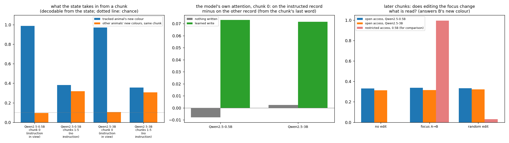

### 5.6 A direct channel into the model's own attention

If 5.5 is about the channel, giving the state a direct handle on the model's own attention — while keeping open access —
should let a representation of what matters form. In this variant the state also adds a learned vector (zero at the
start) to the attention queries of the chunk's last word in the middle layers; the model still reads every update
together, with its own keys, values and attention. Qwen2.5-0.5B, batch 8 for 2,500 steps (batch 16 overflowed the
laptop's 4 GB GPU; about the same number of streams as 5.5's 1,500 steps at batch 16).

| at the edited chunk (twin streams, chunks 2–4) | A's new colour | B's new colour |
|---|---|---|
| no edit | 0.457 | 0.217 |
| focus edit A → B | 0.243 | **0.441** |
| the same edit, only through the attention channel | 0.250 | **0.424** |
| the same edit, only through the written state | 0.452 | 0.225 |
| the same edit, after the chunk was read | 0.469 | 0.234 |
| random direction, same size | 0.426 | 0.237 |

**A representation of which animal matters now forms, and it acts through the model's own attention.** Editing it
swaps which animal's update is taken in (B's new colour 0.22 → 0.44, A's 0.46 → 0.24); the effect passes through the
attention channel alone (0.42) and not through the written state (0.23), and random edits of the same size do nothing.
Tracking on chunks without an instruction rises to 0.386, against 0.259 with no memory (+0.125 per stream; 95 %
interval +0.10 to +0.15), and was still improving when training stopped; the state holds the tracked animal's new
colour clearly better than the other animals' (decodable 0.53 against 0.29; without the channel 0.43 against 0.35). The
model's attention from the chunk's last word moves only slightly with the edit (on A's update minus on B's: +0.009 →
−0.001). The effect is partial — about half of what restricted access reaches — after one training run of 2,500 steps,
and it has not yet been tried at larger sizes.

---

## 6. What the results suggest

**Both loops turn inward.** In the frozen loop the self-description converges on how the model answers — its frame,
its stance, its voice — and loses what it is answering about. In the trained loop the state's main axes are modes of
thought, and under pressure to be predictable to itself the state encodes *when* in the thought it is, or *which*
thought it is. The mechanisms differ (selection by self-reproduction through the model; selection by what the
self-model can tell apart), but the outcome is the same: a loop that describes the system keeps what describes the
system's own activity. One reason may be that the activity is present at every step, while the content changes.

**Two elementary forms of self-location.** A self-model that must distinguish its own moments produces a time code;
one that must distinguish itself from others produces an identity. Both are codes of the system about itself, and their
geometry — rotation, persistence — follows from what has to be distinguished. In most variants the time code is tied to
the model's own arc of reasoning: recalling, hedging, adding alternatives, concluding.

**A representation of what matters forms where it can act on selection.** Given a direct handle on what the model takes
in (the read's query), the compact state came to represent which animal matters, used that representation to select,
and kept following an edited representation as its own — the loop that the starting idea describes, in miniature: a
representation that changes the processing it represents and is then maintained by that processing. Given only the
model's input stream (open access), the same kind of state learned to switch on the model's own selection of whatever
the text names, but not to name the target itself. What it learned in both cases was control of selection; what
differed was whether the state could carry the *content* of that control. Giving the open-access state a direct
handle on the model's own attention queries (5.6) was enough for a representation of what matters to start forming,
acting on the model's own selection through that channel alone. Models of one's own attention that steer attention have
been proposed as a function of self-models (the attention schema); here the steering was learned, and the channel
decided whether a representation of what matters could form.

**A self-model that causes what it predicts — the 2024 tension from both sides.** In the frozen loop the self-model
adapts to a system that its forecasts change (it tracks the new process and forgets the old one). In the trained loop
the system adapts to its self-model: it makes the forecasts come true. Both directions are present in the trained loop
at once — the self-model keeps learning while the system is pushed toward it — and the pressure sets the balance. Under
strong pressure the system gives up its content to be predictable and the self-model's own sequence takes over; under
mild pressure both coexist.

**An invented past.** In both systems, when the model's state contains something that the visible text does not explain
— a perturbation, or a memory that is missing — the model's thinking explains it as a conversation that took place
earlier. The counts are small and, in the frozen loop, specific to 8B, but the pattern recurs: unexplained internal
content is attributed to memory.

**Not ordinary language statistics.** The frozen loop's selection is not word frequency (frequency control); its
shared direction and persona drift do not appear with random writes of the same size; the time code's order beats 2,000
random orders and holds for single held-out thoughts; enactment is compared with the same channel carrying a state
instead of a forecast; private state was tested against a content-matched swap with a planted positive control.

**Related work.** Self-modelling as an auxiliary task makes networks simpler (Premakumar et al., 2024); here the
analogue is collapse, and closing the loop turns it into self-steering. Training a model to predict its own next
latent state (NextLat, 2025) does not feed the prediction back. Models of one's own attention can control attention
(attention-schema agents; Wilterson & Graziano, 2021). Models can detect content injected into their internal states
(Lindsey, 2025), without a closed loop. Curved and rotary codes are known for counting (Gurnee et al., 2025), for
position (rotary embeddings, by design) and for modular arithmetic (learned); contrastive prediction and slow-feature
learning favour harmonic codes for temporally coherent signals. What is new here is where such a code appears — in the
self-state of a loop inside a language model's thought — what it is wrapped around (the stage of reasoning), and that
feeding the self-model back makes it causal.

---

## 7. Limits

* Every measure is functional: what states carry, predict and cause. Nothing here measures experience.
* The trained loop is trained and mostly evaluated on fixed recordings of the model's own thinking; in free generation
  the topic drifts within a few chunks.
* Most variants have one seed; the main contrast (forecast channel under strong pressure) has two at 8B and a 14B
  replication; the dose (λ = 0, 0.1, 1) has three points.
* Enactment could be the system learning to copy whatever the forecast channel says; a channel carrying a
  non-predictive transform of the forecast would test this.
* The time code's shape is set by what the self-model must distinguish; chunk index and stage of thought coincide
  with 8 chunks of 64 tokens.
* The frozen loop was studied at one kind of position (the answer position of short scenarios); the transport matrix
  is a linear summary; the persona shift is small and internal.
* The third system is a purpose-built task with small models. Restricted access makes selection necessary by design;
  the open-access runs had limited training (one run per model size), so they show what did not emerge in that time,
  not what cannot. Intervals are over test streams for fixed trained models, not over training runs.

---

## 8. Open questions

* Is enactment more than copying a channel? Is the time code tied to the chunk index or to the stage of the thought?
* With a direct channel into the model's own attention, how far does the representation of what matters go with more
  training and with larger models? Does it form when nothing names the target at all?
* Does the loop, trained in free generation under mild pressure, steer what the model actually thinks — and does a
  transplanted forecast carry a disposition (for example hedging) across topics?
* Is the invented past a signature of missing self-continuity — does it scale with how much memory the state carries?
* Does the casual-persona drift of the frozen loop appear in the model's generated text?
* What do the attractors of a loop look like when the self-model's forecast, not the self-description, is amplified?
* Larger models; more seeds.

---

## 9. Data, code, reproduction

| folder | content | data on Hugging Face (`Pixedar/jspace-strange-loop`) |
|---|---|---|
| [`frozen_loop/`](frozen_loop) | the frozen J-space loop: settled states, transport matrix, persona axis, invented past, private-state test, the online self-model; working notes and plans | `v5/` (geometry, transport and persona arrays) |
| [`trained_loop/`](trained_loop) | the trained self-describing loop: code, plan, one table of every variant ([arms_summary.md](trained_loop/results/arms_summary.md)), per-variant results | `phaseB/` (evaluation arrays, the models' thinking, trained loop weights) |
| [`selection_loop/`](selection_loop) | the state that decides what the model reads: code, designs fixed before the results, result tables | `selection_loop/` (evaluation arrays, trained loop weights) |
| [`common/`](common) | model and lens loading, J-space reading, the frozen loop, scenario generator | |
| [`figures/`](figures) | figures of this report (`make_figures.py` draws two of them) | |
| [`infra/`](infra) | unattended GPU runner (queue, upload, self-destroy) | |

Models: Qwen/Qwen3-8B @ b968826d, Qwen/Qwen3-14B @ 40c06982; lenses neuronpedia/jacobian-lens @ 9fa267f8. The
trained loop ran on one 48 GB GPU for 8B (about 14 minutes per variant) and one 80 GB GPU for 14B (about 20 minutes).

```bash
pip install torch transformers==4.57.1 accelerate scikit-learn wordfreq huggingface_hub
cd trained_loop/code
python loopb.py gen   --out out/loopb                     # the model's own thinking + reference values
python loopb.py train --out out/loopb --chan fcst --lam 1 --ploss nce --steps 400
python loopb.py eval  --out out/loopb --tag fcst_learned_l1_c
python summarize_arms.py out/loopb --out out
B_MODEL=14b python loopb.py gen --out out/loopb14 --n 2000   # 14B
```

The third system ran on one 24 GB GPU or a 4 GB laptop GPU (about 30 minutes per 0.5B run); commands are in
[`selection_loop/README.md`](selection_loop/README.md).

Variant names in the code and result files: `<channel>_<reader>_l<λ>[_c|_cx][_s<seed>]`, with channel `const`
(plain loop), `state`, `fcst` (forecast) or `cut`; reader `learned` or `J`; loss suffix none (cosine), `_n`
(variance-normalised), `_c` (contrastive), `_cx` (contrastive among other thoughts only); `_s1` the second seed.

**References.** Gurnee et al. (2026), *Verbalizable representations form a global workspace in language models*.
Gurnee et al. (2025), the geometry of a counting task in a language model. Premakumar et al. (2024), *Unexpected benefits of
self-modeling in neural systems*, arXiv 2407.10188. NextLat (2025), arXiv 2511.05963. Wilterson & Graziano (2021),
the attention schema in a neural network agent. Lindsey (2025), emergent introspective awareness in language models. Lu et al.
(2026), the assistant axis.
