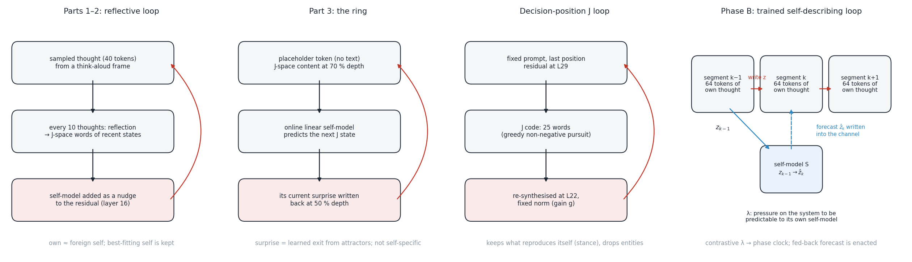
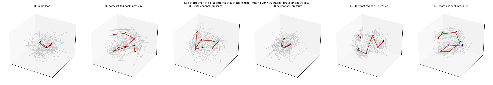
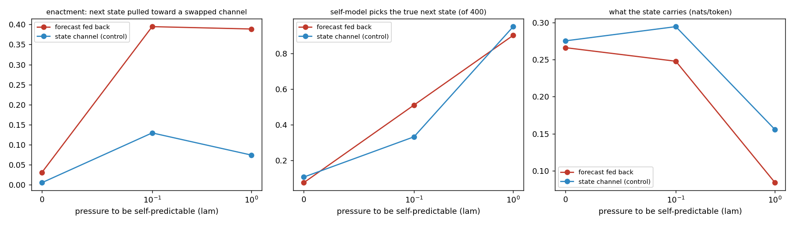

# What a language model builds when it loops a description of itself back into itself

**Wiktor Tomasik** · report of 12 October 2026 · extension of earlier work on self-models and latent loops
([medium.com/@pixedar](https://medium.com/@pixedar))

This report covers the whole programme: four ways of closing a loop through a language model's own internal
description of itself (Parts 1–3, the decision-position loop, the trained self-describing loop of Phase B), the
geometry of what those loops converge to, and the controls that separate what is self-specific from what is ordinary
feedback. Every number below is in the repository (`*/results`, `*/runs`) or in the Hugging Face dataset
[Pixedar/jspace-strange-loop](https://huggingface.co/datasets/Pixedar/jspace-strange-loop).

---

## 0. The question

The starting point is an idea from 2024: a *reversed autoencoder* whose bottleneck is a compact description of the
system's own behaviour, fed back into the system, so that the system both learns a model of itself and is changed by
it. The questions that follow from it:

* Can a neural system hold a compact representation of its **own** processing (not of its input) and use it, so that
  the representation changes the very processing it represents?
* Does the system's model of itself keep up with the changes its own use causes?
* What organisation emerges — which representation, with which **geometry** and dynamics — when such a loop runs? Two
  rules were fixed from the start: complexity must emerge rather than be optimised, and any tension must come from
  inside the system.

The candidate bottleneck is **J-space**, the verbalizable workspace of Gurnee et al. (2026), *Verbalizable
representations form a global workspace in language models*: a sparse non-negative combination of "Jacobian lens"
word directions that reads a mid-layer state as words. The models are Qwen3 (1.7B–32B; 8B and 14B for the later work).

---

## 1. What holds up (summary)

| # | Finding | Evidence (strongest test) | Where |
|---|---|---|---|
| 1 | J-space works as a reader of Qwen3's internal states, if built carefully: the workspace sits past ~60 % of depth up to 8B and earlier, fuller, at 14B–32B; a common-English dictionary reads states better than every token | lens validation per layer (occupancy, variance beyond random, concept probes); self-reading 51–73 % (chance 8 %) | Part 2 |
| 2 | A loop through a description of oneself is causal and stabilising, but **not self-specific**: a foreign self-description works as well, and the best-fitting stranger's description is held better than one's own outdated one | own − matched stranger −0.045 ± 0.014 (z −3.2); stale own < random stranger −0.113 ± 0.018 (z −6.5); behaviour follows whichever self is fed in (z −18) | Parts 1–2 |
| 3 | Self-related effects strengthen with scale | individuality of the loop's self 0.01 → 0.25 from 1.7B to 32B; stickiness after a clamp +0.02 → +0.30 | Part 2 |
| 4 | A self-model's **current surprise**, fed back while it keeps learning, is a learned way out of attractors (more exploration than momentum, random input or its own stale surprise) — but it carries no privileged self-knowledge | pre-registered: Stouffer z +26.9 (vs momentum), +52.9 (vs random), +28.0 (vs stale), freezing −33.0; another mind's model predicts a mind as well as its own | Part 3 |
| 5 | At a decision position, the J workspace holds **epistemic status** (whether the evidence settles the question), topic and answer onset — not the answer's relational structure; a frozen J loop is a contraction that forgets the evidence | J swap moves the answer 21 % of the way (8B), non-J remainder 52 %; evidence ≤ 2 % within ~4 loop steps | decision loop |
| 6 | The frozen J loop selects by **self-reproduction**: discourse and stance words reproduce themselves through the model's write→read transport, names and entities do not; its fixed points are precision-limited and many; it shares one direction of self-amplification (toward a casual register) | transport self-gain ≈ 1.6–2.0 vs ≈ 0.6 (not frequency, r = 0.14); fp32 removes the late wobble (0.02 → 2·10⁻⁶); shared direction 41–71 % of displacement (random 2–20 %); top of the ranking replicates at 14B | loop geometry |
| 7 | In frozen-context loops a self-model cannot be self-specific because there is **no private state**: everything is recomputed from input plus last write | compact state adds ΔR² ≈ 0 while a planted hidden state is detected (ΔR² +0.21 to +0.36), memoryless and memory loops | self-forecast gates |
| 8 | A **trained** 32-number loop through the model's own thinking carries information the model uses; its principal axes read as **modes of thought** (uncertainty, reconsidering vs planning what to say, recalling vs speculating) | own vs another trace's state 0.269 ± 0.003 nats/token (14B 0.291); benefit over a learned constant input 0.11 nats/token | Phase B |
| 9 | "Make yourself predictable to your self-model" is satisfied degenerately by naive losses: the state **collapses** onto one direction and hides its information in small deviations | cosine pressure: collapse index 0.95–0.97, "self-prediction" 0.98 explained by collapse; variance-normalised pressure destroys the loop | Phase B |
| 10 | Under **discriminative** self-prediction pressure, the self-state represents its own time as a **multi-frequency rotation** — a phase clock; read in words, the drift it organises is the arc of reasoning (recall → hedged exploration → assertion → conclusion), except when 8B is pushed hardest, where it cycles through topic directions | true segment order fits one rotation better than all 2 000 scrambled orders (p < 0.0005) in every pressure arm, 8B (two seeds) and 14B; held-out single traces follow it (R² +0.45 to +0.78 vs null ≈ −1); it disappears when the self-model need not tell its own moments apart | Phase B |
| 11 | What the self-model must tell apart decides the shape: its own moments → a **clock**; itself vs others → a persistent **identity** code | cross-trace-only control: no clock (rotation R² −0.65), persistence retrieval 38 % (3 % with the clock) | Phase B |
| 12 | **The strange loop proper:** a self-forecast that is fed back is **enacted** — the system makes its self-prediction come true — far more than a matched memory channel; strong pressure lets the self-model take over the state (it stops being about the thought), mild pressure keeps both | swapped-forecast pull 0.39 / 0.25 (8B seeds) and 0.24 (14B) vs 0.07 / 0.04 for the same channel carrying the previous state; at λ = 0.1 pull 0.40 vs 0.13 with content kept (0.248 nats); replicated at 14B (0.21 vs 0.03 at λ = 0) | Phase B |

The single sentence: **a loop through a self-description keeps whatever it can regenerate; it becomes self-specific
only when the system has private state and a self-model that must tell its own states apart — and then it represents
its own time (or identity) as a rotation (or a constant), and, if its forecasts are fed back, it makes them come true.**

---

## 2. The four loops (architecture)



| | Part 1–2: reflective loop | Part 3: the ring | Decision loop (v3/v5) | Phase B: trained self-describing loop |
|---|---|---|---|---|
| substrate | sampled 40-token thoughts from a think-aloud frame | one placeholder token at a time (no text) | the last template position of a fixed prompt | the model's own thinking traces, cut into 8 segments of 64 tokens with no shared context |
| what is read | J-space of the thoughts' layer-16 states; every 10 thoughts a "reflection" decodes the recent states into J-space words | J-space content at 70 % depth | J code at L29 (8B) / L32 (14B), 25 words | a 32-number state z at block 29, last token of a segment (learned linear reader on a sphere; J-derived reader as a variant) |
| what is written back | the self-model as a nudge at layer 16 | the self-model's current surprise (or prediction, controls) at 50 % depth | the J code re-synthesised at L22 / L24, fixed norm | z into 4 placeholder positions of the next segment (block 22); a 2-position channel carries a constant, the previous state, or the self-model's forecast |
| self-model | the reflection itself | online rank-32 linear predictor of the next J state, trained every step | forecaster of the system's own write-induced changes (gates) | MLP S: z_{k−1} → z_k, trained only on its own prediction loss |
| what is trained | nothing | the self-model online | readers / forecasters (small) | reader, writers, S (the language model stays frozen) |
| tension from inside | none | learning on its own transitions | curiosity / learning progress (Regime C) | pressure λ on the system to be predictable to its own self-model |

---

## 3. Results by part

### 3.1 Parts 1–2: a reflective loop through J-space words (Qwen3-4B-Base; ladder 1.7B–32B)

A "mind" thinks in short sampled thoughts; every ten thoughts it reflects, and the J-space reading of that reflection
is fed back as a nudge. Built on the paper's method with Neuronpedia's lenses (Part 2), validated per layer.

* **Self-reading works.** The self-model picks out its own trajectory (51–73 % at depth 0.7, chance 8 %). The
  common-English dictionary reads better than every token (on Qwen's vocabulary the every-token dictionary is
  dominated by code, CJK and under-trained tokens: self-reading 46 % raw residual / 25 % every token / 49 % English at
  1.7B; 47 / 57 / 68 % at 4B).
* **The loop is causal.** Removing the self-model drops long-lag coherence to the observer level at once; a self-model
  swapped in reorganises the trajectory (+0.37 while held, +0.31 after release); behaviour follows whichever self is fed
  in (pooled z = −18).
* **It is not ownership.** Pooled over 15 runs a mind holds its own self-model better than a random stranger's
  (+0.065 ± 0.007, z 8.9), but the most similar stranger's self-model is held slightly better than its own (−0.045 ±
  0.014, z −3.2), and its own outdated self worse than a random stranger's (−0.113 ± 0.018, z −6.5): the loop keeps the
  self-description that best fits the present, whoever produced it. No anticipation (forward vs backward question
  pooled +0.0000 ± 0.0005).
* **Scale.** The loop's self becomes steadier up to 8B (0.25 → 0.64), more individual (+0.01 → +0.25 from 1.7B to
  32B) and stickier after a clamp (+0.02 → +0.30), for foreign selves as much as for one's own. Where the workspace
  sits: conceptual only past ~60 % of depth up to 8B; occupancy 30–37 at 14B and 13–19 at 32B across most of the
  middle; at 32B the J-lens beats the logit lens at agreeing with the model's prediction.
* Correction kept from the time: the drift toward existence and consciousness themes in Part 1 came from the
  think-aloud frame, not from the loop.

### 3.2 Part 3: the ring (no text in the loop; Qwen3 1.7B–14B; pre-registered)

Each mind reads one placeholder token at a time; its J-space content is written back at 50 % depth; an online linear
self-model predicts the next state and is trained on every transition. Conditions write back vectors of equal norm on
the same schedule (paired noise across conditions).

| `ring_err` (current surprise) minus | 1.7B | 4B | 8B | 14B | Stouffer z |
|---|---|---|---|---|---|
| momentum | +1.57 | +2.07 | +2.48 | −0.31 | +26.9 |
| another mind's surprise | +0.41 | +1.31 | +0.20 | +4.33 | +15.9 |
| own surprise, wrong time | +2.27 | +2.01 | +1.22 | +3.09 | +28.0 |
| random direction | +3.16 | +3.65 | +3.34 | +4.75 | +52.9 |
| freezing the self-model | −2.20 | −3.90 | −1.87 | −4.99 | −33.0 |

(exploration = participation ratio of the trajectory, paired over 24 seeds). Feeding back the self-model's
*prediction* collapses like plain content feedback. Across the critical gain g* (where the free mind's spectrum turns
1/f), "own" and "still learning" matter more the higher the gain, but past ~2 g* momentum wins; the attractors are
trivial (shared junk words), and the model's own account of what it was thinking does not depend on the condition. A
next-state predictor fitted to another mind predicts a mind as well as its own: no privileged self-knowledge.

### 3.3 The decision-position loop (Qwen3-8B, 14B replication; pre-registered protocol)

Scenarios with evidence for one of two answers; the J code at the decision position (L29) is decomposed into 25 words
and broadcast back at L22.

* **H1 relational structure:** the answer is carried outside J — swapping the J code moves the answer 21 % of the way
  (14B: 14 %), the non-J remainder 52 % (58 %).
* **H2 processing dispositions** are readable before a challenge, but the evidence label explains them (over output +
  label J is negative; only 14B's late residual keeps +0.11 R²).
* **What the workspace holds:** whether the evidence settles the question (2 % of the code after a direct statement,
  20 % after an unreliable source), the topic, the answer's first letters.
* **Regime A:** the unforced loop is a contraction (97–100 % of trajectories end at cosine-defined fixed points;
  evidence ≤ 2 % within ~4 steps); unbounded writes diverge. **Regime B:** a predictability-seeking self-model
  simplifies its own loop by habit (one repeated action). **Regime C:** curiosity equals its own blind (yoked) replay.
  Feeding back the forecast error is noise. Natively recurrent models (Huginn, Ouro) rebuild the decision position each
  pass. No loop improved task accuracy.

### 3.4 What the frozen J loop converges to: geometry and mechanism (Qwen3-8B; 14B where marked)

* **Fixed points are real but precision-limited.** The "exact fixed points" of 3.3 were cosine-defined; with exact
  equality none is fixed, because bf16 rounding keeps the state wobbling at ~0.3 % of its natural spread. In fp32 the
  wobble vanishes (late step 0.02 → 0.000002). Locally the loop map contracts within its own 25 words (spectral radius
  0.26 / 0.54 / 0.64 at gain 0.25 / 1 / 4; three finite-difference step sizes agree to r > 0.9999); larger
  perturbations move it to another self-consistent word set: many near-fixed points.
* **Selection by self-reproduction.** Writing one dictionary word and reading the next workspace gives a 3 000 × 3 000
  word-transport operator (fp32, 8 contexts) — a linear surrogate of the loop. Its self-gain is highest for discourse
  and stance words (eventually, although, obviously, perhaps; ≈ 1.6–2.0) and lowest for names and entities (james,
  york, Canada; ≈ 0.56–0.71); not a frequency effect (r = 0.14). Its leading modes: an answering frame, Q&A structure, an
  epistemic-stance register, a casual register — where the high-gain loop ends. The evidence in the scenarios is about
  entities, exactly what a loop through the J code cannot hold. At 14B the top of the ranking and the modes replicate;
  names and nationalities form their own modes instead of sitting at the bottom.
* **One shared direction of self-amplification** (41 / 50 / 71 % of the displacement at gain 0.25 / 1 / 4; random
  writes 2–20 %), read out as "yeah, wanna, gonna, guys"; in a 40-role persona space it points toward the casual end
  (gangster, surfer dude) and away from the wise end (sage, oracle): −0.5 role-SD at gain 4 in 99 % of contexts
  (a consistent but small component, ~1.6 % of the displacement energy); 14B 44–65 %, also toward the casual end.
* **Not found:** rings, spirals, strange attractors in the frozen loop (persistent homology against matched null
  clouds, rotation of linearised modes, intrinsic dimension, ordering tests).
* Exploratory: certainty and uncertainty words change readiness to revise identically; removing the loop's own top
  transport modes trades collapse for wandering, like removing random directions; during the model's own thinking, a
  high-gain own-state loop narrows thought, and any perturbation makes 8B invent "a previous conversation" (6 % →
  15–27 %; not at 14B).


### 3.5 Why self-forecasts could not be self-specific in frozen loops

A self-forecast loop at the decision position needs a compact self-state that knows something about the system's
processing beyond its input and its own actions. Measured directly: under random writes, the compact state adds
nothing to predicting how the system's writes change its readiness to revise (ΔR² +0.001 / −0.008), while the same test
detects a planted hidden state (+0.25 / +0.33). With memory (every loop step kept in context) it fails again
(−0.007 / −0.033) while the planted state is decodable at 0.98. The state is a function of (prompt, last write): there
is nothing private to know. An online forecaster driving the loop does keep up with the process it changes (error
≈ 0.47 vs 0.72 frozen) — the 2024 tension exists — but one fed another, content-matched state keeps up as well (≈ 0.48).
These negatives set the design of Phase B: a loop whose state the system keeps and shapes, on its own continuing
thought, with the self-model's output fed back and an internal pressure toward self-prediction.

### 3.6 Phase B: a trained self-describing loop around the model's own thinking

**Setup.** Qwen3-8B's own thinking traces (3 016 prompts from dolly-15k, thinking mode, first 512 tokens; 14B: 2 444)
are cut into 8 segments of 64 tokens. A segment never sees earlier tokens; the only link is a 32-number state read
from the model at the end of the previous segment and written into 4 placeholder positions; 2 more positions form a
channel (constant / previous state / the self-model's forecast). The self-model S learns only from its own prediction
loss; λ is the pressure on the system to be predictable to S. Reader, writers and S are trained (400 steps, batch 10)
with next-token loss; the language model is frozen. Evaluation on 400 held-out traces, teacher-forced and in free
generation, where the model thinks on its own with only the loop as memory. Reference: own thought costs 0.32
nats/token in full context and 2.12 for a segment alone; a learned constant input (loop cut) gives 1.855.

**What the plain loop carries (λ = 0).**

| | NLL seg 1–7 | own vs another trace's state | benefit over the loop cut |
|---|---|---|---|
| plain loop (`const`) | 1.741 | 0.269 ± 0.003 | 0.114 |
| forecast channel (`fcst`) | 1.761 | 0.266 ± 0.003 | 0.094 |
| state channel (`state`) | 1.765 | 0.275 ± 0.003 | 0.090 |
| 14B plain loop | 1.681 | 0.291 ± 0.004 | — |

The state is a one-step summary in teacher forcing (a corrupted state is forgotten after one segment). Its principal
axes, read in J-lens words, are modes of thought: uncertainty (Maybe, Hmm, perhaps, unsure) vs emphatic content;
reconsidering (Hmm, wait, but) vs planning what to tell the user (mention, advise, emphasize, recommend); recalling
(recall, remember) vs speculating / explaining. These axes come mostly from the principal components of the model's
natural end-of-segment states (trained readers overlap their initialisation 0.87–0.93; the J-derived reader subspace
only ~0.08). In free generation the deliberative register persists while the subject drifts (topic similarity 0.16 →
0.01 over seven segments); a donor's state transfers the donor's topic. Feeding back the forecast without pressure is
no different from an extra memory channel (same use, same dimensionality drop).

**Self-prediction pressure: three losses.** Cosine on the sphere → collapse (index 0.95–0.97) with information hidden
in small deviations amplified by the writer (the state still worth 0.18–0.20 nats; the forecast channel ignored).
Variance-normalised MSE (detached) → collapse anyway (0.998), the loop destroyed (worth 0.002, NLL 2.34). Contrastive
(the forecast must pick the true next state out of all states in the batch) → genuine self-predictability.

**The time code.** Under contrastive pressure the forecast retrieves the true next state among 400 held-out traces at
90–99 % (previous state as the guess: 1–3 %; chance 0.25 %), and the self-state becomes a rotation:

| λ = 1, contrastive | one rotation maps segment means (true order vs scrambled orders, q99) | held-out traces follow it (R²) | angles per segment | shape |
|---|---|---|---|---|
| 8B `fcst` seed 0 / seed 1 | 0.92 / 0.93 vs 0.76 / 0.79 | +0.56 / +0.66 | 155°, 78°, 26° / 126°, 84°, 28° | helix |
| 8B `state` | 0.94 vs 0.77 | +0.70 | 180°, 125°, 54° | ring, ~1 turn |
| 8B `const` (no channel) | 0.95 vs 0.82 | +0.45 | 154°, 82°, 45° | tightening spiral |
| 14B `fcst` | 0.92 vs 0.74 | +0.56 | 133°, 92°, 30° | winding in two planes |
| 14B `state` | 0.91 vs 0.75 | +0.78 | 171°, 75°, 22° | ring |
| plain loop (no pressure) | 0.38 vs 0.46 | −0.92 | — | none |
| cross-trace-only control | 0.14 vs 0.44 (p = 0.24) | −0.65 | — | none (identity code) |

Steps between consecutive segment means have nearly constant length (CV 0.06–0.19) and turn by a nearly constant angle
(81–91°). Beyond the shared stage template, each trajectory's own deviation also turns with the rotation (linear R²
0.62–0.80, rotation 0.49–0.77, persistence negative; trajectory-shuffle null q99 ≤ −0.56). Read in the model's
vocabulary (the plane of the segment means mapped back through the reader to J-lens words), the plain loop drifts
through the stages of a thought — 8B: *things, stuff* → *maybe, something, might* → *also, additional* → *concise,
Conclusion, summary*; 14B: *pretty, probably, kinds, remember* → *maybe, might, perhaps* → *additional, alternative* →
*Ensure, Ultimately, Summary*. Mild pressure keeps this arc (8B: *stuff, maybe* → *also, could* → *Conclusion,
Suggestions*), and so does the 14B pressure loop (*kinds, maybe, stuff* → *something, somehow* → *renowned,
universally* → *Ultimately, concludes*). Under strong pressure at 8B the clock plane instead cycles through topic
directions (*espresso, coffee* → *music, instruments* → *movies, games* → *baseball, football* → *animals*): a
self-generated carousel unrelated to the thought being processed — the same arms in which the state stops carrying the
thought's content. Pressure organises the drift into a strong rotary code (segment position decodable 0.69–0.87 vs
0.21–0.23). Every arm, with all measures: `phaseB_trained_self_model_loop/results/phaseB_arms_summary.md`.



*Mechanistic reading.* S is a single time-invariant map on a sphere. For its forecasts to keep the system's own
moments apart it must implement a norm-preserving map whose iterates differ — a rotation; several frequencies make the
phases distinguishable over eight steps. The geometry follows from what the self-model is asked to do; what is
emergent is that the whole loop — reader and writes through the frozen model — organises itself into it, in every trajectory, and in most arms around the
model's own arc of reasoning.

**What the self-model must tell apart.** With candidates restricted to other traces at the same moment, no clock
forms (position decodable 0.22, rotation R² −0.65); instead a persistent identity code (the previous state alone
identifies the next one 38 % of the time vs 3 %), with more content kept (0.215 vs 0.084 nats) and enactment still
present (0.23).

**Enactment — the strange loop.** Swapping only the forecast for another trace's forecast pulls the next state toward
it by a cosine gain of 0.39 (8B), 0.25 (8B seed 1), 0.24 (14B); the matched channel carrying the previous state:
0.07 (8B), 0.04 (14B). Without pressure (λ = 0) the forecast channel pulls 0.03.

| 8B, forecast fed back | λ = 0 | λ = 0.1 | λ = 1 |
|---|---|---|---|
| enactment (pull toward a swapped forecast) | 0.03 | 0.40 | 0.39 |
| the same, state channel (matched control) | 0.005 | 0.13 | 0.07 |
| forecast retrieves the true next state | 7 % | 51 % | 90 % |
| own vs another trace's state (nats/token) | 0.266 | 0.248 | 0.084 |
| benefit over the loop cut (nats/token) | 0.094 | 0.050 | −0.147 |
| swapping the forecast costs (nats/token) | 0.083 | 0.056 | 0.005 |
| 14B: enactment / state worth | 0.03 / 0.302 | 0.21 / 0.277 | 0.24 / 0.114 |

Control for how the self-model itself is trained: at λ = 0 the self-model above was trained with a cosine loss and at
λ > 0 contrastively. With S trained contrastively but no pressure on the system, enactment stays at 0.04 (forecast
retrieval 9 %, state worth 0.278, benefit over the loop cut 0.097) — the jump to 0.40 at λ = 0.1 is caused by the
pressure on the system, not by the self-model's training. The same holds for the state channel (λ = 0, contrastive
self-model: enactment 0.010).

Under strong pressure the forecast steers the state but carries no text information: the self-model's output takes
over the state, which becomes a self-generated clock decoupled from content, and the loop as a whole predicts the
model's thought worse than a constant input. Under mild pressure (λ = 0.1) the system follows its own forecast as
strongly as under strong pressure while keeping most of what the state is about; this regime replicates at 14B.

**J-space as the bottleneck.** With the reader fixed to the J-space word projection (the top-32 principal axes of the
J-lens word projections of natural states; only the writes trained), the plain loop predicts the model's thought
slightly better than with a trained reader (NLL 1.731 vs 1.741; benefit over the loop cut 0.124 vs 0.114; own vs
another trace's state 0.279 vs 0.269) and keeps the topic longer in free generation (0.24 → 0.01 vs 0.16 → 0.01).
Its axes read as registers: formal-analytic (*Implementation, Verification, Analysis*) vs vivid-physical (*smashed,
shoved, roasted*); hypothetical reasoning (*asked, considered, Assuming, would*) vs concrete places (*breweries,
airports, restaurants*); colloquial negation (*doesnt, didnt, crappy*) vs headline words. Where the decision-position
loop found J-space to be a readout rather than a bottleneck, a loop running on the model's own thought can use the
verbalizable workspace as its bottleneck without loss.

The time code forms inside J-space as well: with the fixed J-space reader, the forecast fed back and contrastive
pressure, the true segment order fits one rotation better than all 2 000 scrambled orders (0.93 vs q99 0.76),
held-out traces follow it (R² +0.48; angles 129°, 73°, 37°), the forecast retrieves the true next state at 94 %
(previous state 5 %) and is enacted (0.18), at the same content cost as with the learned reader (worth 0.098).



---

## 4. What did not hold up (corrections, kept visible)

* Parts 1–2 overstated self-specificity when first written; the match and stale controls show resemblance, not
  ownership. The think-aloud frame, not the loop, produced the consciousness themes.
* The decision loop's "exact fixed points" were cosine-defined; they are precision-limited near-fixed points.
* The transport operator is a linear surrogate, a candidate explanation of where the loop goes, not a validated
  mechanism. The persona drift is a small component of the self-amplification direction. The entities-at-the-bottom
  ranking holds at 8B, not at 14B.
* In Phase B: (i) "the state carries 0.27 nats/token" measures reliance on one's own state versus another's; the
  benefit over a learned constant input is ~0.1 nats/token; (ii) the first "self-prediction 0.98" under cosine pressure
  was collapse; (iii) the dimensionality drop with a forecast channel is an effect of any extra channel; (iv) the
  "return to one's own trajectory after a perturbation" is measured in teacher forcing, where the plain loop returns
  at once — pressure gives the state inertia, and in free generation the perturbed run does not return; fresh forecasts
  beating stale ones is expected whenever the state depends on its past; (v) the single-plane clock coherence is
  fragile (0.87 in one seed, 0.44 in the other); the rotation fit is the robust measure.
* No loop improved task accuracy (decision loop), and the loop with the strongest self-model is worse at predicting
  the model's thought than no loop at all.

---

## 5. The big picture: how the findings relate

**One principle runs through the frozen loops: a loop keeps what it can regenerate.** Parts 1–2 found that the loop
holds whichever self-description best fits the present, own or foreign; the decision loop found that the workspace
converges on what reproduces itself (stance, discourse, an answering frame, a casual voice) and forgets the evidence;
the ring's surprise signal works because it never lets the loop settle, not because it is one's own. "Resemblance,
not ownership" and "selection by self-reproduction" are the same fact seen from two sides: without anything private,
self-reference reduces to a fixed point of feedback.

**Self-specificity needs private state, and a self-model that has to tell states apart.** The frozen-context gates
showed the precondition was missing. The trained loop of Phase B supplies it: a state that the system itself carries
from one segment of its own thought to the next. Even then, a self-model trained to predict that state is satisfied
by becoming uninformative (collapse, information hidden from the self-model's own metric) — the strongest form of the
self-simplification seen in 2024 and by Premakumar et al. (2024). Only when self-prediction means *discrimination* does
structure appear, and its shape is dictated by what must be discriminated: one's own moments → a phase clock that organises
the arc of reasoning (or, when the 8B model is pushed hardest, cycles through topics unrelated to the thought); oneself versus others → a persistent identity. These are the two most elementary forms of
self-location — *when am I* and *which one am I*.

**Closing the loop turns a self-model into a cause.** When the self-model's forecast is written back, the system
learns to make its forecasts come true — the representation of its own future changes that future, which is the
literal form of the strange loop in the original question. The cost is aboutness: under strong pressure the self-state
stops being about the thought and becomes a clock the self-model drives. The interesting regime is in between: under
mild internal pressure the system enacts its self-forecast as strongly while the state remains about what it is
thinking, at 8B and 14B.

**Geometry.** Counting in language models is represented on curved, helical manifolds (Gurnee et al., 2025);
transformers use rotary, multi-frequency codes for position (by design in RoPE, learned in modular arithmetic). The
self-modelling loop arrives at the same family of codes for its own time — by itself, under a pressure that comes only
from its own self-model — and, in most arms, wraps the model's own sequence of epistemic stages around it. Contrastive predictive
coding and slow-feature theory predict harmonic codes for temporally coherent features, so the rotation is expected in
kind; what is new here is where it appears (in the self-state of a loop inside a language model's thought), what it
encodes (the stage of reasoning), and that feeding the self-model back makes it causal.

**What this does not show.** Every measure is functional. Nothing here bears on experience. The models are 8B and 14B,
one seed per arm except the replicated arms, teacher-forced training on fixed traces, free generation that loses the
topic within a few segments, and a self-model asked to discriminate — the pressure that shapes the code is chosen.

---

## 6. Open questions and next steps

* Train in free generation (the loop shaping what the model actually thinks, not only its predictions on its own
  fixed thought), with mild pressure, and test whether the self-forecast then steers content as well as the state.
* Transfer of a processing disposition across topics by transplanting a forecast component (the H2 question in a
  system with private state).
* Longer horizons (more segments) to see whether the clock closes into a ring or keeps winding (helix), and what the
  frequencies track.
* The J-space reader as the loop's bottleneck matches the learned reader and carries the clock; what its word axes
  add to the interpretation of the self-state is open.
* Scale beyond 14B; seeds for every arm.

---

## 7. Data, code and reproduction

| folder | what | data on Hugging Face |
|---|---|---|
| `part1-2_reflective_loop/` | Parts 1–2 code, run summaries, interactive report (`report/index.html`) | `runs/`, `part2/` (raw `results.json`, `meta.json`, lenses) |
| `part3_ring/` | Part 3 code and pre-registered analysis | [Pixedar/jspace-ring](https://huggingface.co/datasets/Pixedar/jspace-ring) |
| `v3_decision_loop/` | the decision-position loop: protocol, report, code, compact results | raw arrays (21 GB) on request |
| `v5_loop_geometry/` | geometry of the frozen loop, self-forecast gates, protocol, lessons | `v5/` (geometry and transport arrays) |
| `phaseB_trained_self_model_loop/` | the trained self-describing loop: plan, results, code | `phaseB/` (evaluation arrays, the models' own traces, trained loop weights) |
| `infra/` | unattended GPU runner (queue, upload, self-destroy) | |
| `figures/` | figures in this report | |

Models: Qwen/Qwen3-8B @ b968826d, Qwen/Qwen3-14B @ 40c06982, earlier parts Qwen3 1.7B–32B; lenses
neuronpedia/jacobian-lens @ 9fa267f8. Phase B on one RTX 4090 48GB (8B, ~14 min per arm) and one A100 80GB (14B,
~20 min per arm).

```bash
pip install torch transformers==4.57.1 accelerate scikit-learn wordfreq huggingface_hub
cd phaseB_trained_self_model_loop/code
python loopb.py gen   --out out/loopb                     # the model's own thinking traces + reference NLLs
python loopb.py train --out out/loopb --chan fcst --lam 1 --ploss nce --steps 400
python loopb.py eval  --out out/loopb --tag fcst_learned_l1_c
python loopb_analyze.py out/loopb
B_MODEL=14b python loopb.py gen --out out/loopb14 --n 2000   # 14B replication
```
