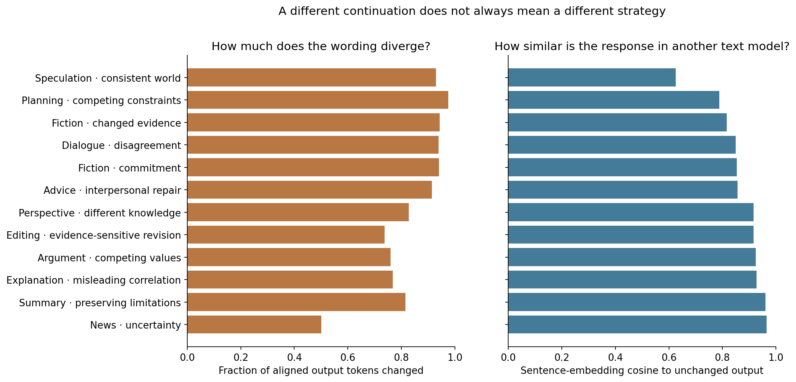
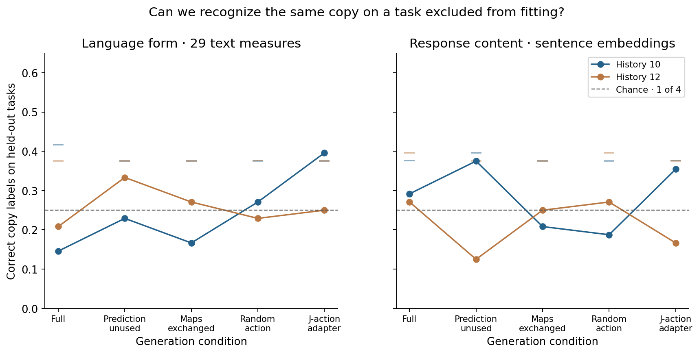
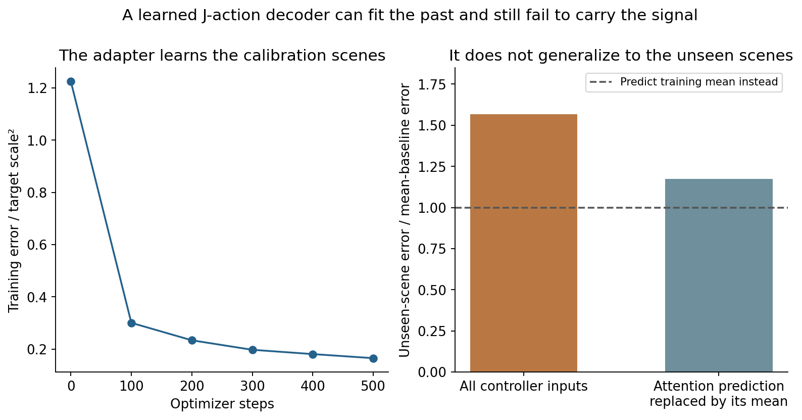
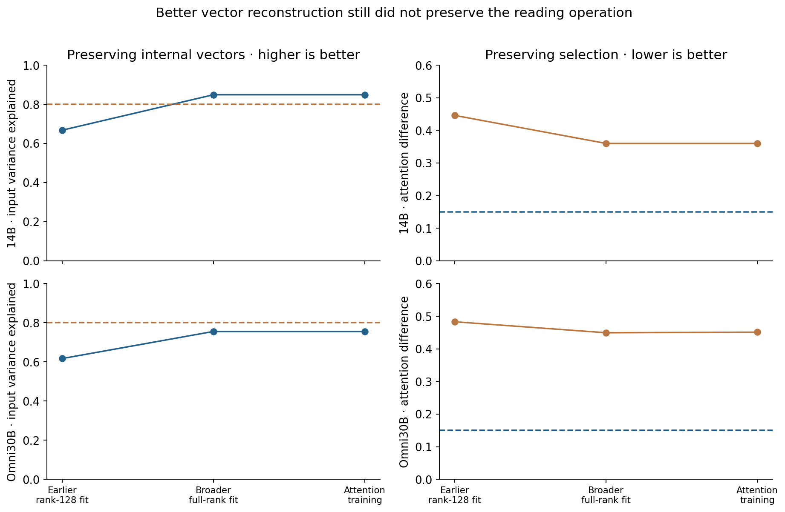
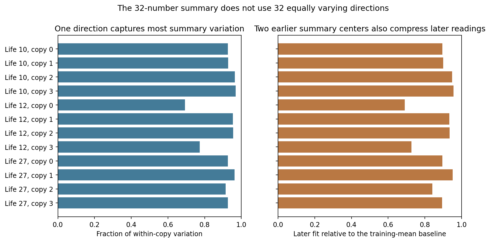
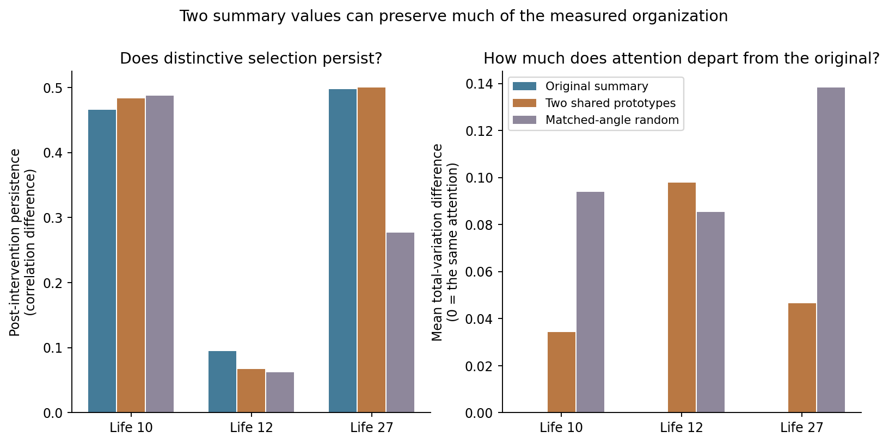

# Expanded behavioral and interface experiments

These results were produced for this revision. Their purpose is to distinguish changing text from a durable change in the controller's way of behaving, and to test concrete interfaces rather than assume that similarly named spaces perform the same operation.

## Twelve task types, with matched comparisons

The earlier pilot had two stories. The expanded study includes commitment under an obstacle, responding to contrary evidence, a disagreement in dialogue, factual news, causal explanation, constrained planning, interpersonal repair, competing public values, different beliefs, speculative fiction, study summarization and correction of an overstated scientific claim.

Histories 10 and 12 were chosen because the existing case studies gave them different strengths: stronger persistence versus stronger limited vocabulary-group results. Their complete controller snapshots are taken at reading 3,000. Each prompt starts a fresh model context and restores the same developed controller snapshot; this is not one uninterrupted language-model life across all twelve tasks.

Each task is run from those two developed controller histories, with four copies in each history. Five conditions are compared: the full controller; the attention prediction learned but unused; prediction maps exchanged between copies 0 and 1; matched-size random actions; and the new trained J-derived action adapter. This produces **480 controller outputs**. There are 24 matched task/history comparisons but only **12 unique unchanged-model outputs**: the zero-action row is exactly identical across the conditions and histories for each prompt, after removing finished-row padding. Repetition of that row is a useful implementation check, not extra independent evidence.

All conditions use sampling stream 101, temperature 0.8 and top-p 0.9. Each response is bounded at 220 generated tokens. The added route remains off while old recorded history is flushed; its size calibration uses fresh prompt steps 32–63, and action starts after step 64. This corrects a weakness in the old pilot. The context is native full context, with the base model frozen.

The gain calibration is condition-specific and averages the four controller rows. Consequently, an exchange can also change the common calibrated gain. Copies 2 and 3 are not strict untouched controls for that exchange. The fifth, zero-action row is the verified unchanged comparison. The study tests the specified operational conditions; it does not isolate schema content while holding every action magnitude fixed throughout generation.

## Much different wording can preserve the same response strategy

The left panel counts the fraction of aligned output-token positions that differ from the unchanged model, averaging copies and histories in the full condition. Planning differs at about 98% of positions; news at about 50%. A different early sampled token can alter many later positions, so these large fractions must not be described as percentages of changed meaning.

The right panel provides a separate comparison using the pretrained [all-MiniLM-L6-v2 sentence model](https://huggingface.co/sentence-transformers/all-MiniLM-L6-v2), with its exact revision stored in `semantic_comparison.json`. Responses are encoded independently, and the cosine between their normalized representations is measured. One means identical embedding directions; it is not a claim that two passages share 100% of their meaning. The model can miss a consequential factual or decision difference.

News and study summaries remain comparatively close to the unchanged outputs, around 0.96 cosine. Causal explanations are also close, around 0.93. Imaginative fiction is much less similar, around 0.63, while planning is around 0.79. The two measurements therefore identify different aspects of change. Planning has more aligned-token divergence than imagination, while imagination differs more in the independent content representation.

Inspection explains some of this distinction. In the ice-cream example, the causal structure remains hot weather → more ice-cream purchases and swimming → more rescues. The controller changes wording and examples of omitted factors. In the planning example, it can change an actual fallback: an inspected controller has the remaining volunteer handle both jobs, while the unchanged response assumes another person can be recruited. Both inspected controller plans still omit an allocation of the stated budget.

Random action also produces substantial changes; across these outputs its mean embedding similarity to the unchanged model is comparable to the full controller's. This is not a powered equivalence result. It shows why producing a visibly different text is insufficient to identify a special contribution of the learned attention model.

## Decision changes are visible, but do not form one clear cross-task outlook

The sensor scene gives a particularly concrete comparison. With history 10, copy 0 asks for delay and another check. With history 12, copy 0 objects to the rising heat but appears to yield to the manager. The unchanged model moves toward shutdown. The action taken differs, rather than merely the number of emotion words. Yet the two developed histories do not support one direction such as consistently greater caution or deference.

The speculative-fiction scene shows why novelty needs a fidelity check. The prompt allows a ten-minute loan of skill with a temporary loss for the lender. History 12 copy 0 changes this to losing the skill “forever,” and develops the consequences of that new rule. This is a substantial content change, but the inspected example is a violation of the premise. A more dramatic imagined cost cannot automatically be counted as better imagination.

The scientific-claim editing task exposes a different failure. Several responses, including the unchanged output and both histories' full-condition copy 0, replace “proved” with “demonstrated” while retaining universal water safety and “no further checks.” Their explanations call this more cautious and accurate. The inference has not actually been repaired. Some other copies narrow part of the claim, so we do not describe all outputs as identical failures. The complete comparisons remain available. The important diagnostic is to inspect the rewritten assertion separately from the explanation of why it is supposedly better.

The explorer now provides a task-specific review for each of the twelve prompts: what question it tests, an inspected comparison, its interpretation, and what to check in the pair. Those reviews concern full-condition copy 0 across the two histories. They are not automatic descriptions of every selected condition or every copy.

## Can text reveal a copy's identity on a task excluded from fitting?

A stronger claim than “these continuations differ” is that the same copy carries a recognizable tendency into different kinds of task. We tested a limited, concrete version of that claim.

For each history and condition, a nearest-centroid classifier is fitted on eleven complete tasks: it computes an average text-feature template for each copy and assigns a new response to the closest template. It receives either 29 text-form measurements or the 384-number sentence embedding. It then tries to identify copies 0–3 on the excluded task. We repeat this for every task. Features are centered within each task across the four copies, without using their labels; scaling is fitted on the training tasks. This makes the assay about relative copy signatures rather than simply recognizing the genre. Shuffling copy labels independently within each task gives 400 comparison runs.

The vertical axis is the fraction of correct copy labels. Chance is one in four, or 25%. Colored lines are the two histories; small horizontal ticks show each comparison's 95th-percentile shuffled-label result. In the full-controller condition, surface-form accuracy is 14.6% and 20.8%; embedding accuracy is 29.2% and 27.1%. None exceeds its shuffled-label comparison. An isolated J-adapter surface result in history 10 has an unadjusted shuffle probability around 0.035, but does not repeat in history 12 and does not survive accounting for the twenty inspected comparisons.

The result is a meaningful separation: the recorded controller has persistent internal selection differences, but these probes do not recover a reliable copy signature across generated task types. This does not prove that no more sophisticated or differently expressed tendency exists. The assay uses selected histories, one sampling stream, a simple recognizer and imperfect text representations. It does show that the present evidence does not justify converting internal persistence into a public claim of a recognizable task-general personality.

## What happened to the 120-concept screen?

The catalogue includes 80 observable properties spanning language, narrative, imagination, emotional tone, interpersonal conduct, reasoning and task success; 30 deterministic language measures; and 10 internal-dynamics measures. Every item has an operational definition. The catalogue does not assume that each item will change, or that these are independent mental capacities.

The first automatic pass asked Qwen3-14B for all 80 ratings at once. It produced repetitive, malformed arrays. That pass was stopped and excluded. The replacement presents eight properties at a time, hides condition/history/copy labels, and asks for an evidence phrase. It passes a minimal anger/no-anger sentinel and produces 1,440 valid groups, or 11,520 ordinal scores, covering prespecified copy 0 plus the baseline for all task/history conditions.

Passing the sentinel did not validate the larger screen. Exactly 720 groups have evidence strings that are not exact response passages. Some are paraphrases; others are generic descriptions or unsupported explanations. Inspection also found a fiction-specific property scored on factual summaries. The largest numerical rankings therefore cannot be promoted to established changes in imagination, emotion or personality. They remain inspectable leads, with the scoring failures recorded. All four copies still have deterministic and internal measurements; semantic ratings cover copy 0 only.

This is why the guided results use actual decision differences, explicit premise violations, text comparisons and the cross-task assay instead of converting a large property table into a psychological profile. A trustworthy follow-up would validate task applicability, require grounded evidence for each judgment, and use independent human review or a separately qualified evaluator on the key contrasts.

## Fine-tuning a J-derived action interface: the attempted decoder does not generalize

The new adapter is a real supervised training experiment with a frozen language model. Its input concatenates the eight-number stance, 32-number reading summary and 256-number predicted attention pull. It predicts 128 coefficients in a J-derived action basis, then maps those coefficients back into model activity. No desired character, emotion or identity is a training label.

Here, J refers to a Jacobian: a linear approximation of how a small internal change affects later processing. The J-lens averages that relationship across contexts to associate internal directions with potential word outputs. In the [source paper](https://transformer-circuits.pub/2026/workspace/index.html), J-space uses sparse positive combinations of a small number of such vocabulary directions. Our fixed, signed 128-dimensional linear basis is a different approximation. Neither the name nor the approximation demonstrates broad availability to multiple reasoning functions, which is the workspace claim that would need testing.

The basis is constructed from 4,096 deterministically sampled, normalized vocabulary directions using the centered unembedding, final normalization weights and the layer-15 J-lens. Its 128 directions retain 77.6% of the sampled dictionary's squared energy. That percentage concerns the sampled dictionary, not the percentage of a real action's meaning retained. This is also not the earlier full-vocabulary sparse J-part decomposition.

Six complete authored situations supply 2,080 correlated copy-step training samples. Two different situations supply 616 test samples. The unit of situation diversity is six plus two scenes, not thousands of independent examples. The objective is to reconstruct the reference selected-content action after projection into the basis.

The left panel shows falling training error. The right compares unseen-scene squared error with simply predicting the training mean. One on the right is that baseline; lower is better. The trained interface has about 1.57 times the baseline error, equivalent to centered R² −0.568. Replacing the attention-prediction input by its training mean improves the ratio to about 1.17, still worse than baseline. Mean directional cosine is 0.389, so some alignment exists without adequate reconstruction.

This interface has learned patterns in its calibration scenes but has not become a faithful general route for the reference signal. The attention-prediction input does not demonstrate a beneficial role in this adapter's held-out reconstruction. This is not evidence that the schema is useless in the original controller. Possible causes include overfitting six situations, insufficient regularization, and trying to reconstruct context-specific model content from compressed controller variables. The test does not distinguish those explanations completely.

The trained adapter was nevertheless deployed as an explicitly exploratory condition, matched to the reference action's norm. Its behavior is available beside the other four conditions. Because the decoder fails fidelity and there is no exact-projection deployment control in this run, output differences cannot isolate an advantage of training or global-workspace fusion. This is a failed candidate interface, not a replacement for the preserved reference model.

## Further training of the larger-model bridges

The old bridges used a restricted rank-128 fit from one early stream. We trained broader full-rank, regularized maps using all four actual early histories, standardized inputs, and a separate validation segment to choose among three regularization strengths. We then evaluated on the later segment used by the previous bridge. This reuse makes the requalification exploratory, rather than fresh confirmation on an unseen corpus.

For 14B, input fit improves from about 0.668 to 0.849. Reading-summary and destination cosines are about 0.964 and 0.957. Yet mean attention difference remains 0.360, above the allowed 0.15. For Omni, input fit rises to 0.756 and the attention difference remains about 0.449. The required operations are still not preserved.

We then trained each key map for 600 AdamW steps against the actual attention distribution, while retaining a key-reconstruction penalty and freezing the value map. Training used only early windows; validation chose the checkpoint. Query perturbations also exercised the broader feature space used by habit and prediction, rather than checking only stance queries. Training loss fell, but validation attention did not improve materially. The final 14B attention difference remained about 0.360, and Omni about 0.451; broader-query checks also failed.

The concrete lesson is that a high average vector fit and a close compressed summary can conceal substantial errors in which positions receive attention. Agreement after compression can therefore conceal disagreement in selection. A successful port needs its operation checked directly, including the query conditions it will encounter. More training on the same early contexts was insufficient here. No larger or multimodal population was interpreted through these failed maps.

## A 32-number summary can behave as a much narrower bottleneck

The synchronized trajectories prompted a new question: are the 32 summary coordinates actually carrying many independently varying aspects of the reading? We examined the full-dimensional signals, rather than infer this from an attractive projection. Across the twelve copies in the three selected lives, the largest single linear direction carries about 69–97% of within-copy summary variation. Two earlier summary centers reconstruct about 69–96% of later variation relative to a training-mean baseline. These are descriptive compression results, not a count of concepts or proof of a two-state whole system.

In the left panel, one direction would capture all variation if the summary moved along a single line. In the right, we fit two representative points using readings 300–1399 and assign each later summary to the closer point. A high score means that two points fitted earlier approximate much of the later signal. It does not establish what that distinction means. An attempted interpretation as a simple story/dialogue versus informational split does not cleanly fit the genre pattern, so we do not give the two points psychological names.

We then tested the bottleneck causally. Two prototypes were fitted **jointly across all four copies**, so the codebook could not give each copy its own pair of identity-bearing vectors. From reading 1,700 onward, the normal summary was replaced by the nearer prototype before computing the stance-update direction. A random comparison changes the summary by the same conditional angle to that nearest prototype, while preserving its original norm. The stance, habit and attention map continue to operate and learn. Every branch matches the prior stance exactly before the intervention.

The left panel measures persistence only in readings 1,700–2,999. Life 10 changes from 0.466 to 0.484 with two prototypes, while its random branch is 0.487. Life 12 falls from 0.095 to 0.068; the random branch is 0.062. Life 27 remains near 0.498–0.500 with prototypes but falls to 0.277 under the random comparison. These are three selected cases, without a population confidence claim.

The right panel checks whether similar persistence hides different attention. Prototype replacement departs from original attention by about 0.034 in life 10 and 0.046 in life 27, compared with 0.094 and 0.138 for random distortion. Life 12 is a counterexample: prototype replacement changes attention slightly more than the random branch, 0.098 versus 0.085. The random angle is matched conditionally in each branch's current state; this is not a guarantee that accumulated distortion is identical after their trajectories diverge.

The concrete insight is that, in two of these cases, a choice between two shared summary values retains much of the measured reading organization. The other modules still store substantial private history, so this does **not** make the entire controller a one-bit system. It does show why the width “32” cannot be presented as evidence of a rich, many-faculty self-image. Persistent selection can survive a severely simplified intermediate summary, and the persistence score alone can miss substantial changes in attention. A stronger rich-emergence claim needs capacities that this reduced control actually loses.

## What this changes in the public interpretation

The reference remains an inspectable history-dependent attention controller with a causally used partial model of attention. The new study adds a clearer behavioral boundary: it changes generated decisions and text in particular situations, but the present cross-task test does not establish a recognizable output identity. It also identifies two concrete interface failures that aggregate scores would have hidden: overfit reconstruction into a J-derived basis, and larger-model vector alignment that does not preserve selection.

Those findings sharpen what to build and test next. A J route needs context-sensitive content preserved on held-out situations; a native larger reader needs functional attention fidelity rather than a flattering summary cosine; and a claim of durable tendencies needs repeated, task-crossing behavior beyond random steering. Qualified full multimodal deployment and crossed controller-history/LLM-context transfers remain incomplete. The coverage audit names these explicitly rather than counting failed qualification as their completion.

All cloud outputs and checkpoints were retrieved with SHA-256 receipts. The owned rental was destroyed and absence verified. The rental and traffic balance change was approximately $0.89. Nothing was uploaded to GitHub or Hugging Face.

---
Wiktor Tomasik · measurements: 1 November 2026 · publication updated: 2026-11-01T23:52:27+01:00
