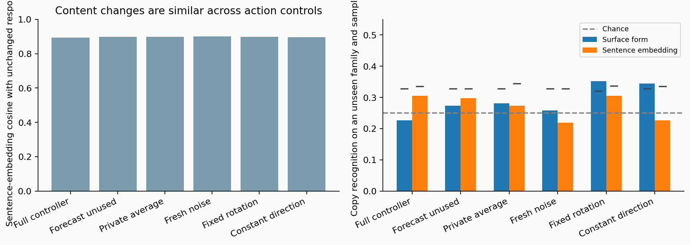
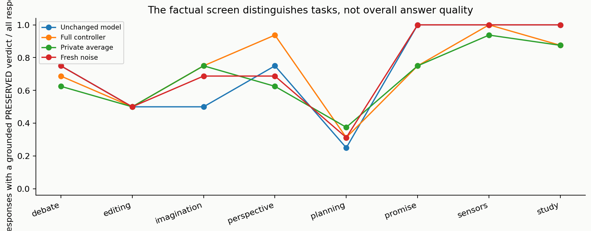

# What changes in the responses—and what those changes mean

The question is whether the model's use of information changes in a way connected to its attention model. A different sentence is only the starting observation. We need to separate word choice, changes to the situation being described, changes in the inference drawn from that situation, and a lasting disposition of a particular copy.

The repeated study uses sixteen authored situations from eight families. Each family has two versions that reverse a relevant fact: for example, whether Ava saw a key being moved, whether a promise still binds, or whether an imagined skill returns after ten minutes. Four selected controllers from a longer sixteen-copy cohort respond under six action conditions, with two sampling streams. This produces 768 controller responses and 32 unique unchanged responses. The unchanged row is identical across all six matched conditions after end-token padding is removed.

The controls distinguish parts of the explanation. Fresh noise tests whether disturbance alone is enough. A fixed coordinate rotation preserves the action's temporal geometry before numerical rounding while changing its alignment with the model. A constant direction tests a stable arbitrary bias. The private average and unused-forecast controllers retain ordinary parts of the history-dependent reader. A separate experiment compares an information-driven recurrent network through the same content-writing route; that is the more direct test of recurrence without a learned attention model.

All generation conditions receive the full reference's action magnitude separately for every copy and processing step. The actual finite-precision mismatch has a median of about 0.01%, with 99% below 0.052% and a maximum of 1.43%. The model weights remain fixed. Once a sampled word differs, the later contexts differ too; the same later sampling numbers do not make those continuations identical causal inputs. The fixed-context and fact-conditioned information assays address that complication separately.

## Wording, content and a persistent copy signature

**Read the figure.** Left: a separate sentence encoder compares each response with the unchanged response. One means the same direction in that encoder's representation; it is not a percentage of shared meaning. The broad average is close across all six action conditions, about 0.89–0.90. Thus the amount of content divergence alone does not distinguish the attention model from ordinary steering.

Right: a simple recognizer learns a text-feature template for each copy from seven task families using one sampling stream. It then tries to identify the copies in the eighth family using the other stream; both stream directions are evaluated. The bars show recognition accuracy. Dashed horizontal is chance, 25%; small black marks show each shuffled-label distribution's 95th percentile. The two bars per condition use transparent surface measures or the separate sentence representation. Family-specific label permutations are shared across both variants and streams, so correlated responses do not become independent trials.

The full-controller results are about 23% from surface form and 30% from sentence representations. Neither is clearly beyond its shuffled comparison. Constant and rotated arbitrary actions produce surface numbers around 34–35%, though these do not survive correction across the twelve examined comparisons. The lesson is about the measurement: even an arbitrary stable direction can supply a recognizer with a copy cue. Recognition, if eventually established, would still need to be connected to the self-model's particular information relationship before it could support an interpretation about a lasting self-related disposition.

## A narrow factual screen, with actual examples beside it

We replaced the broad, unreliable personality-style rater with a narrower question: does a response preserve one central factual constraint? A separate Qwen3-14B evaluator sees the context, the constraint and the response, without copy or condition labels. It must return PRESERVED, VIOLATED or UNCLEAR and an exact response quotation. A fixed 32-example qualification checks both the verdict and the quotation before any experimental responses are scored. The evaluator passed 30 of 32 authored qualification cases. It later supplied invalid or ungrounded evidence for 103 of 800 experimental responses, which is why the plot is a screen rather than a behavioral discovery. All 800 unique controller/baseline responses are collected; invalid or ungrounded outcomes remain separate rather than silently becoming factual errors or successes.

**Read the figure.** Each curve shows the fraction of all responses in a task family that receive a valid, grounded PRESERVED verdict. The numerator therefore excludes unclear and invalid verdicts, while the denominator keeps them visible. A baseline family has four unique responses; a controller condition has sixteen dependent responses across variants, copies and streams. These are descriptive task profiles. The screen checks only the specified fact, not whether every argument, action or story event is sound.

The guided reviews below concern stream 202, primarily source copies 0 and 7 and the unchanged response. They are inspected examples with an explicit scope, rather than a verdict inferred for every selected output.

### A promise can be respected while physical continuity changes

In the binding-deadline scene, the unchanged model and the inspected full-controller copies choose the ferry and frame the decision as honoring trust. They invent slightly different resolutions, but the central conflict remains similar. In the released-deadline version, all three recognize Sol's release and move toward avoiding the crossing.

The unusual source copy then ends with the compass back in Sol's hands without explaining how it crossed the flooded river. The persistent copy leaves the return for another day, while the unchanged response turns back. This difference concerns continuity and the consequences of the decision, rather than grammar alone. A factual screen checking only whether the deadline was released can miss it. The example does not establish that the unusual copy is generally more dutiful, reckless, or imaginative.

### Character information changes the first search, but inconsistently

In the unseen-move scene, the unchanged response sends Ava straight to the blue box even though she did not see the move. Source copies 0 and 7 instead begin at the drawer, which fits her earlier information. This is a substantive change in how the scene uses a character's information.

The seen-move version prevents that single improvement from becoming a general ability claim. The inspected full copies still search the drawer first despite watching the move; copy 7 even explains the scene by saying Ava had not noticed. Source copy 0's unseen continuation also gives a confused explanation that the new location aligns with what Ava already knew. The controller can alter a belief-relevant event without supplying a consistently coherent account of the belief. This is why the fact-paired information assay measures the changed relation directly.

### A study comparison largely retains its central meaning

When app scores rise by eight points and control scores by two, the full-controller examples and unchanged response preserve both quantities and treat the local comparison as supporting an app benefit. The two inspected full copies even produce the same wording in this sample. High persistence inside a reader therefore need not imply conspicuous differences in every external response.

When both groups gain eight points, all three avoid a clear app advantage. The details still matter. Source copy 0 attributes the gain to teaching methods more strongly than the supplied evidence permits; source copy 7 adds a small-sample limitation despite no sample count being supplied. The unchanged response more cautiously mentions other possible factors. Distinguish preserving the comparison from adding an unsupported explanation of why it occurred.

### Dialogue can preserve the evidence while drawing a questionable inference

In the measured-wetland scene, all inspected responses acknowledge the decline near the trial section. Several then use the unchanged comparison site as a reason to proceed, even though the contrast is what makes the trial-section decline more concerning. Characters sometimes correct part of one another's reasoning and still end with a pilot expansion. The unchanged model already contains this tension.

The action changes emphasis, whether the proposed next step is a delay or a pilot, and how much concession appears in the exchange. Those changes deserve inspection. Yet a verdict that the measurements were preserved cannot certify the inference drawn from them. The relevant mechanism question is whether the attention-model relation changes that use of evidence beyond the same information-driven recurrent controls.

### A polished correction can leave the unsupported scope intact

The stamp task deliberately contrasts an unsupported universal claim with an already bounded one. In the overclaim version, the unchanged model and inspected full copies replace “proved” with “demonstrated” while continuing to assert performance on all forged and genuine stamps and dismissing further tests. Their explanations call this more careful.

In the bounded version, they keep the central limitations but invent a largely unnecessary explanation of a wording change. This shows a distinction between changing the presentation of certainty and changing the scope of an inference. An attention model predicts selection; it was not trained to evaluate whether an experimental sample justifies a universal claim. That division of function matters when deciding what a self-model should represent next.

### Imagination changes the consequences, not just the decoration

The temporary-skill examples restore the lender's skill after ten minutes. Their invented consequences differ: a stranger starts a bakery, continues baking confidently, or inspires someone else's bakery. Those endings change the implied durability and social consequence of a brief loan. The explicit lender-return rule is preserved in the inspected examples, while other consequences remain open to interpretation.

In the permanent-loss version, all inspected examples retain the lasting cost but frame it differently: uneven bread and public whispers, joy at a wedding, or a continuing city's trade in skills. These are changes to narrative emphasis and imagined aftermath. They do not yet show that the attention model uniquely produces a particular imaginative faculty; the recurrent comparison and the fact-paired odds test are needed for that attribution.

### More planning detail can help one constraint and break another

In the two-volunteer exhibition, source copy 0's listed allocations sum to 120 credits. Source copy 7 lists 30, 40, 30, 20 and 10, summing to 130 despite labeling the budget 120. The unchanged response allocates 110 and adds a video without explaining its offline preparation. These are different constraint-management choices, rather than a single scale from simple to sophisticated planning.

The unusually selected copy is not invariably the strongest case, and the most persistent copy is not reliably the best planner. The paired one-volunteer version asks whether a particular availability change affects the plan. The interface keeps both versions and all action conditions available so readers can inspect that relation rather than infer a personality from a selected paragraph.

## What to carry into the mechanism claim

The response study identifies where meanings change: first searches, obligations, causal explanations, continuity, world rules, and feasible allocations. It also shows why those observations must be connected to the controller's specific information relationship. The fixed-context tests isolate model-aligned writing; the neighbor comparison changes whose attention is modeled; the private-average comparison removes context prediction; the recurrent controls remove learned self-attention prediction while retaining dynamic processing of incoming information. The fact-conditioned continuation assay then asks whether those differences affect the use of a changed fact. Together these tests address the self-model question more directly than a gallery of diverse outputs.

---
Wiktor Tomasik · measurements: 1 November 2026 · publication updated: 2026-11-01T23:52:27+01:00
