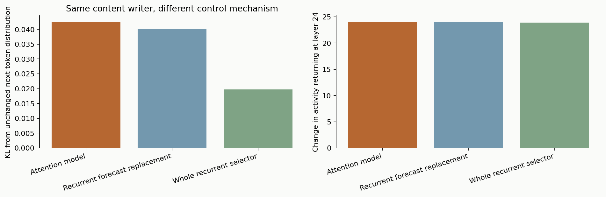
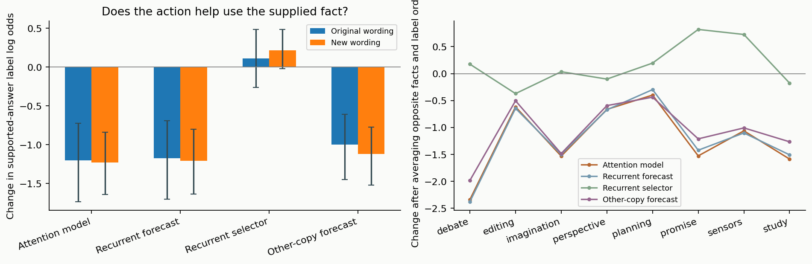

# What belongs to the attention model, rather than recurrence alone?

A chaotic or recurrent controller can create a changing state, select different parts of model activity and alter generated text. Those observations do not identify a contribution from modeling attention. The distinguishing relationship in this architecture is concrete: the attention map is trained to predict the difference between **this copy's** selected content and the ordinary average. Its prediction then becomes part of the next query that determines selection.

We investigate that relationship through complementary controls. Another-copy prediction preserves a learned attention map while changing whose attention it describes. A private average preserves memory of a copy's attention while removing changing context prediction. A generic recurrent filter preserves dynamic processing of incoming model information while removing the learned prediction target. A rotation of the final action preserves its temporal geometry while breaking its alignment with model coordinates. These controls remove different parts of the proposed explanation; none alone establishes a rich self-model.

## A recurrent comparator that reads and writes the same kind of information

The new comparator has 64 recurrent state values. Fixed random matrices map the same 16-number context signal into that state and map the state into a 256-number query direction. A nonlinear update makes its next state depend on both its previous state and current model information. Its weights are shared across copies and never trained to predict attention. It is therefore more demanding than adding a random direction directly to the language model: it responds to information, has memory, and selects real content through the same attention and writing interface.

Before examining its language outputs, we ran it through the same 16,720-reading history as the four selected source controllers. Small state differences grow under the shared input, with a measured conditional Lyapunov exponent around 0.02 per reading, and the final copy states remain distinct. The exponent measures sensitivity to a nearby state under that recorded input. It qualifies the comparator as having a chaotic response there; it says nothing about awareness or semantic richness, and it is not a claim about every later live context.

We use it in two ways. **Recurrent forecast replacement** substitutes its direction for the attention forecast, retaining the original stance, habit and reader. **Whole recurrent selector** replaces the entire changing query contribution, so the stance, habit and learned attention map no longer guide selection. The fixed reader and content-writing route remain the same. The latter control still closes the physical loop through the language model: its selected action changes the model, whose subsequent activity changes the recurrent state. What it lacks is a learned model of its own attention.

Both controls receive the full reference's query strength and final action strength separately for every copy and step. This is an intentionally generous, experimenter-supplied magnitude control: it tests the directions without allowing a quieter or louder perturbation to decide the outcome. It is not presented as an independent deployment that could generate the reference strength stream by itself. The recurrent filter also has a different parameter count; this is a mechanistic control, not a contest proving optimality among all possible networks.

## The trained selector's influence is not explained by the final writer alone

**Read the figure.** The same unchanged native context and cache are used for all three branches. Every action has the full reference's measured size and writes a difference of selected model content. Left: change in the next-token probability distribution, measured by KL divergence; zero means the same distribution, while larger means more influence. Right: the size of the resulting change in model activity returned to the layer-24 reader. The probes occur after the relevant fact in each scene. Means describe sixteen authored scenes, with nested positions and copies.

The full controller and recurrent forecast replacement have very similar average influence: distribution changes around 0.043 and 0.040. Replacing the entire selector gives about 0.020, although the returned activity distance is near 24 in all three branches. Thus equal-sized model changes can have different effects on predictions. The source of the selected direction matters. At the same time, removing the learned attention forecast alone preserves much of this language-model influence. These two observations locate the effect more precisely than attributing everything to either “a self-model” or “just chaos.”

The continuing response experiment adds 384 controller outputs using the same sixteen situations and two sampling streams. Overall sentence-embedding divergence from the unchanged response is similar for the full controller, recurrent forecast replacement and whole recurrent selector, around 0.88–0.89 cosine. A stronger immediate distribution change therefore does not automatically mean a more distinctive final story: sampled continuations amplify differences through several routes. The matched text panels retain all cases rather than selecting only dramatic endings.

The earlier ownership and exchange interventions remain important here. They show that whose attention is predicted affects the controller's continuing organization. The recurrent comparison asks a different question: how much of the action's influence on the language model specifically requires that prediction. An effect on internal organization need not supply a unique semantic policy in generated language.

## Testing the use of a changed fact

We then give the model two opposite versions of each situation and ask which conclusion follows. For example, Ava either watched the key move or did not; the supported first-search location changes accordingly. Neri either remains bound by a deadline or has been released; the supported statement about the obligation changes. Equal gains in a study do not support the same comparison as unequal gains. These are tests of how the action interacts with supplied information, not prompts asking the language model to describe itself.

The answer alternatives are explicitly listed as A and B. Their label order is reversed in a second presentation, so a fixed preference for A cannot masquerade as correct information use. Each situation is also reworded while preserving its facts and alternatives. The model receives one matched action at the last prefix token; we measure how it changes the odds of the supported single-token label relative to the unchanged model. Opposite facts, reversed labels and fresh wording make this substantially more diagnostic than counting changed output tokens.

The shared zero-action context is computed using native bulk prefill. Every controller consumes the resulting observations in sequence, retaining its ordinary state updates. Only the final prefix token receives an action. All branches therefore start from the same model context and receive the same information before the causal intervention. This setting isolates a local influence; it is distinct from the continuing actions in free response generation.

One additional condition replaces the forecast with another source copy's forecast at the same strength. This preserves a learned attention prediction while changing its relation to the receiving copy. The combined comparison asks whether information use depends on this own-attention relation beyond arbitrary context-driven recurrence.

**Read the figure.** Left: each bar is the change in the supported answer's log odds relative to the unchanged model. Positive favors that answer more; negative favors it less. Zero means no change. The two bars show the original and reworded situations, with the answer labels reversed and averaged in each. Whiskers resample eight complete task families; copies and label orders are nested observations. Right: the same changes broken down by family. A fixed preference for A or one particular proposition cannot by itself explain a positive fact-paired score.

The supported label is already preferred in 62 of 64 unchanged presentations. All presentations pass the prespecified answer-format check, and the acted branches also retain sufficient probability on the offered labels. Across four copies, the full controller changes only one of 256 choices relative to the unchanged row. Its main effect here is to soften an existing preference, rather than replace the chosen answer. An illustrative margin of 10 becoming 9.4 still strongly favors the same answer; a visibly large log-odds shift is not a percentage-point gain or loss in accuracy.

That softening is similar with the recurrent forecast replacement and recurs with fresh wording. A simple scale fitted on seven families predicts about 59% of the full controller's squared margin changes on the eighth: the existing binary-answer margin is multiplied by roughly 0.94. This is a control for changes in these label margins, not proof that the entire output distribution has merely changed temperature. Replacing the whole selector produces a substantially different margin profile, close to zero on average. Thus the learned, history-shaped selector matters, while its effect must not all be credited to the attention forecast's detailed direction.

Changing whose forecast is used has a smaller effect: the own forecast softens the supported-answer margin about 0.15 log-odds units more than the other-copy forecast on average, with the same mean direction in both wordings. This is a relational intervention on the attention model. It is not an improvement in fact use, and it does not establish a self-model-specific semantic policy: the recurrent forecast replacement reproduces most of the larger effect, and much of the margin change has a simple scaling description.

The magnitude control matters to that inference. The recurrent replacement receives the reference forecast's changing **strength**, so this assay isolates detailed direction conditional on that strength. It does not show that every scalar consequence of the attention model can be removed without effect. The complete replacement also receives reference query and writing magnitudes. Together with the private-average and unused-forecast tests, these controls identify where richer claims need to be demonstrated rather than assuming that recurrence or a self-related name supplies them.

The resulting insight is a division of function: modeling whose attention is involved helps organize the controller's own continuing selection, whereas much of the present language-level effect comes from the retained selector and its aligned writing route. This is the meaningful boundary to carry into another design. If the next model should regulate its own impact on reasoning, it needs a demonstrated use for that information beyond sustaining a private reading pattern.

An earlier complete-string likelihood assay is retained in the evidence archive. Its alternatives differ in length, so raw preferences between those strings are not treated as answer accuracy. The counterbalanced single-label assay is the main information-use test. The broad automatic personality screen and the narrow factual rater do not supply its scores.

## How to interpret a self-model-specific result

The target claim is an interaction: changing whose attention is represented should change how the system uses incoming model information in a way the recurrent controls do not reproduce. Merely moving through many states, producing diverse stories or influencing predictions more strongly is insufficient. Conversely, the absence of an average accuracy gain does not make a causal relation uninteresting; an attention model might organize or regulate processing without making every answer more accurate.

The architecture currently models a particular aspect of itself—its selection of content. It is not trained to identify which changes in the language model were caused by its own action. Facts about a story character's knowledge are also not the controller's own self-knowledge. The experiments keep these levels distinct so that a specific learned relation can be understood without turning its name into a claim about consciousness.

---
Wiktor Tomasik · measurements: 1 November 2026 · publication updated: 2026-11-01T23:52:27+01:00
