# One reader, many histories: what changes, why it changes, and what we can conclude

Research synthesis by Wiktor Tomasik. Measurements completed 1 November 2026. Start here for the mechanism and main conclusions. The explorer presents the same evidence with clickable architecture views, guided examples and synchronized measured paths. Detailed new methods and results are in [the expanded studies](NEW_RESULTS.md), [the longer-run and action-pattern investigation](SPECIFICITY_REPORT.md), [the repeated-response analysis](PATTERN_BEHAVIOR.md), and [the self-model versus recurrence comparison](RECURRENCE_REPORT.md).

## The question this system makes testable

Can a small system develop a persistent way of selecting information, learn something about that selection, and use what it has learned to influence its subsequent processing? More specifically, does it matter that its learned description concerns **its own** attention rather than another copy's attention?

These questions are easier to ask than to test. Four readers might differ simply because they received different texts. A state might persist because it is almost frozen. A predictor might appear accurate because attention barely changes. An intervention might change behavior merely because any sufficiently large disturbance would do so. The experiments in this report address those alternatives separately.

The strongest finding is a controlled separation. Exchanging specific learned attention predictions usually makes developed copies more alike, and restoring them often partially repairs the change. The model-aligned content actions also influence the language model more than equally sized noise or rotated actions on identical text. Yet a simple private average preserves much of both organization and live influence. Longer lives and fixed-direction controls strengthen that caution. The architecture supplies a real, inspectable feedback mechanism; these endpoints do not uniquely require a detailed context-sensitive self-model.

That last comparison is an important result, not a footnote. It separates three things that were previously easy to conflate: accurately predicting attention, maintaining a distinctive reading habit, and possessing a detailed representation of oneself. The current system demonstrates parts of the first two. The third requires more evidence.

## What actually runs

The reference uses Qwen3-8B and a small, fixed neural reader. At each step, the reader sees the model's internal activity for the most recent 16 token positions. A token can be a word, a word fragment, or punctuation. The reader assigns different weights to those positions, combines the selected activity, and compresses the result into 32 numbers. That summary determines a direction used to update an eight-number persistent state, called the **stance**. The next selection depends partly on that stance.

The four copies share the same reader weights and initial stance. During the first 256 readings they receive different text histories. Thereafter, in the recorded experiments, they receive the same model activity. This change is deliberate: after the warm-up, continuing differences cannot be attributed to four continuously different input texts.

There are two additional learned components. A **habit** slowly changes the connection from stance to selection, using what the copy has actually attended to. An **attention schema** learns to predict which direction the copy's selected activity will differ from an ordinary average of the window. Its prediction is added to the next selection query. A query is the vector used to score how relevant each recent position is. Thus the prediction can become part of what determines attention, rather than remaining an observer's description.

“A learned way of looking” refers to those concrete changes in the selection rule. It does not mean that we gave the model a verbal instruction such as “be curious,” or that it necessarily has an articulated opinion about itself. A **neighbor schema** is a prediction map learned from another copy's attention. An **exchange** makes copies 0 and 1 use each other's maps. Their stances, habits, and input text are not exchanged at the intervention point.

The initial reader was trained earlier in a game that rewarded distinguishing copy dynamics. Its geometry is therefore shaped by a designed objective. The later lives do not receive desired personality labels, but they also do not begin with an unstructured blank reader. Claims about emergence must retain that distinction.

### Recorded and live operation answer different questions

In **recorded operation**, the language model has already produced the activity sequence. The reader's choices can change its own future state, habit and schema, but cannot change the language model's activity. This allows controlled comparisons on identical input. It is appropriate for asking what maintains differences inside the added system.

In **live operation**, the language model is running. The controller compares its selected content with a stance-free reference selection, turns their difference into an action, and adds that action inside the language model before layer 16. The controller then reads activity after layer 24. The intervening model layers transform the action before its consequences return to the reader. This route can affect predictions and generated text. It also introduces a complication: a copy may begin attending to the changes it caused itself.

The historical live milestone used a cropped context/cache. The new behavioral screen uses the native model's full context. The zero-action hook reproduces that native model exactly, but this does not make the two context implementations identical. The explorer now shows separate diagrams for these two operating modes and identifies the generation implementation explicitly.

## What the dimensions do—and why those components exist

The sizes describe the interface, not a discovered inventory of mental faculties.

| Component | What it physically does | Why it was included | A useful functional analogy, with its limit |
|---|---|---|---|
| Eight-number stance | Stores a normalized orientation that changes the selection query. It is rotated by changes in the reading direction rather than overwritten by each new reading. | Earlier replacement updates rapidly forgot their own state and followed the shared text. Rotation preserves dependence on previous state. | A persistent attentional set is an analogy. No coordinate has been identified as a feeling, intention, or brain region. |
| 32-number reading summary | Compresses the activity selected from recent model states, then supplies an eight-dimensional direction for the stance update. | Makes the effect of selection available to the next state update through a bounded interface. | An integrated summary of currently selected information is an analogy. We have not shown the broad access required by a global-workspace theory. |
| 256 query/key/value features, arranged as four groups of 64 | Compare a query with each position and combine the selected values. Different combinations can distinguish different patterns in the model activity. | Gives selection a content-sensitive mechanism rather than a single scalar intensity. | Selective weighting is a functional analogy to attention. The 256 entries are adjustable numerical features, not 256 discovered concepts. |
| Habit matrix | Changes the map from the eight-number stance to the 256-number query as attention accumulates. | The turned stance alone retained some differences, but history did not reliably build stable, content-responsive organization. | Experience-dependent changes in attentional tendencies are an analogy. This is a simple update rule, not a model of biological plasticity. |
| 16-number context description | Projects the window's mean key features into a smaller input for prediction. | Allows an online predictor to depend on current context without fitting a very large matrix from little data. | A compressed context signal is an analogy. Its dimensions are not named situations or senses. |
| Attention schema: a 256-by-16 map per copy | Predicts selected-minus-average key content from the context description. The predicted direction is added to the query. | Tests whether a representation of attention can participate in organizing attention. | A model used to regulate attention is the intended functional analogy. Recognized ownership or awareness of attention is not established. |
| Content action into the model | Changes internal model activity using what the controller selected beyond its stance-free reference. | Earlier attention-emphasis routes mostly changed common behavior and failed to carry copy-specific content back. | A recurrent influence between a selecting system and its substrate is an analogy. It is not an identified cortical pathway. |

The brain analogies are ways to formulate questions, not anatomical identifications. For example, to justify the workspace analogy we would need evidence that the relevant content becomes available to several independent downstream functions, and that disrupting the route selectively removes that availability. A compact vector or a three-dimensional plot does not supply that evidence.

## How to read the main measurements

**Persistence of distinctive reading** asks whether the same copy selects similar content at widely separated times more than it resembles the other copies. The analysis averages selected activity in 100-reading blocks, compares nonadjacent blocks, and subtracts the average cross-copy similarity from the average within-copy similarity. Similarity here is correlation between selected-content profiles. A value of 0.20 means a difference of 0.20 correlation units. It does not mean “20% identity,” “20% consciousness,” or even that the copy is good at the task. A large score can describe a stable filter for punctuation.

**Responsiveness to genre** asks whether the same copy's selected-content profiles are more alike in blocks of the same genre than in different genres. This tests whether the selected information tracks changes in the input. It does not by itself distinguish sophisticated interpretation from sensitivity to the formatting of a news article or dialogue.

**Prediction fit** needs special care. Some historical files call a zero-baseline score “R².” That score compares prediction error with the squared size of the actual attention pull. Predicting a stable average can score well. We therefore also report a centered score and a recent-average predictor. A centered score of 0.32 means that, relative to the stated mean baseline, 32% of the squared variation was captured on that evaluation. Negative values mean that the predictor did worse than its baseline. Scores using different baselines are not interchangeable.

**Uncertainty across lives** is estimated by resampling whole lives. Each life contains four dependent copies and many correlated readings. Treating every token or copy as an independent replication would make the evidence look much stronger than it is. A six-life interval describes variability among those starts; it does not establish generality across language models or arbitrary environments.

## Does whose attention is predicted make a difference?

The first alternative is that adding any learned bias stabilizes the system, regardless of what that bias describes. To test this, the recorded experiment compares a predictor learned from the copy's own attention with one learned from a neighboring copy. Everything else follows the same procedure. After the warm-up the copies receive the same text, so the difference concerns the relationship between a copy and the attention map it uses.

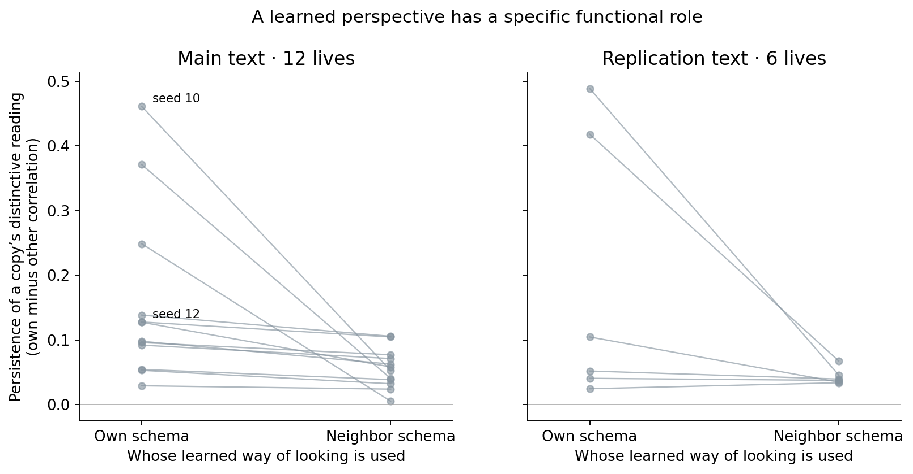

In this plot, each line connects two conditions of the same life. The vertical axis is the persistence difference defined above. A line falling from “own” to “neighbor” means that using another copy's predictor reduced the continuing distinctiveness of reading. On the main text this happens in all 12 archived lives. The mean paired advantage is 0.102 correlation units, with a descriptive bootstrap interval of 0.031–0.183. On the second text it happens in five of six lives, with substantially greater variation.

We then fixed 12 new starts before running them. Own-schema persistence was higher in 11 of 12, averaging 0.220 against 0.082. The mean paired advantage was 0.138, with interval 0.065–0.218. Seed 22 reverses the usual direction; it remains visible. These are new starts on the same reader and text, rather than 12 independent new environments.

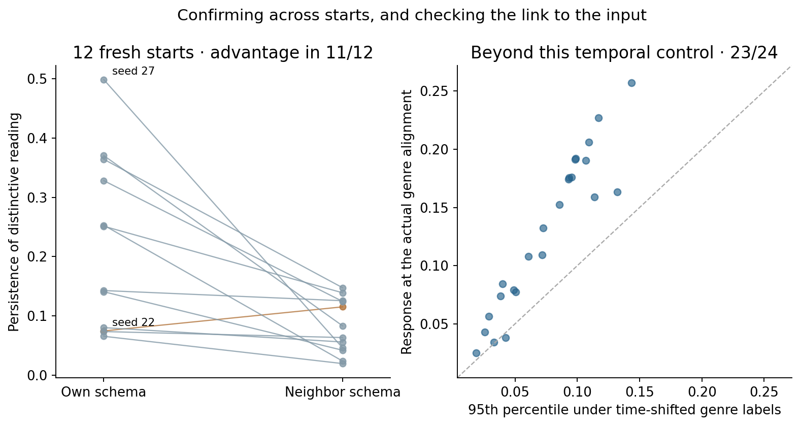

The right panel addresses a different alternative: perhaps a slowly changing trajectory would happen to line up with the sequence of genres. We shift the genre labels around the same trajectory while preserving their order and run structure. Points above the diagonal have stronger real alignment than the 95th percentile of that shifted-label comparison. This occurs in 23 of 24 archived-plus-fresh lives. It supports input sensitivity beyond this timing control. It does not prove comprehension of the meanings associated with those genres.

The own-versus-neighbor comparison shows that the relation between predictor and copy matters. The next test asks whether the predictor's particular content matters more than disturbance alone.

## Exchange and restoration: an intervention with a direction

We run an unchanged twin of each life and two altered branches. From readings 1,000 to 2,000, one branch exchanges the attention maps of copies 0 and 1. A second branch receives a random matrix change matched to the size of that exchange. At reading 2,000 the normal maps are used again. The question is not just whether an intervention causes movement: does the exchange specifically make the two copies select more similar content, and does restoration bring each closer to its unchanged twin?

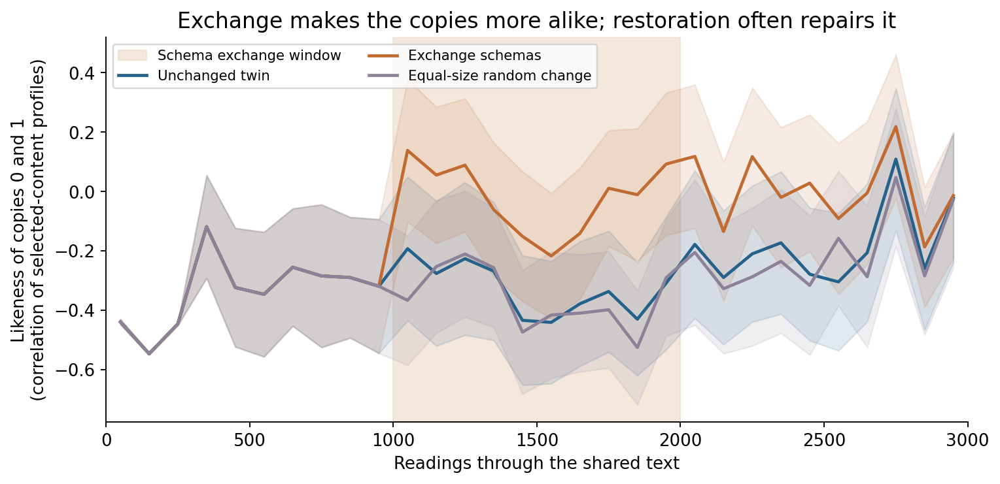

The horizontal axis is reading position. The shaded band marks the intervention. The vertical axis is similarity between the selected-content profiles of copies 0 and 1, so **higher means more alike**, not “better.” Each curve averages lives. The unchanged-twin curve shows the similarity that would occur without an intervention. The random curve estimates what a similarly sized nonspecific change can do.

The exchange increases similarity in 12 of 12 lives and exceeds the random change in 11 of 12. After restoration, the altered copies become closer to their corresponding unchanged twins in 10 of 12. That restoration measure is not identical to the between-copy similarity drawn on this plot; the underlying arrays retain both. A short, 300-reading exchange had previously shown little effect. The longer intervention reveals that the consequence develops through continued interaction with habit and stance.

This is stronger evidence of a functional role for represented content than merely decoding copy identity from a hidden state. Nevertheless, exchanging a learned private filter can produce this result without an explicit concept of “myself.” The simpler-memory comparison below tests that concern directly.

## Must learning continue for organization to continue?

An online system can look interesting because its parameters constantly move. That is different from learning a structure that continues to work. We therefore ran six matched starts with four branches: continued learning, frozen schema, frozen habit, and both frozen. Updates stop at reading 1,000. The already learned matrices remain active, and the stance continues to change.

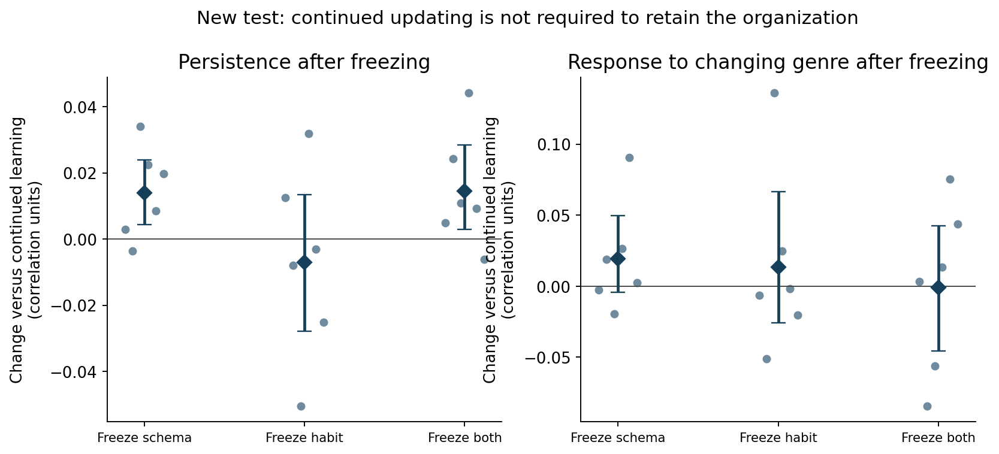

The axes show **change relative to continued learning**, not absolute performance. Zero means no difference from the matched branch. Each dot is a whole life; the diamond is the mean; whiskers describe bootstrap variability. Freezing the schema changes mean post-freeze persistence by +0.014; freezing both by +0.015. Freezing habit alone has no clear consistent effect. These are small changes relative to the range of whole-life outcomes.

The interpretation is that the measured organization can operate through learned structure after its parameters stop updating. “Frozen” does not mean constant attention: a fixed schema still responds differently to different contexts, and a fixed habit still maps different stances to different queries. This test does not show that lifelong adaptation is unnecessary, especially in a changing environment.

## What happens when the text changes?

We reconstructed six developed controllers at reading 1,500 and branched each into familiar or alternate text, with continued learning or with both learned components frozen. Each continuation lasted 1,200 readings. The starting controller is identical across its branches; the transition period is excluded from scoring. The alternate stream was already recorded, so it is an unfamiliar continuation for the controller, not a newly collected blind corpus.

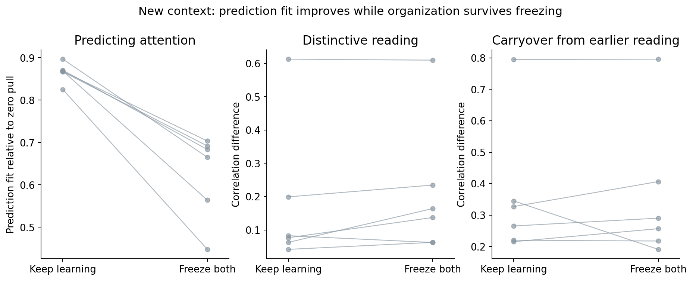

Read the three panels as different questions. On the left, continued learning improves prediction fit relative to zero pull: 0.866 versus 0.626. In the middle, distinctive reading remains at least as strong descriptively in the frozen branch: 0.212 versus 0.179. On the right, similarity to the earlier copy-specific selection is almost unchanged: 0.360 versus 0.361. A falling line in one panel and a rising line in another are not contradictory because prediction and persistence measure different properties.

The result shows why one “self-model score” would be misleading. Becoming better at predicting current attention did not produce a corresponding gain in these organization measures. It also does not prove that accuracy is irrelevant: the branches produce different attention targets, and freezing changes more than prediction error alone. An intervention that improves accuracy while preserving the rest of the selection rule would be a more isolated test.

## A simpler explanation survives: private memory of attention

The attention schema uses context. Does that context dependence explain its benefit, or would a private memory of a copy's typical attention do much the same thing? We tested both prediction and deployment.

First, we compared the schema's prediction with a running average of actual past attention, using approximately the same 500-reading forgetting timescale. The schema has about 30% lower squared error across the six reference lives and wins in all six. The centered prediction score is about 0.320, compared with 0.023 for the average. Thus the schema predicts part of the changing pattern, rather than merely recovering a stable favorite direction.

Second, we replaced the query contribution with the running average. We retained the reader, stance, habit, memory timescale and one-time size calibration. The structured predictor could still be measured, but its output no longer affected selection.

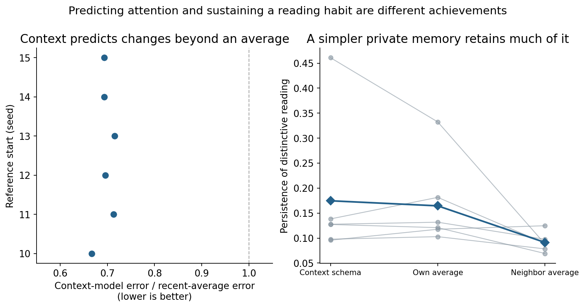

In the left panel, an error ratio below one means that the context predictor is better than the average. In the right, each line joins the same start using the context predictor, its own average, or its neighbor's average. The context controller averages 0.175 persistence and the own-average controller 0.164. The six-start comparison does not establish equivalence. Importantly, the own average still exceeds the neighbor average in five of six starts, with mean persistence 0.164 against 0.091.

The resulting insight is precise: **whose private attention history is used** can matter even when the model of that history is very simple. Own-versus-other use is therefore insufficient to establish a detailed self-model. At the same time, the context predictor really does capture additional variation. We should ask when that extra information changes useful control, rather than count prediction accuracy as a mental-capacity score. The full live exchange/restoration study has not yet been repeated with the running-average replacement.

## What do copies select in actual passages?

The “Read with a copy” panels preserve actual text and accumulated attention. Every token appears in several successive 16-position windows. We add the attention it received over those windows, then subtract the average across copies. Highlighting therefore means “this copy selected this position more than its peers.” It is not an explanation spoken by the copy, and it is not the probability that a word will be generated.

A recurring distinction in the reference cases concerns discourse structure versus content continuation: punctuation, boundaries and line breaks on one side; names and alphabetic content on another. That distinction matters because a persistent attention style need not be a stable preference about people, values or imagined worlds. We now compare 21 transparent feature groups, five genres, early and late segments, and provide surrounding text for highly selected positions. Dictionary matches are labeled as such: a word like “thought” does not establish reasoning about beliefs.

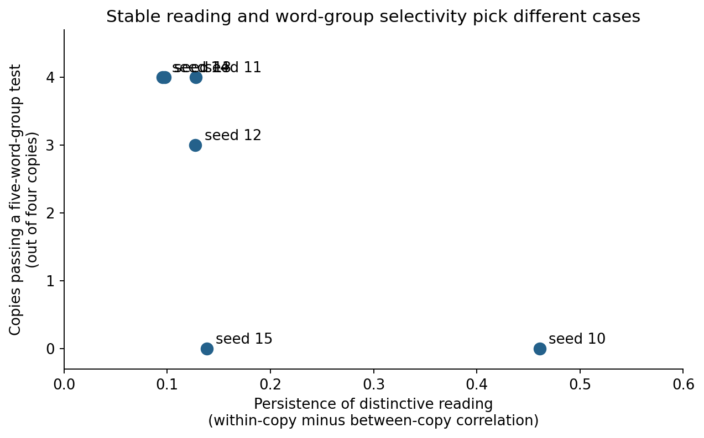

The vertical axis counts how many of the four copies exceed a threshold on five pre-existing word-list comparisons. A word-list comparison asks whether selected activity favors particular groups of vocabulary. It is a limited measurement, not a test of all possible meaning. The horizontal axis measures persistence. Seed 10 is highly persistent while seed 12 scores more strongly on those word lists. Thus “choose the most persistent life” and “choose the strongest result on these content tests” select different cases.

We also fitted ordinary predictors on early positions and tested later ones. One uses formatting features and genre; another remembers each token's average training-period selection with regularization. Across the six original case lives, their mean held-out scores are −0.021 and −0.065. They do not explain the average later selection well. But fresh seed 27, selected after seeing its high persistence, is an important exception: those predictors explain about 31% and 33% of held-out variation. Its most obvious distinctions concern structure and alphabetic content. Unexplained residuals in other lives are questions for further analysis, not automatic evidence of abstract identity.

The strongest ranked early/late features and their counterexamples appear below the passage panels in the explorer. Those rankings are descriptive screening results. Confirming a theme preference would require paraphrases that preserve the theme while changing vocabulary and formatting, along with changes in theme that preserve surface form.

## Why acting can also make a reader less consistent

When a controller acts on a live model, its later input contains consequences of its own action. This is useful if the return carries relevant information. It can also create a loop in which the controller is drawn toward its own disturbance.

The historical experiment ran both an acted-on model and an unacted comparison, allowing the experimenter to estimate the actual action-induced difference. That difference was removed either from the **keys**, which influence what attracts attention, or from the **values**, which supply the selected content. This is a diagnostic counterfactual supplied by the experimenter. The ordinary controller does not have perfect access to it.

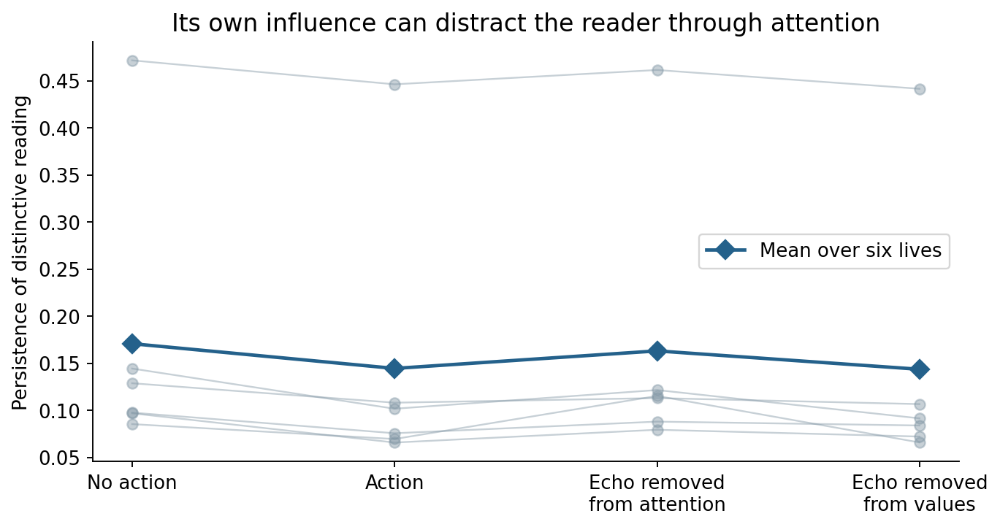

Read each thin line across four conditions of one life. Acting reduces persistence relative to no action. Removing the action-induced difference from what attracts attention recovers about 71% of that cost, whereas removing it from the values does not. The distinction suggests that the action can distract the selection process, rather than merely contaminating the content after selection.

Earlier learned influence predictors mainly captured a steady, shared component. Using one removed roughly half of a picture-level self-confirmation effect, but did not reorganize the copies. A learned predictor of the key-level return was too weak to reproduce the counterfactual repair. This identifies a design target—better prediction of what one's action makes salient—without claiming that this target has already been achieved.

## How to interpret the three synchronized trajectories

The explorer displays three synchronized panels with five selectable recorded signals. The default signals are the eight-number stance, the 32-number reading summary, and the 256-number predicted attention pull. For each signal, principal-component analysis chooses three linear combinations that capture as much variation as possible in that life. The axes are fitted jointly across copies after the warm-up and then held fixed throughout playback. The display reports how much variation those three axes retain.

Scrubbing changes the reading position in all three panels together. This helps ask, for example, whether a change in the selected-content summary accompanies a turn in stance, or whether the predicted pull remains relatively steady while reading changes. The accompanying passage provides context. It does not turn a visual coincidence into a causal explanation; the exchange and freezing experiments supply that kind of evidence.

Distances and loops in the display are incomplete views of higher-dimensional data. A near return in three dimensions may not be a return in the full state. A two-step cycle can look elaborate when drawn over time. No axis is labeled curiosity, self-knowledge, or emotion because those meanings have not been established. This is synchronized playback of measurements, not a claim that a new live inference process is running in the browser.

## What longer runs add to the interpretation

We extended two new cohorts to sixteen copies and 16,720 readings, preserving controller state across six recorded input streams. The copies share input after their different warm-ups. The language-model recordings reset context at stream boundaries, so the added controller has a long continuous life while the base model does not have one uninterrupted conversation.

An unusual-case screen selected a copy whose later 32-number summaries were poorly described by two prototypes fitted much earlier. This is a concrete change worth inspecting. It is not the most persistent copy, and a matched branch also leaves that pattern with the attention forecast unused. A further fit using the complete first input stream finds that four earlier shared prototypes describe its later summaries well. Thus escaping the two-prototype description does not establish a newly appearing kind of representation. Calling it a new self-awareness behavior would go beyond these controls. The explorer shows its position among all 32 own-forecast trajectories and explains the selection rule.

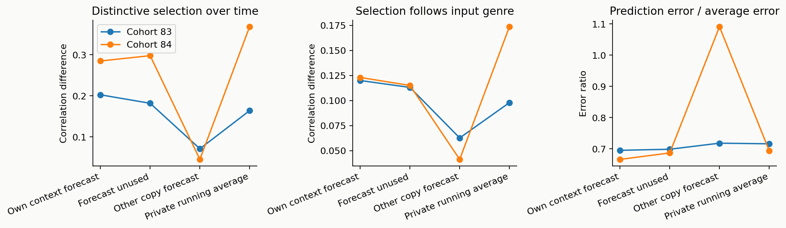

Each line joins the sixteen-copy mean of one cohort under four conditions. The left two panels measure continuing distinctiveness and genre responsiveness in correlation-difference units; the right compares forecasting errors, where below one favors the context-sensitive predictor. The own forecast predicts better, while its organization scores remain close to the unused and private-average controls. Using a neighbor's forecast disrupts organization. There are two cohort replications, rather than 128 independent lives.

An additional continuation replaces the changing forecast direction with a constant direction, or rotates its complete direction stream while preserving its per-copy/time strength. Much of persistence survives. This shows why a prediction's accuracy, its causal influence and the necessity of its detailed information must be tested separately. [The full account](SPECIFICITY_REPORT.md) includes the actual trajectories and all four branches.

We also intervened separately on stance and reading summary. A one-time stance push can produce a lasting attention change; a matched-angle summary push often washes out quickly. Route blocks locate the effects in stance-to-query and summary-to-stance pathways. The difference partly follows from the update's geometry: the stance and decoded reading direction undergo the same rotation, conserving their mutual angle. This designed memory was already described in the research notes and remains numerically conserved in the longer runs. Persistent motion therefore cannot be treated as an independent discovery of self-knowledge.

## What the controller changes in generated responses

The first expanded study crosses twelve tasks with two developed histories and five conditions, producing 480 controller responses. Tasks include imagination, dialogue, news, explanation, planning, editing and evidence use. The task-specific reviews separate changes in wording from changes in decisions, character information, causal structure and compliance with a premise. For example, several explanation and summary responses retain the main relation despite substantial token changes, whereas an imagination response changes a temporary rule into a permanent one. That is consequential divergence, but it is a premise violation rather than automatically richer imagination.

The 120-concept catalogue separates language form, structure, affect, interpersonal behavior, reasoning and internal dynamics. It organizes questions rather than declaring 120 effects. The main interpretation comes from actual task-specific comparisons, transparent measurements and causal controls; automatic semantic rankings remain unvalidated leads in the methods appendix. A text recognizer does not reliably identify full-controller copies across held-out tasks and sampling streams, so we do not infer enduring personalities from selected excerpts.

The follow-up adds sixteen fact-paired situations, two sampling streams and stronger action controls using copies from the longer cohort. [The repeated-response analysis](PATTERN_BEHAVIOR.md) explains the outcomes, the narrower factual evaluator and the comparison against stable arbitrary directions. In both studies, the unchanged model is retained. An apparent controller failure may already be present in that baseline; conversely, a better-looking single continuation is insufficient to establish improvement.

## Which part of the action is special?

Generated text branches after a changed sampled token, so we also test immediate actions on exactly the same context and model cache. Sixteen authored scenes compare the full action with unused-forecast and private-average actions, noise, a constant random direction, another copy's action and a fixed coordinate permutation of the full action stream. The latter preserves temporal geometry before numerical rounding while breaking its alignment with model coordinates. Actual perturbation norms are matched after conversion to model precision, with a maximum relative mismatch of 1.44%.

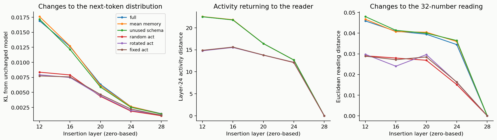

The left panel measures how much the next-token distribution changes, not whether the answer improves. The middle and right measure return to the layer-24 activity and the resulting reading summary. A larger value means a larger effect in those specific units. At layer 16, the full action changes the prediction distribution more than its rotation in all eight scene families. The private-average action has a similar mean effect to the full action. This establishes useful alignment with the language model, while leaving much of that effect explainable by ordinary content selection.

Changing the insertion layer maps an architectural tradeoff. Layers 20–24 produce stronger average return toward an earlier copy-specific summary direction than layer 16, but greater self-confirming return does not imply better prediction: the layer-20 action lowers the authored next token's probability on average. An action before layer 28 affects predictions but cannot alter the earlier layer-24 measurement in the same forward pass. Later words could carry it back. These are attachment diagnostics, not a newly optimized architecture for each layer.

A further analysis holds the forecast's baseline value fixed and changes only whether it responds to a perturbed input. The twins have exactly the same baseline query and output. The changing forecast adds a median local derivative about 4.2% as large as the full stance-response derivative in the sampled cases. This locates the additional context-sensitive route without crediting it for the entire feedback loop. It is not a percentage of consciousness, and small local changes can accumulate. Actions from the average controller excite this route as strongly as full actions on average.

## The attention model versus an information-driven recurrent controller

A generic recurrent network can retain a changing state, react to model information, select content and alter language. The relevant question is which effects depend on learning a relationship to the copy's own attention. We therefore add a fixed random recurrent filter with 64 state values, driven by the same compressed context and connected to the same attention and content-writing interface. Its response is verified as chaotic on the recorded history before its language outputs are examined. It supplies a meaningful dynamic comparator, rather than a random vector added at the end.

One branch replaces only the attention forecast's direction, retaining stance and habit. Another replaces the whole changing query direction. Both receive reference query and writing magnitudes at every step, so this is a controlled test of directions conditional on matched strength. The scalar streams are experimenter-supplied; these controls are not claimed as independent deployments that reproduce all reference functions.

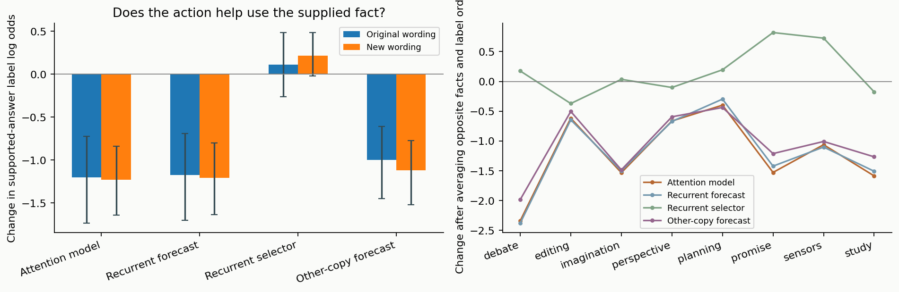

The model sees two versions of each situation, with a different supported conclusion. For example, whether Ava observed the key move determines the warranted first search. We list two answers as A and B, reverse their label order, and repeat with fresh context wording. A single matched action is inserted at the final prefix token. Every controller has processed the same native, unchanged context before that intervention.

The left plot shows the action-induced change in the supported label's log odds compared with the unchanged model. Zero means no change; positive favors the supported answer more; negative favors it less. The two bar colors concern original and reworded situations. Whiskers resample complete families, preserving dependence among copies and label orders. The right panel breaks the result down by family. This is a local information-use test, not a consciousness score or a rating of entire stories.

The central observation is a difference between changing confidence and changing an answer. The unchanged model already favors the supported label in 62 of 64 presentations. Across four copies, the full controller changes only one of 256 choices. Its larger effect is to soften existing answer margins. The recurrent forecast replacement reproduces that broad pattern, while replacing the whole selector produces a different profile. A simple scale fitted on other families describes about 59% of the full controller's squared margin changes on held-out families. This does not make all output changes equivalent to temperature scaling; it shows how much of this particular apparent semantic effect has a simpler account.

Changing whose forecast is supplied makes a smaller, consistent-direction change in those margins across both wordings. The own forecast softens the supported-answer margin slightly more than the other-copy forecast. This is a genuine relational intervention, but it is not a benefit in fact accuracy or evidence of recognized ownership. The generic forecast replacement preserves much of the larger effect, and its reference magnitude stream still retains scalar information from the full controller. The precise finding is therefore about which directional information is necessary for this measured function.

The experiments divide the proposed self-model's role into testable functions. Its learned relationship to a copy's attention helps organize continuing private selection, as the exchange and own-versus-other controls show. Much of its current influence on language, however, belongs to the retained history-shaped selector and aligned content-writing route. Predicting attention, maintaining a reading tendency, influencing a language model and recognizing one's own causal impact are different capabilities. The current architecture establishes parts of that chain without automatically supplying the rest.

This distinction is useful for the next design. A model of attention should demonstrate an information use that is lost when its particular relationship to the receiving copy is broken, beyond effects reproduced by ordinary recurrence or a private average. A model of its own impact would additionally have to predict and use the consequences of its actions. The key-versus-value return experiment locates a promising causal interface for that question; it does not imply the present controller already has that capability. Full methods, matched text outputs and the amplitude-control boundary are in [the recurrent comparison](RECURRENCE_REPORT.md).

## Readiness and further interfaces

The publication candidate preserves one validated 8B reader and its recorded and live operating modes. Workspace adapters, larger-model bridges and multimodal deployments are separate interface studies. Their training records and qualification outcomes remain in [the experimental appendix](NEW_RESULTS.md) and [coverage audit](REQUIREMENTS_AUDIT.md), without being promoted as interchangeable versions of the reference. [Architecture choices](ARCHITECTURE_CHOICES.md) explains how the research history motivates each retained component.

## What these experiments add

The contribution is a causal account of which relation supports which function, rather than a gallery of emerging patterns. History can create a selective tendency; a prediction of attention can help sustain it; whose history is represented matters; prediction quality and persistence can separate; a simple private average reproduces part of the apparent self-model effect; and a live controller can capture its own attention through the return from its actions. These findings make a more demanding next experiment possible.

Attention-control models and activation interventions are established ideas. The candidate contribution is this causal dissection in one inspectable, history-dependent system, including negative controls and failures. It is not a claim to have invented attention schemas or to have demonstrated consciousness. The previous report's source discussion remains available in the preserved version; the architecture-choice report explains how this project's design decisions follow from its own tests.

The broader objective—rich organization whose meaning was not prescribed—is still more demanding than persistence, movement or many distinct states. Fixed codes, simple cycles and arbitrary chaos are insufficient. A stable, interpretable filter is a concrete functional result. Whether it develops more general, durable, task-spanning tendencies is the question the expanded behavioral study begins to investigate.

## Evidence files and release boundary

The original 168-life recomputation, fresh-start studies, freeze/context controls, private-memory controls and raw cloud results remain in the parent evidence directory. This revision adds scripts, task specifications, a 120-concept catalogue, replay arrays, analysis outputs and collection receipts in its own directory. The development checkout remains separate from this publication.

The new prompts are project-authored. Existing corpus passages remain private pending source-specific redistribution review. This edition connects the code, compact reader, numerical evidence and interactive explanation. The requirement audit identifies which requested experiments remain incomplete; a failed transfer is not counted as a completed larger or multimodal self-model study.

---
Wiktor Tomasik · measurements: 1 November 2026 · publication updated: 2026-11-01T23:52:27+01:00
