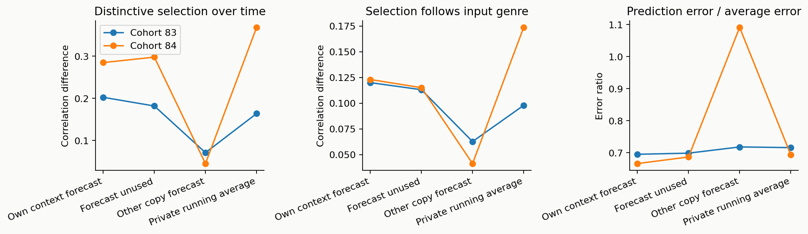
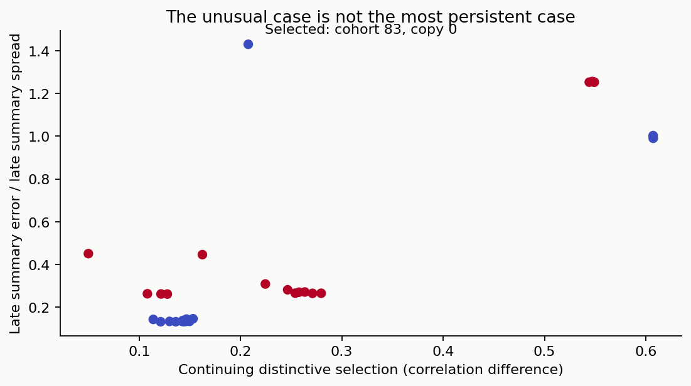
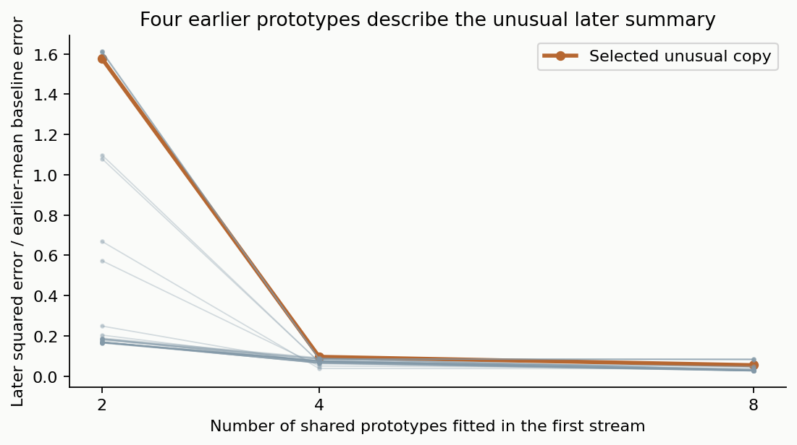
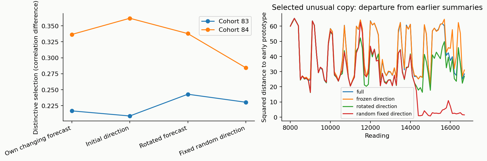
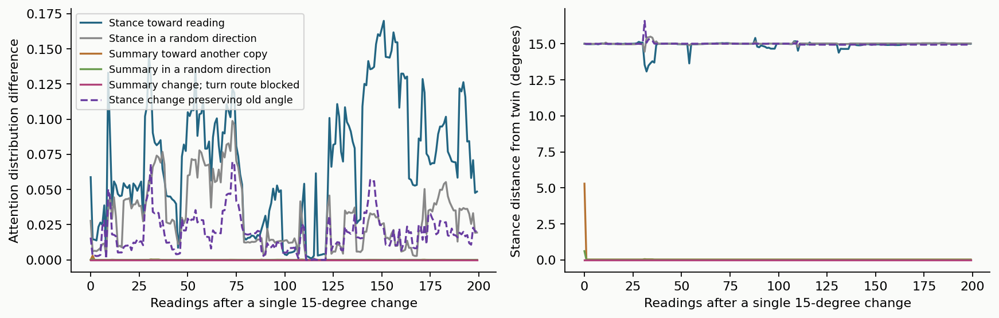
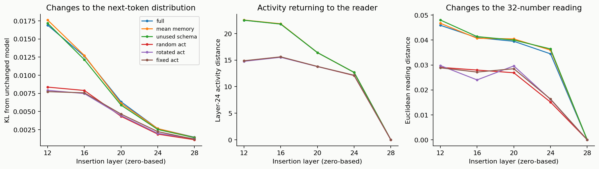
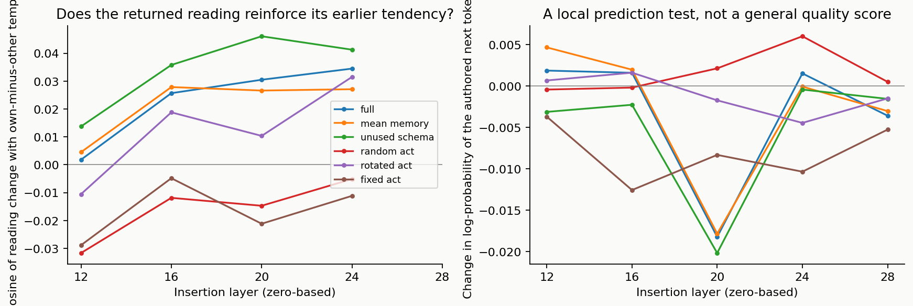
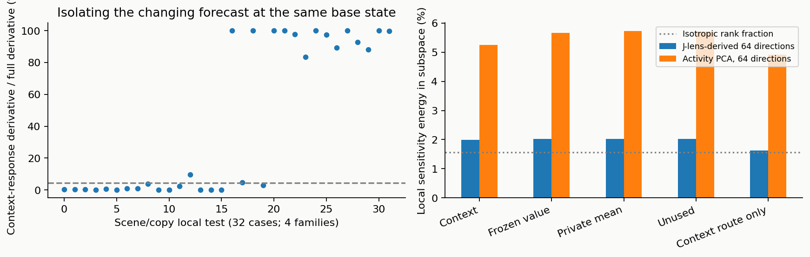

# What the longer runs and stronger controls reveal

The purpose of these experiments is to distinguish a learned model of the controller's attention from other ways of creating persistent, structured changes. A controller can matter without representing itself in a rich way. A stable private bias can also look individual. We therefore ask which effects depend on a context-sensitive prediction of this copy's attention, which depend on writing useful directions into the language model, and which follow directly from the controller's update rule.

The reference reader and language-model weights remain fixed. The online habit and attention-prediction maps change according to their existing rules. These experiments investigate the current architecture; they do not replace the ongoing architecture-development project.

## More copies, longer observation: does a different kind of organization appear?

Earlier comparisons usually involved four copies and 3,000 readings. We ran two new cohorts with sixteen copies each for 16,720 readings. The first 256 readings give copies different histories. The remaining input concatenates six previously recorded model streams, with every copy receiving the same stream after warm-up. Controller state continues across stream boundaries. The underlying language-model recordings reset their context between streams, so this is a long controller life rather than a single uninterrupted 16,720-token language-model conversation.

Each cohort has four matched branches: its own context-sensitive attention forecast, the same forecast left unused, a forecast learned from another copy, and a private running average of past attention. The running average is an important comparator because it remembers what this copy selected without predicting how that selection changes with context. There is no exchange of messages among the sixteen copies. Increasing their number expands the sample of possible trajectories; it does not create a social system.

**Read the figure.** Each line is the mean of sixteen copies in one cohort. The left panel measures whether a copy's selection resembles its own distant selection more than other copies' selection. Its units are a difference between correlations. The middle panel asks whether selection is more similar within the same input genre than across genres. The right panel compares squared prediction errors: below one favors the context-sensitive forecast over the private average. The first two scores describe organization; the third describes prediction accuracy. A gain in one need not produce a gain in another.

Across the two cohorts, mean continuing distinctiveness is 0.244 with the own forecast, 0.240 with the forecast unused, 0.058 with the other-copy forecast, and 0.266 with the private average. These are descriptive means from **two cohort replications**, not 128 independent experiments. The context forecast is more accurate than the private average, with an error ratio around 0.68. Nevertheless, the simple average retains comparable measured organization.

The conclusion is more specific than “self-modeling creates individuality.” An inappropriate prediction can strongly disrupt a developed controller. A context-sensitive model does forecast more of the changing attention. But on these persistence and genre measures, that extra predictive detail is not clearly necessary. The similarity between own, unused and average branches is a central result to explain in a future design.

## What counts as an unusual case here?

We fixed a numerical screen before examining these new output texts. It compares continuing distinctiveness, genre responsiveness, the spread of stance motion, departure from two early reading-summary prototypes, and forecasting error. A trajectory is unusual if its combination of features lies far from its closest peers. Simple near-static and two-step endpoints are filtered before ranking. The screen deliberately contains no desired identity, emotion, or self-awareness target.

**Read the figure.** Each point is one of the 32 own-forecast trajectories. Rightward means more continuing distinctive selection. Upward means the last 4,000 reading summaries are poorly reconstructed by two prototypes fitted to readings 600–1,399. The vertical score divides reconstruction error by the later summaries' spread; it is not a count of concepts. The marked point was selected by the multivariable screen, not by either plotted coordinate alone.

The selected case is cohort 83, copy 0. Its late summary error is 1.43 times the relevant spread, so the two earlier prototypes are a poor description of its later summaries. Its persistence score is 0.208, below several peers near 0.61. “Unusual” therefore does not mean “most stable,” “most capable,” or “most self-aware.”

The matched controls constrain the interpretation. The same copy also leaves the early-prototype pattern when its attention forecast is unused. Other-copy and private-average branches remain closer to their earlier prototypes. Thus the case is worth inspecting as a change in organization, but the escape is not unique to the context-sensitive self-prediction route. Thirty-two trajectories also cannot establish the prevalence of a rare phenomenon. The four copies taken into the new language-model tests include this unusual case, a median case, a persistent case and a further representative; they are not four independently discovered personality types.

### Is the unusual later summary actually new?

The first two-prototype fit used a period containing dialogue and authored reports. We therefore repeated the reconstruction with prototypes fitted over the complete first stream, covering all five genres and all sixteen copies, then evaluated the final 4,000 readings. Two prototypes still fit the unusual copy poorly. Four earlier prototypes reduce its later squared error to about 9.6% of the error from always using that copy's earlier mean summary; eight reduce it to 5.5%.

**Read the figure.** The horizontal axis is the number of shared earlier prototypes, not the number of minds or discovered concepts. Each line evaluates a copy on later data that was not used to fit those prototypes. The highlighted trajectory is the selected unusual copy. Downward means an earlier description reconstructs more of its later summaries. The comparison is descriptive; the four-prototype controller has not been deployed as a causal replacement.

This narrows the rare-behavior claim further. The later summaries do not require a newly appearing high-dimensional representation under this test: a small set of earlier summaries covers them. The finding concerns this intermediate signal, not the entire controller's capacity. We retain the original selection so that the follow-up tests its meaning rather than replacing it with a more flattering outlier.

### Does the forecast's changing direction sustain the longer organization?

We replayed both cohorts from reading 8,000 to 16,720 with stronger controls on the predicted query itself. The full replay reproduces every saved stance and reading summary exactly. Three branches replace the forecast direction with its initial direction, a fixed signed permutation of the full forecast stream, or a constant random direction. Each uses the full replay's forecast magnitude separately for every copy and reading. The other controller updates continue. This makes the forecast's direction the tested variable, without quietly changing its strength as well.

**Read the figure.** Left: sixteen-copy mean distinctive selection during this continuation, separately for the two cohorts. Right: the selected unusual copy's squared distance from either early reading-summary prototype, averaged in 100-reading blocks. Higher on the right means an earlier two-prototype description fits less well; it does not imply more meaning or awareness. The branches receive an experimenter-supplied reference magnitude stream, so this is a diagnostic intervention rather than a standalone replacement model.

The full-versus-fixed distinction is not decisive on persistence. In cohort 83 the full score is 0.217 and the frozen-direction score is 0.209; in cohort 84 they are 0.336 and 0.362. Rotated and fixed-random directions also retain substantial organization. Thus persistence survives removal of the forecast's detailed changing direction in these continuations. This strengthens the ordinary-memory caution: a prediction can be accurate and causally active without its detailed predictions being necessary for the chosen endpoint. The right panel also reveals a difference hidden by the persistence score. The fixed-random branch returns near its early two-prototype pattern late in the continuation, whereas the full and frozen-direction branches remain farther away. Thus similar persistence can coexist with different summary dynamics. The full and frozen-direction traces are very close in this selected case, so that departure still does not uniquely require a changing context forecast. These are selected-case observations on a shared input schedule, not estimates of how often such events occur.

## Why a stance change can persist while a reading-summary change disappears

The **stance** is the eight-number state used in subsequent attention queries. The **reading summary** is the 32-number compression of selected content. A decoder converts that summary into an eight-number direction. The update rotates the old stance by the rotation that carries the previous decoded direction onto the current one.

That construction has a built-in invariant. If the old stance and previous decoded direction have a particular angle, applying the same rotation to both preserves that angle. In symbols, the dot product of the normalized stance and decoded direction stays constant through an ordinary update. This was already identified in the research notes; the new runs verify it over longer lives. Across all 128 branch trajectories, the largest alignment drift is below 0.000029. This is a property of the update rule, not a newly learned self-description.

We tested the consequences directly at readings 8,000 and 15,000. Starting from the same saved controller, one branch receives a single 15-degree stance change. Another receives a 15-degree change in the reading summary. Random-direction changes have the same angle. The habit and prediction-map updates are frozen in every branch during this short assay so that the fast causal route can be isolated. Freezing map updates still lets the fixed map respond to current input.

**Read the figure.** Horizontal position is the number of readings since the single change. Left: the distance between the branch's actual attention distribution and the unchanged twin's distribution. Right: the stance's angular separation from that twin, in degrees. These are causal changes to the same saved system, not correlations between unrelated lives. The plotted curves concern the later intervention; the earlier assay is retained in the numerical results.

A stance push toward the decoded reading changes subsequent attention more than a random stance push in these two cases, and the stance displacement persists. Blocking the perturbed stance from entering the attention query eliminates the attention effect while leaving the stance displacement. That locates the route: stance affects attention through its query contribution.

A one-time summary push toward another copy's summary usually has a much smaller, brief effect. Blocking the summary-to-stance update eliminates its later attention effect. The transient response is consistent with the geometry: when the decoded reading moves out and then back, the corresponding rotations can largely undo one another. This does **not** show that the summary is unimportant. Sustained changes, learning changes, and movement around several planes can have different consequences. Nor does the larger effect of the stance push establish a semantic meaning for “toward the reading”: that push also changes the conserved angle more directly than a generic perturbation.

A follow-up moves the stance by the same 15 degrees while deliberately preserving its angle to the previous decoded direction. Attention still changes, and the stance remains about 14.9 degrees from its unchanged twin after 200 readings in both assays. Thus the conserved scalar is not the whole memory: orientation around that direction also has persistent causal consequences. This control prevents the geometric explanation from being overstated as a one-number account of all behavior.

The practical lesson is to avoid reading duration as a measure of mental importance. Persistent state, transient content, and learned maps have different causal roles. A short-lived summary change can be the means by which a lasting stance update occurs in other circumstances; the present single-pulse assay establishes only the measured route and timescale.

## Does the action have a special pattern, beyond random activation changes?

The live action is a selected-content difference inserted inside Qwen3-8B. To isolate its immediate effect, we replayed sixteen authored contexts from eight families: sensor evidence, promises, another person's information, a study comparison, debate evidence, editing an overclaim, an imagined object, and practical planning. Each family has two versions that change one relevant fact. The language model processes the same text and the same unchanged context cache in every one-step comparison. Its state does not branch because of different sampled words.

At selected positions, four controller actions are compared with: no action; a controller whose attention forecast is unused; a private-average controller; fresh random directions; a constant random direction; another copy's action; and a fixed signed permutation of the full action's coordinates. The permutation is particularly useful. It preserves sizes and temporal inner products before numerical rounding, while breaking the alignment between the selected-content pattern and the language model's coordinates.

The actual additions, after conversion to the model's numerical precision, are matched in norm. The largest relative mismatch over the full assay is 1.44%; this finite-precision limit is reported rather than treating requested floating-point norms as exact. The actual rotated direction has cosine at least 0.9918 with its intended permuted counterpart. Unchanged-row checks qualify the zero-action route. The action is inserted before layers 12, 16, 20, 24 or 28, while the controller reads after layer 24. Layer numbers are zero-based.

**Read the figure.** Each point averages nested probe positions and copies across the authored scenes. Left: change in the next-token probability distribution, measured by KL divergence from the unchanged model; higher means more influence, not better answers. Middle: distance between acted and unacted activity at the layer the reader receives. Right: distance between the resulting 32-number summaries. Every curve represents the same measured action magnitude at a matched point, so a stronger curve cannot be explained simply by a larger requested perturbation.

At the current layer-16 insertion, the full action produces a mean distribution change of 0.0126, compared with 0.0075 for its fixed rotation and 0.0079 for fresh random directions. The full-minus-rotation contrast is positive in all eight scene families. Descriptive family-resampling intervals also remain above zero. This establishes that the direction's relationship to the model matters in this assay. However, the private-average action produces 0.0127, and the unused-forecast action produces 0.0122. The extra influence is therefore largely shared by ordinary content-aligned actions. It cannot be assigned uniquely to a detailed self-model.

**Read the figure.** The left panel projects the action-induced summary change onto the selected copy's long-run summary direction minus the other copies' mean direction, then divides by the change's total size. This gives an angular alignment (cosine), separating the direction of the return from its magnitude. Zero means no component along that template; positive means movement toward it. Layer 28 has no immediate return, so no alignment point is drawn there. Positive values indicate movement toward the copy's earlier tendency. The template is an experimenter's measurement, not a target the controller was taught to recognize. The right panel asks whether the authored next token becomes more or less probable. Positive values support that particular token; they do not measure the quality of a complete response.

Full, average and unused-forecast actions all tend to reinforce the earlier summary direction at layer 16. The full-versus-average and full-versus-unused differences are small relative to variation across families. A noise contrast alone would have overstated the specificity of this result. Insertion at layers 20–24 produces a stronger average return along the old summary direction, but layer 20 also reduces the probability of the authored next token on average. More self-confirming return is not automatically better reasoning.

Layer 28 changes model predictions but produces exactly zero immediate return to the layer-24 reader. This is the expected causal order: an action inserted after a measurement cannot change that earlier measurement in the same forward pass. Later generated words could still carry an effect back. These tests map an attachment tradeoff; they do not select a best layer for every task. The action was derived using the current reader rather than separately trained for every insertion layer.

## How much of the response actually passes through context-sensitive prediction?

The attention map can affect processing in two different ways: it supplies a private query bias, and that bias changes with incoming context. To isolate the second contribution, we compare the ordinary controller with a twin whose predicted query value is held fixed at the same baseline input. Their baseline query and output are exactly identical. Only their response to a changed model observation differs.

We differentiate the next stance with respect to one incoming 4,096-number model observation at one probe in eight scenes from four evaluation families. The activity projection is fitted on the other four families. All 32 scene/copy formula checks reproduce the actual simulator to within 0.000002.

**Read the figure.** Left: the size of the derivative added by allowing the forecast to change with context, divided by the full stance-response derivative. The dashed line marks the median, about 4.2%. This is a ratio of local mathematical sensitivities, not a percentage of self-awareness or of all long-run causal influence. Right: the fraction of local sensitivity lying in two different sets of 64 input directions. The horizontal reference is the isotropic rank fraction, 64/4,096. The bars concern local input response, not the amount of semantic knowledge in the model.

On these points, the changing forecast adds a modest local response to a larger response already present through direct selection and private bias. Actions from the average controller excite this context-sensitive route at least as much as the full actions on average. A small local derivative can accumulate or amplify over time, so the result does not prove the route dispensable. It does rule out treating all returned activity as an effect specifically caused by changing self-prediction.

The J-lens-derived 64-direction basis captures roughly 2% of the full local sensitivity, against about 1.5% in equal-rank random bases and 5.3% in the fitted activity basis. This particular linear proxy is not the full sparse, word-direction representation used in the workspace paper. It also tests the reader's input at layer 24, whereas the earlier failed learned action adapter concerns a different interface. These results locate a weakly privileged input subspace under this assay; they do not settle whether a different workspace attachment would work.

## Repeated response tests and the internal model path

The repeated response study collected all 768 controller responses and 32 unique unchanged responses. Every matched unchanged row is identical across conditions after end-token padding is removed. The actual perturbation mismatch has a median around 0.01% and a maximum of 1.43%. The explorer preserves all sixteen situations, both sampling streams, all six conditions and the four source copies.

The [response analysis](PATTERN_BEHAVIOR.md) distinguishes changes in wording, character information, physical continuity, evidence use, imagined consequences and feasible plans. A narrow factual evaluator passed 30 of 32 qualification cases but still supplied invalid or ungrounded evidence on 103 of 800 experimental responses. Its visible verdicts therefore remain a bounded screen, rather than the basis for a general quality or personality claim. The central information-use test instead uses direct, counterbalanced model label probabilities.

Three synchronized plots now show actual model activity after layer 24, controller stance, and reading summary during the selected response. Both sampling streams and all six action conditions are measured. Fixed axes are shared across conditions within a situation. The model plot uses a 64-direction lens-derived subspace and then a three-dimensional display projection; the reported retention concerns that subspace, not the entire language model. Paths stop at the first end token. After sampled text branches, the different path also reflects different incoming words, which is why the fixed-context and single-action information tests remain necessary.

The separate [recurrent comparison](RECURRENCE_REPORT.md) keeps the same content-selection and writing interface while removing the learned attention-prediction direction, or the entire changing query direction. It directly addresses whether the effects require the proposed self-related relationship rather than an arbitrary information-driven recurrent system.

## What these results mean for a public research claim

The strongest supported story is about a feedback mechanism and its limits. A developed selector carries history, learns to forecast its own attention, and writes content-aligned changes into a language model. Specific exchanges and causal route blocks show that its components matter. Yet ordinary private memory reproduces much of the measured organization and live influence; the most unusual longer trajectory does not uniquely require the context-sensitive forecast.

That boundary is useful for future architecture work. A next design should show a task where predicting its *changing* attention is necessary, beyond a private average or fixed direction. It should also distinguish recognizing the consequences of its own action from merely reading activity altered by that action. The current attention model predicts selection; it is not trained to identify which changes in the language model were caused by itself. The diagnostic counterfactuals supplied here by the experimenter are not a capability the controller already possesses.

These are findings about this implementation and these tests. We do not claim a literature-first discovery of persistent state, structured steering, or conserved rotations. The potentially useful contribution is the controlled separation: ownership-sensitive disruption can coexist with ordinary-memory sufficiency; unusual trajectories can coexist with a constrained intermediate representation; and self-confirming return can increase without better local prediction. That is a concrete, falsifiable account to present publicly with the source-specific license scope in LICENSING.md.

---
Wiktor Tomasik · measurements: 1 November 2026 · publication updated: 2026-11-01T23:52:27+01:00
