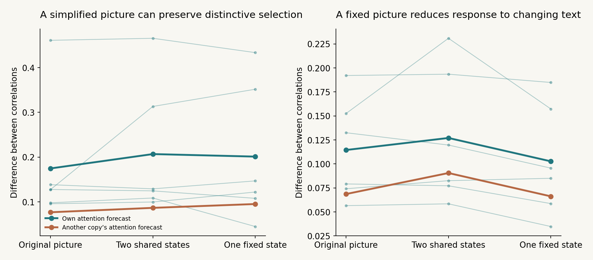
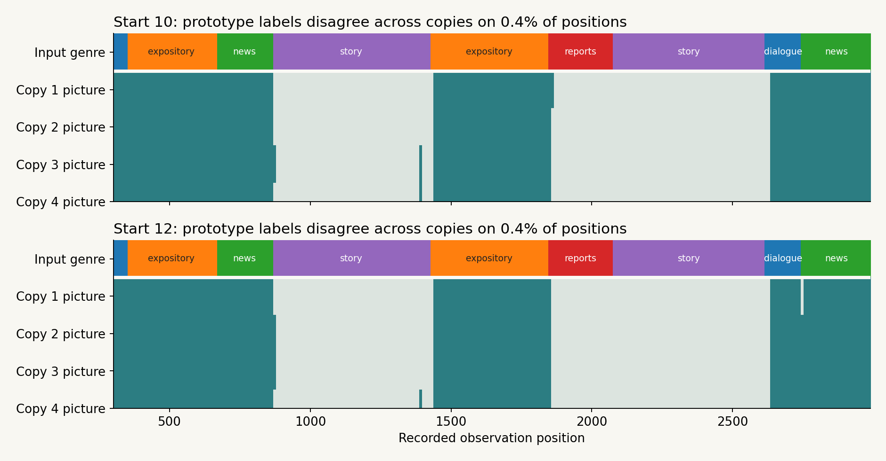
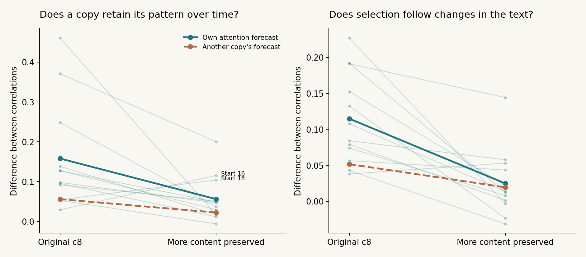
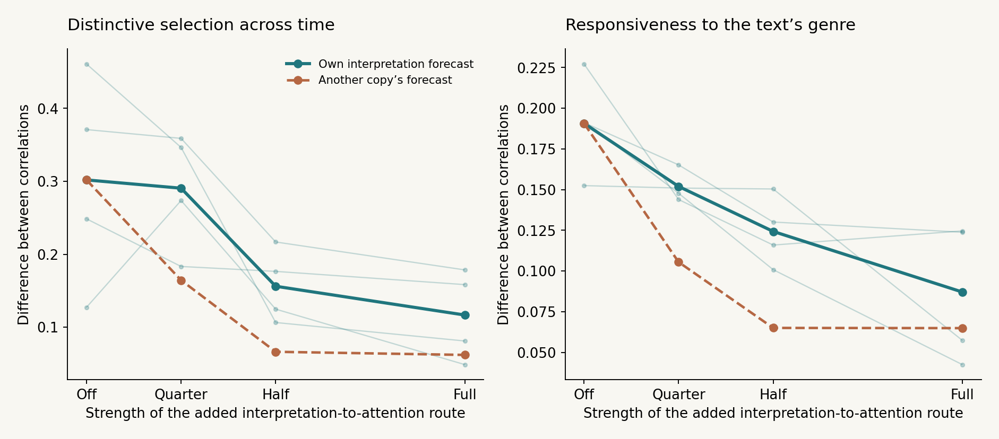
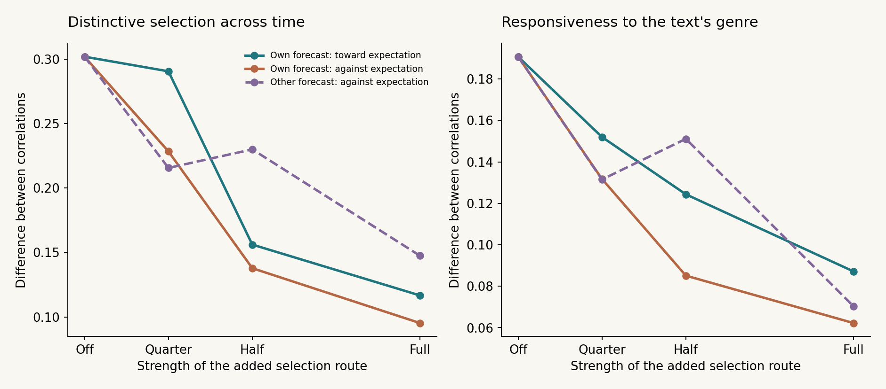
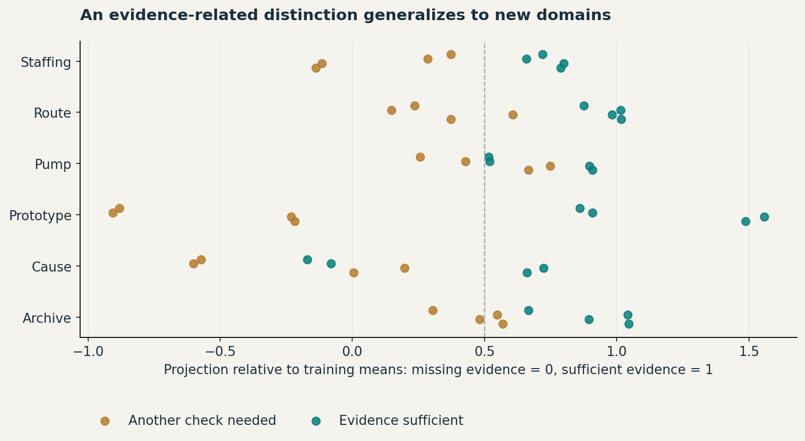
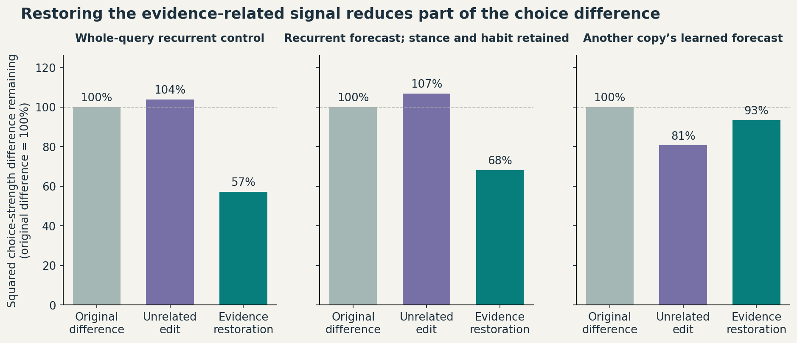
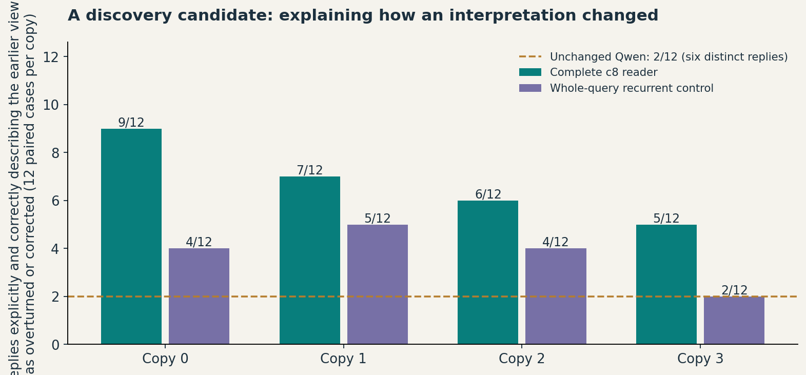
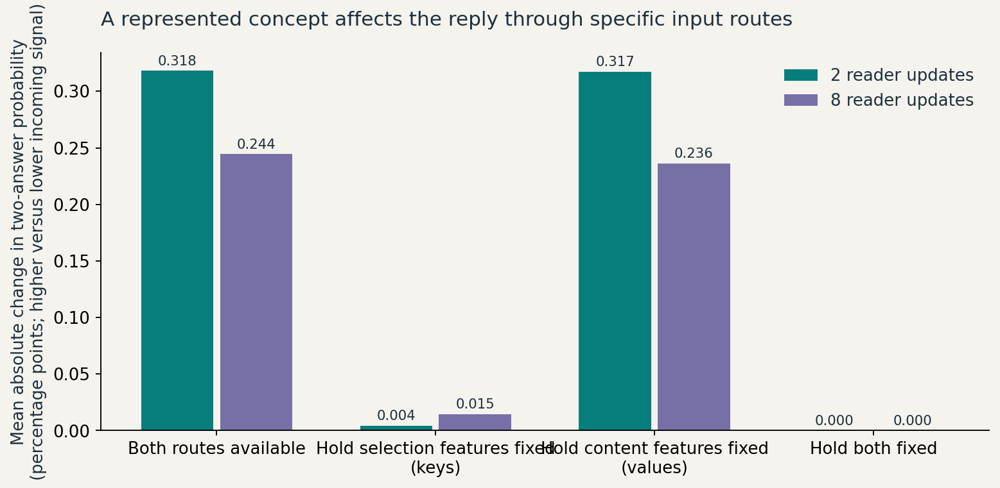
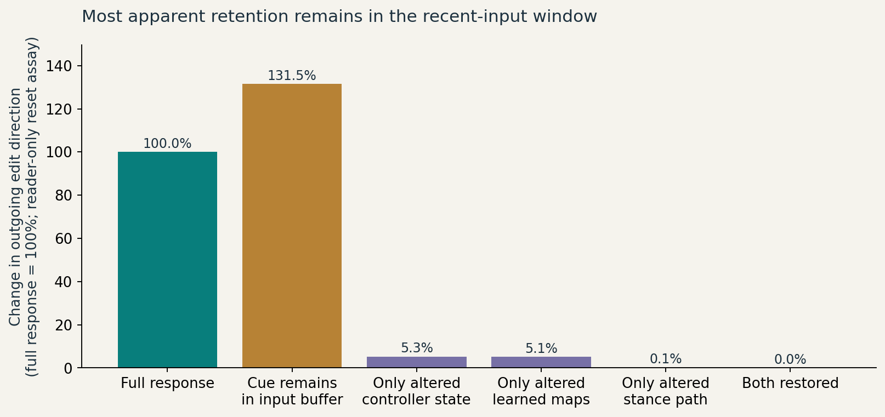

# Self-modeling of attention in a language-model feedback loop

Wiktor Tomasik · consolidated research edition, 3 November 2026

## 1. The question: when does a model of a process become part of that process?

A language model can represent a situation, compare explanations and produce a conclusion. That does not by itself tell us whether it maintains useful knowledge about how it arrived at the conclusion, what it selected, or how its own previous processing changed what now appears important.

The project starts from a question about self-understanding. Can a system learn something about how it processes information and use that knowledge to change what it does next? Attention schema theory offers one concrete example: a simplified model of attention might help regulate attention itself. [Wilterson and Graziano’s neural-agent experiment](https://pmc.ncbi.nlm.nih.gov/articles/PMC8379943/) illustrates this idea in a visual task.

Here the self-model belongs to a small reader attached to Qwen3-8B. The reader assigns weights to recent internal activity and learns to predict which features its own weighting will emphasize. That prediction helps set the next weights. In live tests the reader also feeds selected information back into Qwen, whose updated activity supplies the reader with new input. Qwen’s weights stay fixed. The experiments test how these loops affect selection, what information is carried forward, and which changes reach language output.

The strongest current result is a separation. A copy can retain a distinctive way of **selecting** information even when its compact summary is largely shared with other copies. The learned attention forecast participates in that selection. Adding a model of the copy's compact interpretation has a different effect: when it guides attention, it changes organization but can reduce responsiveness to the text. Separately, a live intervention can affect an identifiable evidence-related representation in Qwen and thereby alter answer preference. These results concern different links; they are not one completed demonstration of a system understanding its own thoughts.

This edition integrates the architecture experiments through 3 November with the meaning-oriented follow-ups. It keeps one reference configuration. The later variants are tests of particular routes, rather than additional models advertised as successive improvements. Earlier meaning experiments remain results of that reference; they have not been silently reassigned to the new variants.

## 2. What the reader actually does

Four copies begin with the same small neural reader. Different early histories allow their maintained states and learned maps to develop differently. After that warm-up, recorded experiments deliver the same Qwen activity to every copy. A lasting difference can then come from their developed organization rather than continuously different input.

The reader considers a window of sixteen recent observations after Qwen's layer 24. Each position has **keys**, features used to determine how strongly it attracts attention, and **values**, features combined after positions are selected. A **query** scores the keys and produces attention weights. The query combines a fixed bias, the current stance, a learned habit and a forecast of the copy's own selection contrast.

The **selection contrast** is the attention-weighted average of keys minus their ordinary average. It measures which key features the reader emphasizes relative to weighting all positions evenly. The habit learns its relationship to the stance. The attention forecast learns its relationship to a compressed description of the current window. Both contributions enter later queries. A descriptive attention model has a precedent in [Wilterson and Graziano’s neural-agent experiment](https://pubmed.ncbi.nlm.nih.gov/34385306/); this project tests its own learned relationship rather than inheriting that agent’s performance.

Selected values become a 32-number **picture**. This is the implementation's name for a compact numerical summary, not an image experienced by the system. A decoder maps it to a direction. Changes in that direction rotate the existing eight-number **stance**, which in turn influences selection. Rotation was introduced to preserve dependence on the previous stance; it does not establish a persistent self or a psychological trait.

| Component | Why it is present | What its size or name does not establish |
|---|---|---|
| Native Qwen activity, 4,096 numbers per observation | Carries detailed information that the small controller can select and route | The coordinates are not 4,096 independently named concepts |
| Sixteen-observation buffer | Makes recent activity available for comparison and repeated selection | Retaining a cue is not remembering an interpretation as one's own |
| Eight-number stance | Keeps an orientation affecting the next query | No coordinate has been identified as curiosity, identity or emotion |
| 32-number picture | Supplies a bounded selected-content summary for turning the stance | Thirty-two coordinates need not carry 32 independent aspects of interpretation |
| Habit | Retains a learned association between stance and actual selection contrast | A developed private bias can exist without detailed self-knowledge |
| Attention forecast | Predicts selection contrast from a 16-number context projection | Its 256 output features are four groups of numerical key features, not a vocabulary of 256 concepts |
| Wide content writer | Routes selected native information into Qwen without reconstructing it from the compact picture | An interpretable downstream effect need not already be explicitly represented in the compact controller |

Persistent attentional sets and predictions of one's own processing are useful functional analogies to cognition. These component names do not identify brain regions or establish biological equivalence. The small states are also not the system's entire memory: wide observations and learned matrices retain information.

Two schedules answer different questions. In **recorded mode**, the controller cannot change the saved Qwen activity. This isolates its selection dynamics. In **live mode**, a writer computes developed selection minus a fixed-bias selection over native content, adds the resulting action before Qwen layer 16, and reads the processed consequence after layer 24. A further feedback route therefore passes through Qwen's computation. The architecture view draws the schedules separately and lets each block be opened.

Qwen's weights and the reader's neural weights are frozen during these development experiments. The initial reader was trained in an earlier copy-dynamics study; stance, habit and prediction statistics then develop online. The current study does not train desired personality descriptions or statements of awareness.

## 3. Where the lasting differences live

The original exchange experiment asks a relational question. After development, what happens if two copies use each other's learned attention forecast while retaining their own other state? They move toward one another's way of selecting; restoring the original maps can move them back. Matched random map edits help distinguish a directionally appropriate exchange from generic disruption. The live result is strongest on the main text and less consistent on two additional texts.

But own-versus-other performance alone is insufficient to identify a detailed self-model. A private running average of past selection preserves much of the same organization. In two longer, sixteen-copy cohorts, the context-sensitive forecast predicts changing selection more accurately, while private averaging retains comparable persistence. The extra predictive detail and the measured organization are separable outcomes.

Another interaction explains why removing one route can look surprisingly weak. Habit and attention forecast learn overlapping selection contrasts. On the tested histories their query contributions point in very similar directions, with mean cosine 0.956. Removing the forecast redistributes about 5.5% of attention when habit remains, compared with 28.8% when habit is absent. The second route can retain related information. These cuts concern contributions to the query, rather than deletion of every state dependency involving a component.

### A shared compact picture can coexist with different selection

The new prototype experiments test whether the picture's apparent complexity is necessary. Fit two representative pictures jointly across all four copies, then replace each later picture with the nearer representative. A second condition fixes the picture, so the stance stops turning. Both are compared with the original and with another copy's attention forecast.

**Reading the figure.** The horizontal positions change only the picture route. The first panel's vertical score compares a copy's distant selection profiles with those of other copies; higher means more persistent distinctive selection. The second panel's score compares selection within the same genre with selection across different genres. Both are differences between correlations, not percentages of identity. Thin lines follow six matched starts; thick lines show means. The other-copy forecast remains a disruptive comparison even after simplifying the picture.

The two-state replacement retains much of the selection organization. Holding the picture fixed also leaves substantial organization but weakens response to changing text in several lives. This does not reduce the entire controller to one bit: the habit, forecast, observations and other state remain. It shows that a wide-looking compact summary need not be the carrier of the measured individuality.

**Reading the timeline.** Horizontal position is recorded observation number. The top band marks input genre. Each lower band is one copy's nearest picture prototype; those two labels are arbitrary numerical clusters. In these displayed starts the copies occupy the same prototype at the same positions, despite having distinct selection histories. The fit is descriptive, using the recorded life; it is not a held-out demonstration that the reader understands genre.

In the prototype analysis, two pictures explain about 92–94% of variation in ten of twelve inspected runs: six starts with each of two forecast conditions. The picture follows one genre against the others on roughly 90–91% of observations. A separate twelve-start reference cohort contains four starts with clearer selection differences. Later diagnostics refine the picture claim: where those copies read differently, their pictures also differ in three of the four individual starts. The picture map strongly suppresses that difference in one start. Its more general limitation is that different early histories often lead to almost the same stance, after which the copies continue reading similarly.

The interpretation is concrete: the habit and forecast can preserve copy-specific selection while the compact picture mainly reports a shared aspect of the text. A selector may repeatedly emphasize names or sentence boundaries without maintaining a rich private interpretation of their meaning. High persistence alone does not decide between those possibilities. Because it compares profiles, this score also does not measure the absolute amount of copy-specific information.

### Preserving more content exposes a trade-off with stability

Why do different early histories so often fail to leave different stances? The original reader was formed in a contest that distinguished copies reading different texts. Its compact picture learned a coarse distinction that separates those texts, largely their genre. Histories differing in other ways can therefore leave nearly identical stances. In seven of twelve starts, three copies leave their different warm-up texts with pairwise stance cosine above 0.999; in six of those seven the fourth soon joins them.

The diagnostic replacement preserves more of the selected content. A fixed 32-dimensional projection is fitted to the earlier reference readings, retaining 99.1% of their variation. A rescaled eight-direction decoder then supplies the direction used to turn stance. The query, habit and attention forecast are retained. This changes both the picture map and its stance decoder, and is a recorded variant rather than a newly qualified default model.

**Reading the figure.** Each thin line joins the same start under c8 and the replacement, for twelve starts using their own forecast. Thick lines compare means with the own or other-copy attention forecast. The first panel measures persistent distinctive selection and the second response to genre changes; both are differences between correlations. The two labelled starts improve in persistence, so the result is not uniform across starts.

Different warm-up histories leave distinguishable stances in twelve of twelve replacement runs, compared with four of twelve under c8. Attention also separates more, from 0.084 to 0.231. Yet persistence falls from 0.158 to 0.056 and responsiveness from 0.115 to 0.025. Stance turns 2.6 times as much per observation. The own forecast still gives greater persistence than another copy's in eight of twelve starts, but it does not restore the original organization.

The useful distinction is between **different copies** and **a copy that stays consistently itself while responding to input**. More detailed content can make the first easier while making the second harder. In this implementation, the coarse picture also slows the stance enough for the learned selection maps to build on it. The replacement changes compression and decoding together, so it does not isolate a general law that richer content causes instability. Its projection was fitted descriptively on the reference cohort, not validated on new text. These measurements establish neither recognized ownership of a thought nor new language behavior.

The passage instrument below lets the reader inspect actual excess attention in authored replays. Highlighting means that a position received more attention than the cross-copy average over overlapping windows. It is neither a token-generation probability nor an explanation produced by the copy. These earlier reference replays do not test the later interpretation-feedback variants.

## 4. What models of its own influence and interpretation can change

### Knowing an influence is different from recovering organization

In live operation, a copy encounters activity partly changed by its own previous action. Earlier impact predictors learn parts of that contribution. A picture-level predictor captures about a third of the measured effect and, when used as a subtraction, removes about half of a directional self-confirmation measure. A key-level predictor changes what attracts attention. These are separate extensions of the reference, not all modules integrated into every language experiment.

The perfect diagnostic removes the actual action-induced difference from the keys, using a matched no-action row available to the experimenter. It recovers 71% of the persistence lost through acting. Removing the difference only from values does not. The cost therefore involves what captures attention rather than only contamination of already selected content.

The learned correction and this diagnostic measure different things. The earlier 13% is attention moving closer to a no-action reference; 71% is recovery of a persistence loss. They are not percentages of one capacity or a learning-completion ratio.

The 3 November analysis narrows the mechanism further. Much of the action and its return are common across copies. More expressive predictors did not generalize beyond a simpler estimate of the directly returning component. Using the qualified learned estimate moved attention only modestly and did not recover the persistence cost. Additional controls found a similar cost when another copy supplied the action and when its size was preserved without the same processed content. Within these tested features, the disruptive attention pull is largely shared, not the distinctive part of the copy's meaning.

This changes the earlier interpretation that a stronger own-echo model was simply waiting to recover the diagnostic benefit. The perfect counterfactual remains informative about the disturbance, but it is not evidence that the copy already has the observations required to learn that correction. The copy-specific component can still carry meaning through Qwen. Disturbance, private selection and semantic influence need not be the same signal.

### Predicting a compact interpretation, then using it in different places

The interpretation model predicts the picture produced by selected reading minus the picture produced by reading the window evenly. Its target is a numerical contrast in the reader's picture coordinates. Calling it an interpretation model does not establish that it knows a proposition, its truth or its autobiographical source.

In the four more individual starts, its own predictor explains about 82% of that contrast compared with about 10% for another copy's predictor. Adding the prediction to the picture changes how the stance turns, but generally does not change the measured selection organization. The less stable start can become steadier under both own and other forecasts, so stabilization alone is not evidence for correct ownership.

A further variant uses the same kind of prediction to guide **where the copy looks**. It increases attention toward positions whose content would move the picture toward the forecast. This changes the organization, and using the copy's own forecast differs from using another's. Yet the benefit has a cost.

**Reading the figure.** The horizontal axis increases the added route from off to quarter, half and full strength; these are relative calibrated couplings, not proportions of consciousness. Thin lines follow four previously identified individual starts. Thick curves compare own and other-copy interpretation forecasts. The first panel measures persistent distinctive selection; the second measures response to genre changes. At quarter strength mean persistence is near the reference, but responsiveness is lower. At stronger settings both decline. There is no tested strength meeting the full predeclared condition of participating without the measured loss of text responsiveness.

This is a useful architectural result rather than a new best model. A self-prediction can become causally important by changing the operation that actually carries organization. But coupling a forecast of a mostly shared picture back into selection can also favor the system's expectation over changes in input. Here that description refers to recorded numerical dynamics; it is not a finding that generated language becomes hallucinatory or that the system imagines an inner world.

### Does looking against its expectation remove the cost?

The earlier route draws attention toward content that would move the picture toward its own forecast. A matched test reverses only that route's sign: the copy is drawn toward content that challenges the forecast. It uses the same four previously identified individual starts, own versus another copy's forecast, and three strengths: 24 additional recorded runs.

**Reading the figure.** Horizontal position increases the route's calibrated strength. The first panel measures persistence and the second responsiveness. Curves are four-start means with a common off-reference; they are not independent samples at each plotted point. Teal shows the earlier confirming route; orange reverses its direction using the own forecast; purple reverses it using another copy's forecast.

Reversing the route preserves the picture's coarse genre agreement, but responsiveness still falls from 0.191 to 0.132, 0.085 and 0.062 at increasing strengths. Its own forecast now gives *lower* persistence than another copy's at half and full strength in three of four starts. Correctly learned self-related knowledge can therefore undermine the pattern when it is used in the opposite direction.

This narrows the explanation: confirmation adds the picture's drift toward its expectation, but the responsiveness cost is not specific to confirmation. In this tested design, either direction adds a competing force to selection. The result concerns this route, these starts and this recorded text; it does not show that every model of interpretation must compete with input.

The three panels follow the same four reader copies on the same input. Stance is the state that helps set the next attention weights. The compact picture summarizes what was selected. Selected content measures how each copy’s attention-weighted features differ from the four-copy average for the same input. It is measured before the picture compresses them. Comparing the panels helps separate stable differences in selection from changes that the shared text brings to all copies.

Start 10 gives a clear example. Average copy differences explain 95% of stance X and 89% of selected-content X in the displayed recordings. By contrast, text category explains 92% of picture X. Start 12 also has a strong text-linked picture X, but persistent copy differences show up more strongly on stance Y than on stance X. Use the same start when comparing routes, since the coordinates are fitted separately for each start.

X, Y and Z are the first three principal components, fitted separately for each panel and each start and shared by all three routes within that start. To interpret each axis, we compared its scores with differences between copy averages within a route, with the time course shared across copies and routes, and with text-category averages of that shared time course. The first two percentages in each row measure distinct patterns. Text category is part of the shared time course. Selected content is already centered against the other copies, so the shared signal is small by construction. The 100-observation content blocks use their majority text label for this check. These are descriptions of the displayed recordings. A higher coordinate means more of that particular numerical contrast. The sign is arbitrary, and a category association can reflect the passages used as well as the type of text. Playback uses recorded c8 and confirming-route runs. The later transparent picture has a different coordinate system. The overview uses one fixed scale per panel and start, and the close-up follows the highlighted copy over the last 500 observations with a changing camera. Content points appear when each 100-observation block is complete.

## 5. What changes in Qwen's use of meaningful information?

The preceding tests locate selection mechanisms. A separate live study asks whether an intervention changes an interpretable internal distinction that affects a decision.

The situations concern evidence sufficiency under an explicit rule. Two panels showing one sensor do not count as independent confirmation. Two independent instruments can. Two archive records copied from one source are not two independent observations. These cases connect through a relation—whether the information supports the proposed conclusion—not through one shared topic word.

First, the unacted model supplies a reference. For each held-out domain, a direction is estimated from sufficient-versus-insufficient cases in the other domains. At the decision position after layer 24, it classifies 41 of 48 reference cases; the direction's separation has the expected sign in all six domains. This is a qualified, limited readout, not a universal truth coordinate. Rule satisfaction, linguistic polarity and other correlates are not completely separated by this small task set.

**Reading the figure.** Each dot is a reference case from a domain excluded when its direction was fitted. Position along the horizontal axis is the activity projected onto that direction, normalized using the training groups. The plot asks whether unseen-domain cases separate. Overlap shows errors. It does not ask whether the controller has consciously inspected evidence.

The causal test then applies one controller action on a common native prefix. It restores the evidence-related projection toward the no-action value while retaining other changes, and compares an unrelated edit of matched size.

**Reading the restoration test.** The starting squared difference in answer log odds between two controllers is set to 100%. Squaring measures size without letting opposite-signed effects cancel. Restoring the evidence direction removes 42.8% of the full-versus-whole-query-recurrent contrast, and 31.9% of the smaller forecast-only recurrent residual. The unrelated edit does not reproduce that reduction. These are fractions of a particular contrast, not percentages of reasoning or accuracy.

The effect is usually a change in preference strength. Full versus recurrent forecast differs by 0.9 percentage points on average after probabilities are renormalized to the two answer letters; only three of 384 nested comparisons strictly reverse answer ranking. The controls are information-driven recurrent selectors, not disconnected noise, but their recurrent weights are fixed random weights. They retain the trained reader/writer and receive reference strength streams. Forecast-only replacement also retains stance and habit.

This gives a concrete bridge from controller intervention through a meaning-related representation to choice. It does not establish that correct ownership of the self-model causes that bridge: exchanging copy forecasts does not yield a selective restoration effect on this same semantic direction. The influence predictors in the preceding chapter were separate configurations, so their correction has not been shown to travel through this mediator.

### Changes in interpretation appear in actual replies, with a narrower scope

In revision scenarios, a supplied initial explanation is followed by confirming or contradictory evidence. A delivery initially attributed to a blocked road is later explained by a late departure while the road was open. Some replies reach the new conclusion but incorrectly describe it as their original explanation. Others explicitly preserve the distinction: the earlier explanation has been overturned.

**Reading the counts.** A reply counts only when it correctly describes the earlier assessment as superseded; merely giving the new answer is insufficient. There are 27 such replies out of 48 for the full reader, 15 for the whole-query recurrent selector, and 28 for another-copy forecasts. The initial explanation was supplied rather than generated by the system. Coding was a single unblinded review, and the relevant revision representation did not pass semantic qualification. This is a candidate behavior, not established recognition of one's own earlier belief.

The response instrument includes paired examples across fiction, dialogue, planning, explanations, advice and evidence tasks. Changes can concern event continuity, use of a character's information, revision, or unsupported inference. They are not only stylistic. But neither unusual prose nor a recognizable arbitrary steering direction establishes a stable self-related disposition. Cross-task copy recognition was not reliably established, and the broad automated concept/personality screen was insufficiently grounded. Those scores are not presented as discovered mental faculties.

## 6. The other direction: how content reaches the reader and returns

An incoming change can affect selection without being explicitly reconstructed inside the small state. A bounded test perturbs only what the reader receives along the qualified evidence direction, while the direct Qwen prefix remains unchanged. The reader revisits held current content for two or eight updates, then its outgoing action is tested at the fixed decision. This artificial re-entry schedule isolates communication; it is not the native generation schedule and produces no new natural-language examples.

**Reading the route comparison.** Bars show the absolute positive-versus-negative pulse difference in two-answer probability, in percentage points. Holding the changed observation's keys at their unpulsed values reduces the effect from 0.318 to 0.004 after two updates, and from 0.244 to 0.015 after eight. Holding values leaves most of it; holding both removes the effect. The original native information remains present under the clamps. The test blocks transmission of an update, not all access to a concept.

There is a second important route through the writer's **subtraction reference**. Changing keys can alter both developed selection and the fixed-bias selection subtracted from it. An outgoing action can therefore change even when developed attention is replayed unchanged. A changed act alone is not evidence that the developed selector changed. The terms also interact after normalization and Qwen processing.

The earlier positions in the prompt did not pass the evidence readout's qualification. A direction found at the decision position cannot simply be given the same semantic label elsewhere. The new round-trip test also did not produce a clean additional output-side mediation result; the preceding chapter's restoration percentages are not reused here.

**Reading the reset test.** Set the full outgoing-direction response to 100%. Removing the original altered cue leaves about 5.3% through changed controller state; learning maps alone retain about 5.1%, the stance path about 0.1%. This assay uses twelve situations and one history, without another Qwen run. These ratios concern direction changes, not fractions of memory capacity. The buffer-only response is larger than the intact response, showing interaction rather than additive memory boxes.

Most apparent retention here is rereading a cue still in the sixteen-observation buffer. A small trace changes future routing. Correct recall of an earlier proposition, its ownership or its causal source is not established. This distinction matters for interpreting long-looking paths as knowledge of one's own thought history.

## 7. What J-space does—and what has not been fused

J-space is a candidate view of representations aligned with potential language outputs. The upstream [Jacobian-lens study](https://transformer-circuits.pub/2026/workspace/index.html) identifies word-linked activity directions and tests whether information in them can be reported, edited and flexibly used. This project uses several different approximations and interventions; their names do not make them equivalent.

The original sparse action decomposition isolates a language-aligned part of the writer. It carries a distinct next-token channel, including continuation versus ending/structure tendencies. Its effects can oppose the complement, so increasing that part need not amplify the original full action's behavior.

The later 8B semantic studies use a rank-64 linear lens proxy. It contains only about 3.6–5.3% of the squared evidence-direction length. A projected readout classifies 36 of 48 cases, but restoring only that projection does not reproduce full-direction mediation. Reader-side projected pulses and unrelated directions have comparable effects. This is usable communication through a limited proxy, not a successful fusion of the full sparse workspace with the self-model.

Another attempted adapter predicts a J-derived action from stance, picture and expected attention. It learns its calibration scenes but fails unseen-scene reconstruction. The host remains frozen. Output differences from that unqualified interface cannot be credited to a successful fine-tuned workspace architecture.

A separate new analysis of old strict-32-bit Qwen3-4B response maps uses full sparse J reconstructions. Predicting how an intervention changes answer margin is harder than reading current answer confidence. With the same 64-coordinate prediction interface, native activity explains more matched-confidence, same-text sensitivity variation than the tested sparse reconstruction. This does not show that all J representations lack the information. It shows why readable content and causal sensitivity cannot be assumed to have the same sufficient representation.

That older-data replay also learns a hidden mapping between commands and measured intervention consequences. Correctly paired action history helps predict and regulate later effects; uncertainty about the mapping can choose an informative next probe. Ordinary recurrent accumulation reproduces the mapping learner exactly. The feedback uses privileged action-minus-no-action branches. This is restricted causal self-knowledge in replay, not native c8 thought ownership or a newly trained fusion.

The larger and audiovisual tests likewise remain qualification results. Even an improved 14B bridge with close picture/destination directions leaves a substantial mismatch in actual attention. Native audiovisual reasoning is a baseline capability, not evidence of the additional reader's contribution. No larger-model or multimodal controller population is promoted as a valid extension through those failed interfaces.

The human-mind hypothesis remains a question about relationships: content may remain richly distributed while another process tracks selection, interpretation history and expected self-caused change. Such relations could be useful without a miniature second concept processor. The experiments establish some selection and consequence relationships; they do not establish a unified first-person perspective or subjective experience. Their relevance to consciousness remains an interpretation, not a measured percentage.

## 8. Reading the evidence and reproducing the account

This edition has one current explanation and a small set of measured instruments. Earlier reports are dated supporting history, not additional current chapters. The 3 November synthesis supersedes its October predecessor. The c8 checkpoint remains the reference; picture reductions and interpretation couplings are named experimental variants.

The new recorded-run audit reaggregates 28 dose/ownership lives and 36 prototype-control lives from saved arrays. Twelve native/reference comparisons exactly reproduce earlier stance, decoded-direction and selected-content records. That supports retaining earlier c8 meaning results for the same reference rather than rerunning them simply because another route was tested later. It does not validate language behavior for the new route, whose reported tests use recordings.

Persistent selection and genre responsiveness are defined using separated 100-observation blocks and correlations between selected-content profiles. The latter profiles are already centered across copies. They are not raw Qwen activity suitable for a naive own-versus-other activation replacement. The fixed definitions remain useful for the organization comparisons; a preliminary transfer interpretation that treated centered profiles as raw activity was excluded.

Copies within a life, alternate wordings, answer-label orders and repeated analyses of the same trajectories are dependent. The strongest claims preserve that structure. Descriptive prototype fits are not held-out concept discovery; exploratory qualitative reviews are not independent human validation. Exact positive controls and source manifests remain available with the numerical evidence.

The archive includes the compact reader, author-owned demo, code, configurations, measured arrays or compact exports, and provenance. Base Qwen weights are obtained separately under their upstream terms. Original external corpus passages are omitted from this public presentation; authored tasks and generated responses are identified. Software/reader and research-material licenses retain their separate scopes.

The durable contribution is the set of separations: selection can remain individual while the picture is shared; accurate prediction can fail to improve organization; the same prediction can matter differently depending on where it enters; and an action can alter an interpretable language-model distinction without demonstrating that the compact controller knows that distinction as its own thought. Those conclusions make the mechanism more specific and its remaining questions easier to state.

The late-evening extension freezes completed architecture sections 94–98. Its compact archive contains 72 matched records: 24 opposite-direction runs, 24 transparent-picture runs and 24 reference comparators. The comparators overlap earlier reference evidence and are not new replications. The numerical archive, normalized configurations and a CPU-only checker reproduce persistence, responsiveness, attention separation, stance turning and the warm-up history-registration count. Later running experiments are outside this snapshot.
