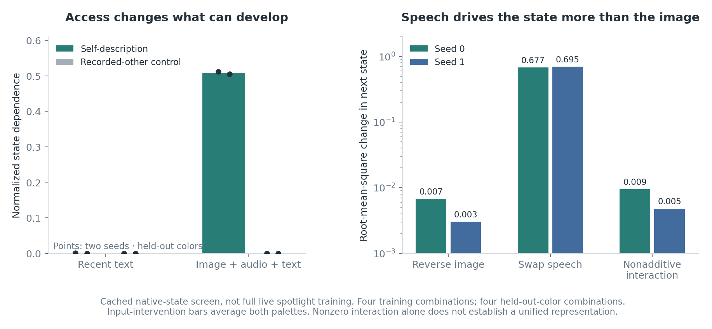

# Prediction changes and multimodal input experiments

Two experiments test the interpretation of the attention-feedback loop. The first asks whether saved interfaces change a language model’s predictions and generated wording. The second asks whether the centered-field training objective transfers to a model that accepts text, images and audio, and which inputs drive the resulting loop. Both use small samples; the measurements and unsuccessful controls are included below.

The **reader** is a learned network that weights internal model activity. Its numerical **summary** sets the next control state, which changes the next read. The **shared spotlight** applies the reader’s attention weights as a bias inside the language model. The [main report](../REPORT.md) defines the training objective and response-field measurements.

## 1. Saved interfaces change wording; this does not establish personality

Three saved interfaces for Qwen3-0.6B—two trained to describe their own responses and a control trained to describe another run’s recordings—were compared with a baseline without the attention bias. Every condition used the same explicit float32 attention implementation, including the baseline, avoiding a zero-bias versus native-kernel comparison. The base model was Qwen3-0.6B, stored in bfloat16 precision, at revision `c1899de289a04d12100db370d81485cdf75e47ca`; TensorFloat-32 acceleration was disabled. The experiment used an RTX 3050 Ti; this hardware detail and the precision settings matter for numerical replay.

On three matched prose inputs, after the first 30 tokens, the best self-describing interface changed 23.2%, 19.0% and 20.0% of top predictions. The second changed 14.5%, 15.9% and 9.2%; the recorded-other control changed 13.0%, 12.7% and 15.4%. These are input-specific top-prediction differences, not accuracy gains.

Four fixed prompts then received 64-token greedy continuations under each condition. Their wording changes, including under the control. The prompts, full 64-token continuations, token counts, mean distribution changes and all recorded state/attention trajectories are preserved. A few divergent continuations are not a personality scale, a replication across readers, or evidence of a self-description-specific persona. No model self-report is used to explain a hidden state.

See [behavior results](results/behaviour/results.json), [`code/behaviour.py`](code/behaviour.py), and the numeric recordings in the data release. The [interactive comparison](../interactive/) shows measured responses to starting-state interventions, using distances in the full eight-dimensional control space. Those distances are not interpreted as semantic similarity. The word-based J-space lens and the learned numerical summary are different representations. No word interpretation of the summary has been validated.

## 2. Text, image and audio: which inputs drive the loop?

**Built with Qwen.** The native model retains the [Qwen Research license](https://huggingface.co/Qwen/Qwen2.5-Omni-3B/blob/f75b40e3da2003cdd6e1829b1f420ca70797c34e/LICENSE), which permits research/evaluation use and is not an open-source license. This release publishes the independent experimental code and measured observations, without redistributing the base model or the multimodal reader checkpoints. Their checkpoint hashes are recorded for provenance. The main Qwen3 interface checkpoints belong to a different model family and remain in the public data release.

The model was the unquantized **Qwen2.5-Omni-3B Thinker**, revision `f75b40e3da2003cdd6e1829b1f420ca70797c34e`, with the native image/audio encoders and joint text decoder. The loaded Thinker contains about 4.70 billion parameters. Inference used explicit attention in float16 precision, with float32 learned readers and hidden-state tuple index 25. The experiment ran on a Tesla T4; peak allocated GPU memory was approximately 10.7 GB.

An image contains left and right colored panels. An audio direction specifies which panel's color to name. The four image/direction combinations of red/blue train the reader; green/yellow provides four held-out-color combinations. Each image is also reversed. This small factorial design varies image arrangement and spoken direction independently. It tests a specific input interaction rather than general multimodal competence.

An initial task used one or two beeps. Image controls passed, but the model called both audio controls “two.” Its joint score was 4/8, the same as silence. That task cannot test integration because its audio positive control failed. A documented exploratory revision used equal-duration offline-synthesized “left” and “right” speech. Both transcription controls and all four image controls then passed. Joint color choice was 5/8; silence and gray-image interventions each gave 4/8. Giving the direction as text gave 8/8. Eight trials do not establish a reliable native binding advantage. Historical JSON keys `beeps: 1/2` refer to left/right in the spoken revision.

### Comparing access to model activity

The centered-field reader objective was transferred to cached native states. Readers first underwent 2,000 training steps on the uncentered position objective, which allows copies to be distinguished by their common destinations, then 3,000 steps on the centered-field objective. The auxiliary objective encouraging differences between copies was disabled in both stages. Each of two seeds supplied a matched initialization for the self-description and control conditions, with shared probes and deterministic per-step permutations of four distinct contexts. The control described another run's recorded field. The language model was run once per input and its activity cached. Reader training did not alter that activity or receive feedback from changes to the model. It also omitted the next-token prediction loss and the live attention-bias channel. This isolates the reader objective but does not reproduce the complete live feedback architecture.

Two sets of 16 reading positions were compared from the same native forward passes:

- **Recent text:** the last 16 contextual decoder positions.
- **Sampled modalities:** four image positions, four audio positions and eight recent text positions, with 16 positions total.

| Reading positions | Seed | Description target | Held-out normalized dependence | Pattern correlation |
|---|---:|---|---:|---:|
| Recent text | 0 | Itself | 0.000281 | +0.001 |
| Recent text | 1 | Itself | <0.000001 | +0.002 |
| Recent text | 0 | Recorded other | 0.000147 | −0.144 |
| Recent text | 1 | Recorded other | <0.000001 | +0.016 |
| Sampled modalities | 0 | Itself | 0.512 | +0.795 |
| Sampled modalities | 1 | Itself | 0.505 | +0.866 |
| Sampled modalities | 0 | Recorded other | 0.000031 | −0.064 |
| Sampled modalities | 1 | Recorded other | <0.000001 | +0.064 |

Normalized dependence compares starting-state-dependent destination variation with displacement variation; it is not a probability. Pattern correlation measures agreement between centered predicted and measured responses. See the definitions in the [main report](../REPORT.md#3-what-state-dependence-means-here). Unscaled explained variance for the two sampled-modality self-description runs remains about −584 and −604: the field head is again uncalibrated. Clamping the state-dependent reader query makes destinations essentially constant over probes. The earlier preliminary recent-text comparison is also retained; it used an auxiliary objective encouraging differences between copies and context sampling with replacement. Comparisons to that preliminary screen cannot isolate the change in reading positions. The final table above uses the matched corrected schedule in both reading conditions.

### Changing the image and spoken direction separately

The state-dependent loops reading sampled modality positions are **dominated by spoken direction**. Across training and held-out colors, reversing image panels changes next destinations by root-mean-square distance 0.0028–0.0087; swapping left/right speech changes them by 0.676–0.695. The image effect is about 0.4–1.3% of the audio effect. A small nonadditive factorial interaction is measurable, but does not establish a unified shared representation. Gray-image and silence interventions use full native encoder/decoder forwards, rather than zeroing selected latent features. Reader attention mass is descriptive and is not a causal decomposition of modality contributions; contextual audio/text positions can already carry image information.

The recorded-other control is also strongly direction-sensitive. State dependence, input sensitivity, task success, and integration across modalities are separate properties. The measured dependence on the control state does not establish that the loop combines image and audio information effectively.

One frozen evaluation applied the learned reading as the bounded log-attention bias to decoder layers 18–24 for a single model pass. It affected the final text queries; the reader was not trained through this response. Zero bias exactly reproduced the unmodified model's prediction scores. For seed 0, the self-description reader changed no top predictions on eight trials. Its output distributions nevertheless changed: median Kullback–Leibler divergence, a distribution-distance measure, was 0.073. A control reversing the attention bias across positions changed one top prediction; the recorded-other reader also changed one. The self-description summary changed by at most 0.000247 relative to its baseline norm. Some sampled modality positions precede the affected text queries, so this small response partly reflects which positions the intervention can reach. It is not an estimate for a fully recurrent multimodal loop.



The positive result is that the centered-field objective can produce state dependence when the reader samples image, audio and text positions. Reliable cross-modal use, richer stimuli, live prediction-loss learning, feedback through the native model, and longer-lived identities remain untested. This does not establish qualia, subjective unity or self-awareness.

## Reproduction

Fetch the [selected artifacts](../self_reference/README.md), then run `python followups/code/behaviour.py` for the local text-model probe. Set `JSPACE_BEHAVIOUR_OUTPUT` to choose a fresh output directory. Allow roughly 1.3 GB of GPU memory for the qualified 0.6B probe; do not silently substitute a new precision/kernel for a replay.

For the multimodal experiment, use a fresh CUDA environment with `transformers==5.8.1`, PyTorch, Accelerate, NumPy, Pillow and SoundFile, and at least the measured memory plus headroom. Review the upstream model's license. From the repository root, execute these files **in the same Python/notebook namespace**:

```python
from pathlib import Path
for name in ["omni_setup", "beep_perception", "spoken_perception", "preliminary_screen",
             "paired_intakes", "intake_screen", "native_spotlight", "modality_check"]:
    exec(Path(f"followups/code/{name}.py").read_text(), globals())
```

The small speech waveforms and exact perception stimuli construction are included. No base-model weights or multimodal reader checkpoints are redistributed. `source_hashes.json` identifies the executed source snapshots before portable-path and transport-output edits. JSONs preserve the complete reported conditions; selected native features and response fields are in the immutable data release. The results have not been replicated across numerical backends, and two seeds do not establish broad generalization.
